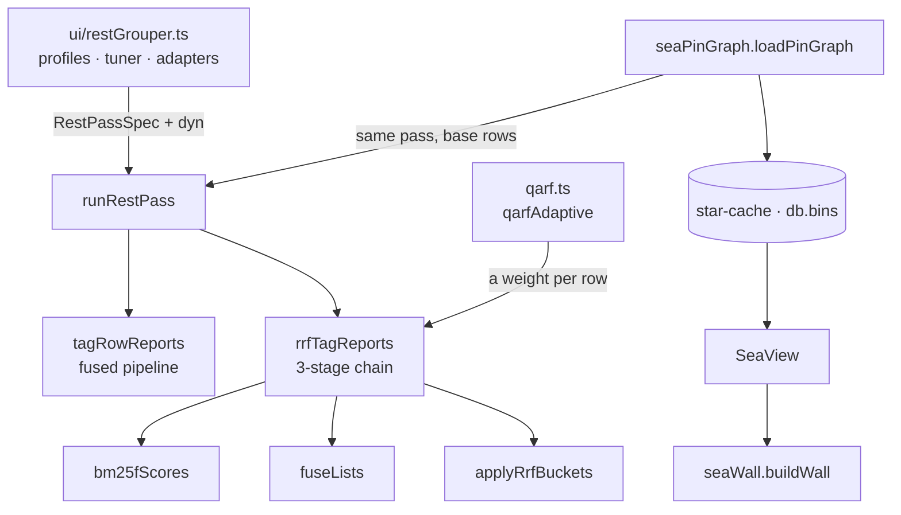

# The tagger — a qarf-based tagging layer

Scope: what a row should be tagged with, how a pass ranks it, how the sea reads the same
evidence, and what has to change before the lexical core can move into a standalone
library. This document replaces the former `docs/startag/` set (`sTag.md`, `rstag.md`,
`ui.md`, the search-box read path, and `row=star.tagger.md`).

The tagger answers two questions from the same evidence:

- **Focus** — a title is about a few curated tags or about none. A suggestion survives only
  if the priority half carried it or it clears a stricter second cut-off; a row left with
  nothing stays untagged.
- **Promote** — a term more than two rows of one burst-and-tag group propose is a
  direction, not a tag: the group mints it as `parent/theme`, so the sub-tag says which of
  the curated tags those rows were filed under.

Two methodologies produce the evidence, and they differ in cost and in who can add one:

| | A. Static functions | B. Dynamic scripts |
|---|---|---|
| Lives in | `src/srctag.ts` (pure TypeScript), plus `src/rstag.ts` and `src/qarf.ts` | `type='src'` rows, evaluated by `runsrc.runBody` |
| Adding one | a source edit: typecheck, tests, build | write the row in the editor, or let the agent chat write it — no build |
| Reachable by | whoever can ship the bundle | the app itself, a `run_src` tool call, `seedTagRows` |
| Cost per call | none: local and deterministic | a provider request, a key, a rate limit, a CORS origin |
| Belongs there | tokenizing, fusion, ranking, the row's own text | anything that calls a model or an external classifier |

The static half is the default and the fallback: it runs with no network, so a missing
adapter or key degrades the score instead of stopping a sweep.

## Shape

```
src/srctag.ts        channels · tokenizer · trie · TextRank · TagParts · explainTag · write path
src/rstag.ts         runRestPass · restTagMap/restTextMap · caps · the 3-stage chain
src/qarf.ts          the adaptive weight: corpus IDF, λ(row), the per-burst scale
src/ui/restGrouper.ts  REST_PROFILES · RestHyper · the srctag/* adapter rows · grouping
src/ui/seaPinGraph.ts  loadPinGraph: the sea's own pass over pins + newest tab/tag rows
src/ui/starTaggerRun.ts  the star.tagger.md row and the db.bins seed cache
src/ui/seaWall.ts      the wall's packing and per-region recency
src/ui/SeaView.tsx     the camera, the input, the readout
```



The dependency runs one way: the UI imports the engine, `qarf` imports the engine for its
chain mechanics, the engine imports `srctag`'s primitives, and nothing imports the UI or
`qarf` back. That is what lets the engine be tested without Dexie, and it is the direction
a future extraction has to keep.

| Module | Knows | Does not know |
|---|---|---|
| `src/ui/restGrouper.ts` | which groupers exist, their defaults, the tuner's overrides, the `srctag/*` adapter rows, the rows and pins on screen | how a row is scored |
| `src/rstag.ts` | how a pass runs, what the pre-processing drops, how ranked lists fuse | the store, the DOM, React, any grouper ref |
| `src/qarf.ts` | how specific a row's own text is against its working set, and what that does to its channel split | the chain's stages, the store, the DOM |
| `src/srctag.ts` | tokenizing, the trie, TextRank, vector maths, the channel vocabulary, the write path | which list is on screen |
| `src/ui/seaPinGraph.ts` | which rows the sea reads, and how new each tag's evidence is | the wall |
| `src/ui/seaWall.ts` | rectangle packing, recency dimming, the bands | three, the DOM, a pass |
| `src/ui/SeaView.tsx` | the camera, input, readout | what a region is |

## Evidence

### Static channels

| Channel | Source | Default weight |
|---|---|---|
| TF-IDF | `txt` tokens, `urlTokens(ref)` and Markdown links in `txt`, against the neighbour window | 0.35 |
| BM25F (`bm25`) | `title`, `url` and the row's own tags as weighted fields, ranked by the chain's statistical stage | 0 |
| Embedding cosine | an injected `EmbedFn` against the neighbour centroid; `hashEmbed` (64-bin character histogram) when none is supplied | 0.35 |
| TextRank | `textRank()` over the row's own tokens, normalized by its top rank | 0 |
| Burst TextRank (`clusterRank`) | the same walk over the window's pooled tokens, gated on the row's own copy of the term | 0 |
| Priority tags | `#tag` tokens in pin `md`-card headings (`pinPriorityTags`) | 0.20 |
| TurboText trie (`keyword`) | a keyword match's own weight, on top of the `keywordBoost` the priority channel applies | 0 |
| Classifier labels | an injected `ClassifyFn` | 0.10 |

A candidate is **only** a token of the row's own text, a trie match, or a classifier
label: a priority tag lifts a candidate, it cannot introduce one. `TagParts` keeps the
shares apart and `explainTag` splits them, so `channels[].contribution` adds up to `score`.
`minScore` 0.05 and `topK` 8 ship; `RSTEXT_TAG_SCORE` raises both because a normalized
centrality puts most tokens near 1.

Lexical details worth keeping:

- `tokenize` is NFKC + lowercase; Latin runs split on non-alphanumerics, are stop-worded and
  length-filtered; a CJK run is cut into sliding bigrams by default. Term weight is
  `1 + log tf`, IDF is `log((N + 1) / (df + 1)) + 1`.
- `TurboTextTagger` (also `KeywordTagger`) is an Aho–Corasick automaton: `match` is the
  FlashText reading (longest form wins, a match consumes its span), `matchAll` and `counts`
  expose the full output. `TrieOptions` adds `distance` (fuzzy), `overlap` (`greedy` |
  `optimal`), and `caseSensitive`; an entry may carry `weight`, `case` and `block`.
- `textRank` is a **weighted** walk — an unweighted walk over a four-token title reports
  every token as equally central. Defaults: window 4, damping 0.85, 30 iterations, tol
  1e-4.
- `hashEmbed` is a fallback signal, not a learned embedder.
- A priority tag cannot introduce a candidate: it reaches the row through the trie, so a
  link whose title never mentions the pin card's word is proposed nothing.
- `pinTags` reads a card's Markdown headings, strips closing hashes, and keeps `#`-prefixed
  tokens; the character class is `[\p{L}\p{N}_]`, so a hyphen **ends** a tag
  (`#machine-learning` yields `machine`). A `{ref}` token is not a tag. `pinPriorityTags`
  concatenates and de-duplicates the cards; which rows count as cards is the caller's
  choice (the app uses `type === 'md' && ref.startsWith('pin')`).
- `db.embs` is keyed by `[hash+mdl]` with `mdl` indexed (`src/vecCache.ts`); the namespace
  is the adapter row, not a provider model, so a provider switched inside `secret.md`
  reuses that row's older vectors until the table is cleared. `vecs` was dropped rather
  than re-keyed because Dexie aborts an upgrade that changes a primary key.
- Window: `TagWindowConfig.dim` is `tid`, `dt`/`modAt`, or `rec.visitTime` (with
  `rec.visitTimes`, the legacy `rec.visitTIme`, and `rec.access2discard`); `burstGap` and
  `denseSpan` default per dimension. `bucket: 'domain'` scores each hostname as its own
  working set.
- Post-processing: `dedupeTags` drops a later tag when it is a plural stem of a kept one or
  the two contain one another (both ≥ 4 characters); `rankTags` cuts at `minScore` and
  `topK`.

### The aim pass

`applyTagAim(results, cfg, minScore)`:

- **Focus** keeps a suggestion whose `parts.priority > 0`, and every other one at or above
  `aimMin` (0.4, raised to at least the run's `minScore`).
- **Promote** groups rows by `dim#cluster#anchor`, counts tags over the **pre-focus** lists,
  and mints `anchor + '/' + theme` for a term more than `promoteMin - 1` rows propose
  (default 3). `promoteTop` (2) caps the themes per group. A promoted tag is a synthetic
  suggestion: `parts.group` is the row count, `origin: 'sub'` marks it for the chips.

Three properties are deliberate: evidence comes from before the focus cut (a filter cannot
erase the signal it reads); the anchor is not its own theme; a sub-tag is always a term the
row was already scored on.

### Dynamic rows

`type='src'` rows are evaluated by `runsrc.runBody`: a module body is loaded from a
`data:text/javascript` URL and its default export is called with `ctx`; anything else is an
async function body. `ctx` is `{ db, ref, args, console }`. A module's source text is its
identity.

| Ref | Kind | Result |
|---|---|---|
| `srctag/embed.js` | src | an `EmbedFn` over one provider |
| `srctag/classify.js` | src | a `ClassifyFn` over classifier.dev |
| `srctag/suggest.js` | src | the rule-comparison report |
| `srctag/suggest-ds.js` | src | the same report, channels defaulted to `ds` |
| `srctag/keywords.md` | md | surface forms for the trie (`parseKeywordDoc`) |

A body reads `secret.md` under `## Providers` / `### <name>`; `ctx.args.provider` and
`ctx.args.model` override the row's defaults. The request shape follows the Base URL
(Cloudflare `/ai/run` takes `{ text: [...] }`; everything else takes OpenAI-compatible
`{ model, input, encoding_format }`). `seedTagRows` writes missing rows (never overwrites),
`clearTagRows` tombstones what it wrote, and the “Tag adapters (smoke)” menu runs one live
call per adapter.

`installSrctagGlobal()` publishes `srctagApi()` on `globalThis.srctag` for the rows, because
a `data:`-URL module cannot resolve a relative import. It exposes `tagRows`,
`tagRowsForPinSave`, `tagRowsInteractive`, `tagSweepRows`, `planTagUpdates`,
`commitTagUpdates`, `dexieTagPort`, `customTagPort`, `pinPriorityTags`,
`loadAdaptersFromStore`, `keywordEntries`, `parseKeywordDoc`, `tokenize`, `rankTags`,
`textRank`, `summarizeTagRun`, `groupByDomain`, `rowDomain`, `applyTagAim`,
`summarizeTagAim`, `textHash` and `mapVectorCache`.

The providers the seeded rows reach, and what `secret.md` must hold for each:

| Provider | Block seen in `secret.md` | Base URL | Credential |
|---|---|---|---|
| Cloudflare Workers AI (`@cf/baai/bge-m3`) | `cfw` / `bge` in the seeded defaults | `https://api.cloudflare.com/client/v4/accounts/<acct>/ai/run` | bearer token |
| Silicon Flow (`BAAI/bge-m3`) | any OpenAI-compatible block | `https://api.siliconflow.cn` | bearer token |
| OpenRouter (`nvidia/nemotron-3-embed-1b:free`) | `ere` / `nbed` in the tests | `https://openrouter.ai/api` | bearer token |
| classifier.dev | `cjev` in the seeded defaults | `https://classifier.dev` | optional |
| `ds` | whatever the document defines | whatever the document defines | first listed key |

The page origin must be allowed by the provider; a browser cannot reach one that refuses
CORS. The same providers are reachable in-process for a caller holding a key —
`createEmbedClient`, `createSiliconFlowEmbed`, `createOpenRouterEmbed`,
`createCloudflareEmbed`, `createClassifierDevClassify`, `embedBatch` and `embedWithCache` —
but the app itself goes through the rows, because that is the half a user can change
without a build. `test/srctag.test.ts` is the only direct caller today.

A new adapter is a row, not a release: the chat's `write_file` goes through the same store,
`daType(ref)` types a ref by its suffix (`.md` becomes an `md` row, everything else `src`),
and `run_src` runs it with `{ ref, args: { provider, model } }`. That needs gate level `rwr`
or above; the static channels need no permission.

`srctag/suggest.js` is the reporting row: it reads the working set out of `ctx.db`, drops
the pin cards from the scored rows while taking their `#tag` headings as the priority
tags, and scores the set once per rule — `tid`, `dt`, `visitTime`, and the `suffix_*` tag —
where rows sharing a tag become one another's neighbourhood. Each rule reports rows,
suggestions, distinct tags, mean and max score, priority hits and its Jaccard overlap with
`tid`. `args.adapters: false` keeps it off the network; `detail`, `topK` and `bucketLimit`
trade report size for the 8000-character result `run_src` returns. A `suffix_*` tag groups
rows without ever being suggested, because `rowSources` reads a row's `txt` and URLs and not
its `tags`.

## The pass

`runRestPass(das, spec, opts)` is the body every grouper shares:

1. **Cap** — newest `tid` first, sliced to `opts.limit ?? spec.limit`.
2. **Resolve priority tags** — `opts.priorityTags`, else the pin cards' `#tag` headings when
   `spec.pinsPriority`, else the scored rows' own tags. For either chain pipeline the
   fallback skips provenance tags.
3. **Resolve dynamic channels** — `spec.dyn(priorityTags)` when the profile has one; no
   store, no hook, lexical channels only.
4. **Score** — `tagRowReports` (fused) or `rrfTagReports` (chain, with the adaptive weight
   when the spec names one).
5. **`ownTagLess`** — key the reports by `tid` and drop every tag the row already carries.
6. **Return** `Map<tid, RowTagReport>`.

| Spec field | Meaning |
|---|---|
| `dim`, `bucket` | the ordering the window and clusters are measured on, and whether each hostname is its own working set |
| `score` | channel weights and cut-offs, folded over `DEFAULT_TAG_SCORE` |
| `limit`, `pinsPriority`, `aim` | the cap, the priority source, and the focus/promote knobs (`false` leaves raw scores) |
| `pipeline` | `fusion` (default), `rrf`, or `qarf` |
| `bm25`, `rrf`, `buckets`, `global` | the chain's stage knobs |
| `qarf` | the adaptive half, handed over by the profile so the modules stay acyclic |
| `dyn` | `(priorityTags) => Promise<TagRowsOptions>`: the dynamic channels |

`restTagMap` and `restTextMap` are the named aim-free passes: the first over `tid`, the
second over `visitTime` bucketed by hostname.

## Write path

`planTagUpdates` turns results into `{ tags, rec }`. `add` only adds; `replaceAuto` also
removes tags the row's own `rec.tagAuto` provenance names; `replace` sets the list outright.
`[del]` and the `keep` list survive all three. `dexieTagPort` writes `tags`, `rec` and a
local `modAt`; `commitTagUpdates` sequences writes; a row without a `tid` is skipped.

`dexieTagPort` does not shelf a version the way `sdb.daEdit` does, so an auto-written tag
never reaches the diff tab; `src/ui/tagApply.ts` is the app-side port and writes through
`daEdit` instead, which is what makes a later diff show the change. `rec` merges by union
(`fc.recMerge` through `sdb.deepMerge`), so a provenance key removed on one client returns
when a copy still carrying it merges in. `rec.tagAuto` is read by nothing in the read path.
Written tags land in the `*tags` MultiEntry index that `iq` and `availableDas` read, so a
tag write is immediately a filter crumb.

## Entry points

| Use | Call | Default window |
|---|---|---|
| pin card saved | `tagRowsForPinSave(pins, rows)` | `visitTime` |
| agent chat, user-picked rows | `tagRowsInteractive(rows, tids)` | `tid` |
| extension tab sweep | `tagSweepRows(rows)` | `tid` |
| rest-list chips (`rstag`, `rstext`, `rsfreq`, `rstrank`, `rstt`) | `tagRowReports` through `ui/restGrouper.restProfileMap` | the profile's own |
| rest-list chips (`rrf`, `qarf`) | the same, with `pipeline: 'rrf' \\| 'qarf'` | `visitTime`, bucketed by domain |
| rule comparison (`run_src`) | `run_src('srctag/suggest.js')` | all four, side by side |

All are `tagRows` with defaults; `onlyTids`, `priorityTags`, `synonyms`, `embed`,
`embeddings`, `classify`, `labels`, `rank`, `bucket`, `urls`, `trie` and `aim` are per-call
options. `tagRowReports` is the read-only form: lexical channels unless an embedder or
classifier is injected, the aim pass when `opts.aim` asks, and one `RowTagReport` per row
carrying the window, cluster, trie hits and one `TagExplanation` per tag.

## Pre-processing

Four kinds of term sit on a row without being about it, and all are removed from the
**inputs** before the ranking stage — a global term left in the bag is re-ranked by a graph
walk and returns as a chip.

- **A function word** — `GlobalConfig.stop` (`DEFAULT_STOP_WORDS`). The tokenizer's shared
  `STOP_WORDS` cannot grow without moving every pipeline, so the engine carries its own
  English list.
- **A global term** — `globalTerms` over title, URL and own tags; dropped above `maxDf`
  (0.6), but only once the pass holds `minRows` (8). Three rows make every term “global”,
  which is the guard's point.
- **A provenance tag** — by prefix, `PROVENANCE_TAG_PREFIXES`: `suffix_` (the title tail
  `fc.txtRx` strips), `dev_` (`sdb.dev_PREFFIX`), `ref_` (the domain family), and `FIXME`
  (the store's maintenance markers — `FIXMEchange_rejected`, `FIXME_dup_ref`). Their terms
  are dropped per row, not per pass, so a `dev_android` row does not silence `android` in
  another row's title. The same prefixes keep a tag out of the sea's graph, its table and
  its wall, whichever half proposed it.
- **A named term** — `RestTagOptions.filters` through `filterTerms`, which splits a value on
  separators and camelCase (`suffix_GoogleSearch` → `suffix`, `googlesearch`, `google`,
  `search`). A term the list is itself about says nothing about one row of it.

`excludedTerms` resolves the frequency floor and the named terms once per pass; the
provenance terms join per row before it is tokenized.

## The 3-stage chain

The chain exists because an exact matcher is a recall layer, not a ranking one.

| Stage | What runs | Where |
|---|---|---|
| 1. Candidates | `TurboTextTagger.match`, the row's own tokens, the classifier's labels | `srctag` |
| 2. Statistical ranking | `bm25fScores` over weighted fields | `rrfRowsInSet` |
| 3a. Fusion | `fuseLists` by rank, with the adaptive weight when asked | `rrfRowsInSet`, `qarf` |
| 3b. Expansion | `cTfIdf` + `discoverThemes` + `mmrSelect` | `applyRrfBuckets` |

**BM25F** weights `title`, `url` and the row's own `tags`; a field the config does not name
(or weights at 0) is not read at all, so its length never enters the corpus statistics. The
corpus is the pass's working set, so under `bucket: 'domain'` “rare” means rare within one
site. `url` is its own weight: `urls` governs the token bag, `w url` the field.

**Fusion** scores every candidate as `Σ cfg[channel] × 1/(k + rank)`, normalized by the best
the enabled lists could jointly give one term, so 1 means “the top of every list this pass
ran”. `rrfExplainCfg` divides the *weights* rather than the result, which is what keeps
`channels[].contribution` adding up to `score`. A term that tops a single list reaches 0.22
of a six-list normalization (0.33 with the dynamic pair off): it clears `minScore` 0.12 and
does not clear `aimMin` 0.4 — asking for corroboration by two signals.

**Buckets** (`applyRrfBuckets`) applies the aim pass's shape with each burst read as a
class: `cTfIdf` scores terms by frequency inside the burst times rarity across bursts,
`discoverThemes` folds in the burst's own TextRank walk (`BucketConfig.graph`), and
`mmrSelect` keeps the `promoteTop` most distinctive ones that stay apart
(`BucketConfig.lambda`). Evidence comes from the pre-focus lists.

### The adaptive weight (qarf)

A fixed split assumes the same rankers are equally informative on every row. `qarf` reads
the split off corpus IDF statistics (QARF, Rafeeq et al., DATA 2026):

$$
\mathrm{idf}(t)=\log\frac{N}{df(t)},\qquad
\mathrm{spec}(q)=\frac1n\sum_i \mathrm{idf}(t_i),\qquad
\hat z(q)=\frac{\mathrm{spec}(q)-\mu_{IDF}}{\sigma_{IDF}}
$$

$$
\lambda(q)=\mathrm{clip}_{[\ell,u]}\Bigl(\sigma\bigl(\alpha\cdot\hat z(q)+\mathrm{logit}(\lambda_0)\bigr)\Bigr)
$$

The row is the query and the candidate tags are the documents, so λ is read per row against
the working set it is scored in (one corpus per site under `bucket: 'domain'`). The paper's
two rankers become two groups of lists: lexical (`bm25`, `priority`) and semantic
(`textRank`, `clusterRank`, plus `embed`/`suggest` when `dyn` supplies them). `λ₀` is the
lexical share the profile's weights already stand for.

`qarfRowWeights` gives the lexical group λ of the total weight and the semantic group 1−λ,
each keeping its ratios; the sum of weights is unchanged, so a fused score of 1 keeps its
meaning and a report carries the weights that produced *its* score
(`TagRowResult.weights`). At `α = 0` the sigmoid is flat at `λ₀` and the two chain groupers
score identically — exact, because `qarfAdaptive` returns no blend at all. The clip bounds
the share so no row silences a side; when one side carries no weight there is nothing to
trade and the profile's weights stand.

The theme stage scales the burst walk by `qarfLambda(−ẑ, ½) / ½`, multiplicative like the
mixer it feeds: at average specificity it is 1, so `α = 0` leaves `BucketConfig.graph`
exactly as set.

### Knobs

| Knob | What it moves |
|---|---|
| `topK` | the only control that shortens a row's chip list |
| `stop`, `max df`, `urls`, `w url`, the provenance rule | what the chips are worth |
| `qarf α` | whose reading it is: 0 is `rrf`, above 0 each row's split follows its specificity |
| `rrf k` | the suggestion count a long way; a row's chip count barely |
| `min`, `aimMin` | almost nothing on the chain: its fused scale is flat |
| `minLen` | removes short words from both graph walks — and every CJK bigram with them |
| `k1`, `b`, `w title`/`w tags` | a few percent on a rank-fused list |
| `promote ≥`, `themes ≤`, `mmr λ`, `graph λ` | whether a burst mints a sub-tag, and which words |
| `rows` | how much of the list is scored; the chain ships it empty (`all`) |

The tuner (`src/ui/restTuner.tsx`) renders these per profile; every control and reading
carries hover text from `src/ui/restHelp.ts`, which `test/startagfeed/restHelp.test.ts`
checks against `REST_PROFILES`.

## Rest-list readings

`restGrouper` picks how the rows below the pins are drawn. Five chip groupers keep the
`rsdt` date blocks and decorate each row; `rrf`/`qarf` start on the clustered reading.

### Chips

`restProfileMap` scores the newest `RSTAG_LIMIT` (200) rows in a live query and returns
`Map<tid, RowTagReport>`, dropping tags a row already carries. Each report's tags render in
front of its row as dotted-outline chips; a promoted tag (`origin === 'sub'`) draws solid
and italic. The strip is cropped to `treeCac['cropWidth']` and scrolls; the chip nearest the
row drops its right border, so the box reads as open against the item it delimits. The colour
is `getColorChar11`'s hue mixed 70% toward the row text colour. Nothing is written, and a
chip's title carries `explanationText` plus every scored row that proposed the tag
(`restTagContributors`).

### Algorithm groupers

| Grouper | Carries the score | Channels |
|---|---|---|
| `rsfreq` | TF-IDF against the neighbour centroid | `tfidf`, `priority` |
| `rstrank` | the row's own TextRank walk and the burst's | `textRank`, `clusterRank`, `priority` |
| `rstt` | the TurboText trie | `keyword`, `priority` |

All three take the pin cards' headings as the priority tags, run the aim pass, and offer the
visualization switch and hyperparameters. `aimMin` has to be calibrated per score family:
0.4 bites a TF-IDF list and is inert on a TextRank one.

### Tuner

Each profiled grouper renders an always-editable strip (`RestTuner`, mounted by `cardTab`
whenever `REST_PROFILES[restGrouper]` exists); values are component state, nothing is
persisted, and `reset` restores the profile.

| Control | Moves |
|---|---|
| `viz` | the reading the panel draws, and for `clusters`/`priority`/`themes` the blocks the list renders |
| `aim`, `aimMin`, `promote ≥`, `themes ≤` | the aim pass and its knobs |
| `dyn` | loads the store's `srctag/*` adapters; offered only where a dynamic channel carries weight |
| `window` | `tid`, `dt`, `visitTime`, or `domain` |
| `urls`, `w url` | the token bag's URL switch, and BM25F's URL field weight |
| the profile's weights | one per channel that family scores with |
| `topK`, `min` | `TagScoreConfig.topK` and `minScore` |
| `rows` | how many newest rows the pass scores (`all` when empty) |
| `graph w`, `damp`, `iters`, `tol`, `minLen` | both TextRank walks |
| `fuzz`, `overlap` | `TrieOptions`, on `rstt` |
| `k1`, `b`, `w title`/`w url`/`w tags` | `Bm25Config`, on the chain groupers |
| `max df`, `stop` | `GlobalConfig`, on the chain groupers |
| `rrf k`, `qarf α`, `mmr λ`, `graph λ` | fusion, adaptive weight, and the bucket stage |

### Visualization panel

The panel's header is the same in every reading: rows, rows scored, rows that kept nothing,
and the tags-per-title histogram. The body follows `viz`:

| Reading | Body | Blocks |
|---|---|---|
| `chips` | a line saying the tag layer stays beside each row | keeps `rsdt` |
| `clusters` | no bars; each head explains itself in its hover text | replaced by one block per kept tag the threshold draws |
| `priority` | curated vs none, bars per kept tag, priority-backed ones in a second colour | replaced by `priority tag kept` / `no tag kept` / `unscored` |
| `themes` | one line per burst-and-anchor group with its terms | replaced by one block per group |
| `channels` | one bar per channel, split by its share of the pass | keeps `rsdt` |
| `keywords` | the surface forms the trie matched, with row counts | keeps `rsdt` |

`src/ui/restVizData.ts` holds the readings as pure functions (`tagsPerTitle`,
`priorityCoverage`, `tagClusters`, `themeGroups`, `channelShares`, `keywordHits`,
`vizBlocks`). Every row lands in exactly one block, and rows the cap left unscored get a
trailing `unscored` block. The `priority` reading counts every kept tag but draws only the
ones more than one row kept, reporting the rest as `+ N kept by a single row`; `topK`, `stop`
and `max df` are what thin it.

### Clustered reading

`rrf`/`qarf` start on `viz: 'clusters'`: `vizBlocks` files every row under the tag it kept
and the list draws one block per tag, so the reading is a partition rather than a second
chip layer. A row's head is the first tag in score order carrying a `priority` channel, else
its top tag; a non-curated head needs `CLUSTER_MIN_ROWS` (3) rows. The head line lists the
other tags two or more of its rows kept, with a promoted theme in italics, and the head
chip's hover names the channels, the row count and the rows. Curated tags lead, then wider
clusters, then `(tags kept by 1-2 rows)`, `(no suggestion)` and `unscored`.

## The sea seed and `star.tagger.md`

`seaPinGraph.loadPinGraph(setup)` reads the pin cards plus up to `base` newest
`type='tab'`/`type='tag'` rows, scores them with `qarf` (`visitTime`, bucketed by domain,
URL out), and returns `PinGraphSeed`: pins, rows, one report per scored row, the graph with
a pin's variant spellings kept apart, each node's reach, each tag's `recency` (where its
newest row sits in the window) and its `trend` (recent head against the older tail).

The row is the only configuration. It is read with `useLiveQuery`; editing `## Setup`
re-seeds, and nothing else does.

```
## Setup
# base: 5000        rows pulled for the seed
# trace: 555        rows in the cached table
# maxGraph: 1111    nodes built before the table is cut
# recent: 500       newest rows that make the trend head
# minRecent: 3      recent rows a tag needs to emerge
# minLift: 2        recent rate over older rate
# alias: js = javascript, k8s = kubernetes
# noSyn: no         ignore the generated synonyms
# noTheme: no       ignore the generated themes
# noWeb: no         ignore the generated web edges
# reset: no         rebuild the table and mapping once, then clear itself
# alpha: 1 / floor: 0.1 / ceil: 0.9   optional qarf overrides

## Mapping            generated once, then editable (aliases, synonyms, themes, web)

## Notes              the user's own text
```

Limits: `base` ≤ 50,000; `maxGraph` ≤ 5,000; `trace` ≤ 5,000 and never above `maxGraph`;
`recent` ≤ `base`; `minRecent` ≤ 1,000; `minLift` ≤ 100. `trace: 0` caches no table rows.

`starSetupFingerprint` keys the re-seed on the seed-producing keys only: `reset` is left
out (clearing it must not seed twice) and the `no*` filters are left out (they change how a
stored mapping is read, not what the seed produces).

### Storage: one row and one bin

| What | Where | Why |
|---|---|---|
| Setup overrides | `db.das` row `star.tagger.md`, `## Setup` | hand-written, small, synced |
| Overridable relation mapping | the same row, `## Mapping` | mostly stale, editable; written once and on `reset` |
| Generated table + bursts | `db.bins` record `star-cache` | changes on every seed; must not push a row |
| The seed itself | the same `star-cache` record | rebuilding it costs a `base`-row scan plus qarf |

`ui/starTaggerRun.ts` owns the cache:

- `dasStamp()` is `{ tid, count, modAt, snap }` — newest row, row count, newest edit, and
  the server/snapshot pair. Any row edit moves it: the cache is deliberately conservative.
- `readStarCache()` returns the record when its `v` matches `STAR_CACHE_VERSION`, reopening
  the graph's `name` from the `folded`/`merged` maps (the one field `binPut` cannot encode).
- `saveStarSeed()` builds the table, keeps the stored text when its table lines are
  unchanged (the `seeded`/`time:` lines must not churn it), writes `## Mapping` only when
  the row has none or `reset: yes`, then measures the stamp *after* that write and
  `binPut`s the record. The stamp is measured last because the mapping row is itself a
  `das` write.
- A mount whose stamp and fingerprint both match opens on the cached seed: no scan, no
  qarf, and no `greet`. That is the whole load path now; the only remaining push is the
  one-time mapping write.

`STAR_CACHE_VERSION` must be bumped whenever what a seed produces changes, or a stale cache
survives a table that has not moved.

A row written by an older build still carries a `## Taxonomy` section. It is no longer
written and is only read as the first-mount fallback until the first seed lands; it is left
in place rather than deleted, because it is the user's row text.

## The sea readings

### The wall

`SeaView` draws `buildWall`, which splits the wall at the star meridian (`lon` 0, `rise` 0):

- **left** (`lon >= 0`): emerging tags from the recent head, strongest first; each column's
  second level is its one-hop neighbours.
- **right** (`lon <= 0`): one column per top-level pin-card heading, newest first; the next
  heading level tiles below it, and a spelling keeps a thin band under its heading.
- **rear** (from 90 to 180, less the front bands): the remaining cloud tags, brought round
  by a horizontal spacing change. The half past 180 is cropped at the seam.

`seaSky.ts` owns the place↔direction convention; one degree of rise is the same distance at
every longitude, so a grid cell is square. A cylinder rather than a sphere makes the
vertical axis a pan.

### Recency dimming

A row star dims by where its stamp sits **inside its own tag's region**: the newest row a
tag kept is full strength whatever the wall's age, so an old tag reads as an old tag rather
than as a dim one. A point with no stamp keeps full light, a region of one stamped row is
full strength, and the sea-level star — the newest evidence of its own tag — stays full
whenever that tag kept a stamped row. `STAR_DIM_FLOOR` (0.05) is the oldest end of a
region's span.

### Tiers

What a region shows is decided by the screen, not by the table: the frame loop measures
each region's projected box and publishes the tier it earned. The screen is spent widest box
first, because a region a reader can see is worth more than one they cannot.

| Tier | Shows | Earned by |
|---|---|---|
| `blocks` | the tag's name and up to `BLOCK_ROWS` (12) of its rows | `SEA_LIMITS.blockPx` (14000) of box and one of the 8 row budgets — or a curated tag, which never gives way |
| `label` | the name across the rectangle | one of the 24 name budgets |
| `point` | nothing; the region's mark, opened by hover or tap | `SEA_LIMITS.pointPx` (4000) of box, or an exhausted budget |

A demoted pin is never the reason a cloud loses its rows, but the pins do *spend* the
budgets. `labelFontPx` sizes a name to its box (0.6 em, 11 … 220 px). The tier map is
published to React only when a visible region's tier changes, at most once per `VIEW_MS`
(120 ms).

### Marks and edges

`seaStars(graph, regions)` returns one star per region at its centre, carrying the region
and the mean lexical share it should be outlined in, plus an edge per pair of tags one row's
chip list held, heaviest first and capped at `MAX_EDGES` (260), with `maxRows` and `maxEdge`
for the renderer's own scaling. `starSize` and `starOpacity` compress by square root, so a
tag one row kept stays visible beside one fifty rows kept.

Edges are drawn along the wall rather than as chords: two tags at opposite longitudes are on
opposite sides, so a straight line would pass through the camera. An edge is sampled every
`ARC_STEP` (3) degrees, dropped past `EDGE_SPAN` (120) degrees and faded by the square of its
reach. `skyLegend(field, names, order)` lists every kind the taxonomy names — zeros included
— so an empty band reads as an unread seed rather than an absent feature.

### Motion

The camera only turns on the spot and pans along the axis; both halves of a drag are a grab.
`seaMotion.ts` owns the coast: `transfer` 0.9, `friction` 0.12, `minSpeed` 3, `maxSpeed`
360, `wheelGain` 60. `treeCac['seaMomentum']` (0–100) is the one user control — 0 stops the
sky on release, 100 carries for seconds. A plain wheel pans, Ctrl/⌘ + wheel changes vertical
spacing, Shift + wheel changes horizontal spacing. The field of view follows the feel's zoom
range; sea level tilts the aim by up to `SEA_FEEL.levelPitch` (6) degrees.

### Camera, pointer and cards

The sea-level star's vertical glow spans two thirds of the viewport; its core is twice the
nominal ring height, and the ring is a one-pixel `fwidth` line with `RING_DEPTH_PX` (10) of
glow. Row stars rest at `STAR_REST_PX` (3) and open within `STAR_LIFT_PX` (30). A click or
tap under `CLICK_SLOP` (5) pixels pins the region's card at the pointer; the header moves it,
the lower-right corner resizes it, and a new target reopens it at the default position. A
click on a region locks the camera, an empty-wall click clears both, and double-click or the
compass returns to the star.

Regions are DOM (`SeaRegions.tsx`) rather than geometry, for the two things three.js cannot
give: text find-in-page can reach, and rows that are links. The loop projects each region's
four corners and writes its transform, size and clip path, so a pan costs style writes and no
React render. Only `/` hands the sea the pointer; the readouts hang below the user bar.

### Alternate packing (not routed)

`seaRegions(graph, { recency, kind, …shape })` is the DOM-less region packer kept for its
tests and the paused `SeaRegions.tsx` view. It returns one region per tag: every root, then
the widest others up to `maxRegions` (220), in the `SEA_REGION` shape — `pinCol` 96,
`shelfGap` 6, `aliasBand` 14, `areaPerRow` 6, `aspect` 2, `minW` 18, `minH` 14, `maxH` 60,
`maxStretch` 1.8.

- **the column** is the curated half, newest `recency` first; a pin's spellings take a thin
  band along the bottom of its own band.
- **the strips** hold everything else: a tag answers for the pin within two hops
  (`clusterOf`), a cluster's run goes to one strip, and runs alternate west and east.
- **a shelf** takes tags until the next would not fit, then stretches up to `maxStretch` to
  close its strip; a region's wall is `areaPerRow × rows` and its width follows from that and
  `aspect`.

`regionAt` and `regionsInCell` are the pointer and grid-cell reads. `wheelZoom` remains
exported and tested but is no longer called by `SeaView`.

### Measured

| Reading | Where it comes from |
|---|---|
| the packing over the newest 2222 rows: 1 pin card (22 headings), 4542 nodes, 220 regions kept; a cloud region 299×53 px at the median and never below 18×14; the widest pin taking the column's 96 degrees at 114 px; 50 regions in front; 467 degrees of rise | `SEA_REGION`'s own doc comment |
| the marks and bands over the real 37k-row table: 22 pinned, 1 alias, 123 related, 0 remote, 74 own | the sea's `skyLegend` readout |

### Reaches and the disc

`buildTagGraph(pins, rows, reports, { keepAliases: true })` keeps a pin's variant spellings
as their own nodes, which is what makes `pinReach` possible:

| Reach | What it is |
|---|---|
| `pinned` | a tag a pin card's `#tag` heading names |
| `alias` | a spelling or synonym of a pinned tag, kept as its own node |
| `related` | one co-occurrence step from a pin |
| `remote` | two steps, through a related tag |
| `own` | nothing a pin reaches |

`tagGraphLayout(graph, { kind, ring })` reads whichever taxonomy the caller names, so the
disc (`rgraph=1`, `src/ui/TagGraph.tsx`) and the wall draw the same graph without either
owning it. The disc's node outline is the mean lexical share (`RowTagReport.qarf`) of the
rows that kept the tag — the one reading no other view shows.

## Measurements

The numbers behind the defaults come from `test/srctag-cdp.test.ts`, which reads the live
`tagDB_0` out of the page on `localhost:5173` over CDP and scores those rows in Node.
`CHANNEL_CASES`, `HYPER_CASES`, `AIM_CASES`, `RRF_CASES`, `QARF_CASES` and `FILTER_CASES`
are written to `test-artifacts/srctag-sweep.md` (the aim grid also as `.svg`);
`SRCTAG_SWEEP_OUT` moves the directory and a skipped run writes nothing. `SRCTAG_CDP_LIMIT`,
`SRCTAG_API_SAMPLE` and `SRCTAG_SKIP_API=1` trim the run; a verbose run prints the tables
into `test.log`. The committed artifacts are the baseline: re-run the whole file, not one
`-t` section, or the file is truncated.

Channel sweep, live table (1499 rows, one pin card with six tags), 2026-10-08:

| Case | rows scored | suggestions | distinct | mean | max | ms |
|---|---|---|---|---|---|---|
| `tfidf` | 175 | 801 | 561 | 0.126 | 0.958 | 155 |
| `textrank` | 1499 | 10643 | 4921 | 0.898 | 1.907 | 870 |
| `textrank@domain` | 1499 | 10644 | 4479 | 0.982 | 2.250 | 550 |
| `rstext` | 1499 | 6958 | 2519 | 0.692 | 1.750 | 579 |

TF-IDF leaves 1324 rows with nothing; TextRank keeps the default cut-off trivial, which is
why `RSTEXT_TAG_SCORE` raises `minScore` to 0.4 and `topK` to 5. `minScore` 0.7 starts to
bite (1237 rows kept, 262 empty). Dropping `clusterRank` moves 31% of the tags.

Aim grid (`rstext`-style score, `tid` window):

| case | untagged | tags kept / row | rows with a sub-tag | distinct sub-tags |
|---|---|---|---|---|
| aim off | 0 | 4.47 | 0 | 0 |
| `aimMin` 0.4 | 0 | 5.12 | 573 | 77 |
| `aimMin` 0.7 | 8 | 2.24 | 1164 | 48 |
| `promoteMin` 2 | 0 | 5.53 | 834 | 253 |
| `promoteMin` 4 | 0 | 4.94 | 412 | 35 |

`aimMin` 0.4 is inert on a TextRank family — a normalized centrality puts most tokens near
1, the same reason the preset raises `minScore`. `promoteTop` is not decoration: on a `tid`
window the whole table is one cluster (burst gap 1), and without it the `aimMin` 0.7 case
minted 53 sub-tags per row.

Chain grid over the newest 600 of 1499 rows (2026-10-15, URL out, `topK` 5, stop list on;
anchor = the `rrf` preset):

| Case | sugg | distinct | empty | sub rows | jaccard |
|---|---|---|---|---|---|
| `preset` | 2341 | 1629 | 9 | 71 | 1.000 |
| `urls on` | 3313 | 1502 | 1 | 256 | 0.524 |
| `k1 0.5` / `k1 3` | 2460 / 2458 | 1649 / 1645 | 9 | 118 / 117 | 0.957 |
| `b 0` / `b 1` | 2458 / 2460 | 1649 / 1648 | 9 | 117 / 118 | 0.956 |
| `title only` / `tags only` | 2328 / 1233 | 1629 / 16 | 9 / 5 | 71 / 565 | 0.998 / 0.007 |
| `k 1` / `k 200` | 888 / 2341 | 450 / 1632 | 0 / 9 | 132 / 71 | 0.269 / 0.987 |
| `no bm25` | 1306 | 151 | 3 | 437 | 0.087 |
| `no priority` | 2318 | 1634 | 9 | 60 | 0.994 |
| `no graph` | 2293 | 1694 | 9 | 43 | 0.801 |
| `no buckets` | 2239 | 1614 | 9 | 0 | 0.991 |
| `stop off` | 2359 | 1630 | 9 | 71 | 0.963 |

The statistical stage carries the breadth (without `bm25`, 1629 distinct collapses to 151
and the walks fill the list with function words), and the graph walks are what the time
goes on (87 ms without them against ~190 ms with).

Adaptive weight, α by α:

| Case | sugg | distinct | λ̄ | σλ | sub rows | jaccard |
|---|---|---|---|---|---|---|
| `α 0 (= rrf)` | 2341 | 1629 | 0.667 | 0.000 | 71 | 1.000 |
| `α 0.5` | 2337 | 1627 | 0.596 | 0.129 | 70 | 0.964 |
| `α 1` | 2345 | 1620 | 0.546 | 0.198 | 74 | 0.928 |
| `α 2` | 2350 | 1612 | 0.497 | 0.265 | 78 | 0.888 |
| `α 4` | 2386 | 1612 | 0.472 | 0.315 | 78 | 0.849 |

λ̄ at the control setting is exactly the profile's lexical share (0.667), so the anchor is
the neutral point and not an approximation. λ̄ sits below it at every setting above 0: μ_IDF
is a mean over a long-tailed vocabulary, so the typical row is less specific than the
average term and the weighting tilts it towards the neighbour walks. 5% of rows already sit
on the clip at `α 1` and 36% at `α 4`.

One filtered list — the 378 rows carrying `suffix_GoogleSearch`:

| Case | sugg | distinct | sub rows | top roots |
|---|---|---|---|---|
| `urls on, w url 1` | 2354 | 707 | 236 | `gx 462 · opera 291 · google 271 · utf 230` |
| `urls off, w url 0` | 1577 | 1260 | 7 | `ideas 12 · risk 7 · convexity 6 · macro 5` |
| `… floor on, f= named` | 1573 | 1257 | 7 | same |

Reading the URL is the pattern; the corpus floor alone is not enough because the residual
patterns are the rows' own provenance tags, which the per-row rule drops.

The clustered reading (`viz: 'clusters'`, the chain groupers' default) files each row under
the first tag in score order that carries a `priority` channel, else its top tag; a
non-curated head needs 3 rows. Over the 2026-10-14 read of 599 rows it produced 32 blocks:
30 heads holding 168 rows, one `(tags kept by 1-2 rows)` holding 422, one `(no suggestion)`
holding 9. Of 1630 distinct tags, 1297 are kept by exactly one row — which is why a tag
needs two rows to draw a panel bar and three to head a block.

## Chrome

Everything a reader drives tagging from outside the list is `src/ui/tap.tsx`:

- **the bar** — a floating toolbar holding the omnibox and four menus, movable by a drag
  handle (`BAR_DEFAULT`, session-only `barPos`; nothing is persisted). Panels are
  `position: fixed` and placed by the bar (`dropStyle(below, spanLeft)`) rather than by their
  class, and the omnibox takes the toolbar's free width and reaches the screen's left edge
  while focused or holding a query.
- **the omnibox** — one lower-cased substring against a row's `ref` **or** `txt`, capped at
  12 rows and debounced 180 ms, so typing never re-runs a Dexie query. Focus with an empty
  box shows three zones in order: `restTagStore.rank`'s suggestions (the last rest-list pass,
  or the sea seed before it), then `availableDas`'s most used tags. `Enter` opens,
  `Shift+Enter` tags only that row, the `#<tags>` row tags every match, and clicking a
  suggestion applies it to the rows that suggested it. Writes are `ui/tagApply.ts`:
  add-only, through `daEdit`, with the applied tags offered back as an undo toast; the query's
  tokens become priority tags capped at `MAX_QUERY_TAGS` (4).
- **the settings rows** — each `input-tree-*` sits in a `.picker-container` with an invisible
  native picker stretched over it. A datalist filters itself by the box's text, so focus
  parks the text in `data-keep` and empties the box; blur restores it unless the row was
  edited (`data-typed`), and closing a panel unmounts a focused input without a blur, which
  is why saving on the way out is explicit (`savePendingRow`, `data-saved`). What each value
  means is `docs/greet.md`'s.

## Review notes

Traps worth knowing before changing this layer:

- **The wall is the reading and the marks are its scale.** The packing decides where a tag
  is; `seaStars` takes the regions rather than laying out tags itself, so the two can never
  disagree.
- **Every band of the sea comes from one partition.** `pinReach` decides the column, the
  spellings, the cluster runs and the strips; `kindOf` is the disc's own taxonomy, read only
  when a caller passes it.
- **The vertical axis is time and detail, not distance.** The column orders by `recency`;
  read as hop count, the wall looks wrong.
- **Two screen-size facts decide what a reader sees**, and neither is in the table: the tier
  budget and the quad each region's own corners project to.
- **The stage is a background.** Only the sea's route hands it the pointer, so a feature
  that wants a click on the wall has to earn it there.
- **A node's share hides who kept it.** The disc averages the share over the rows that kept a
  tag, so a rare-token row and a paraphrastic row land in the middle and neither shows; the
  hover names the row count, not its spread.
- **The widest node is not the most interesting one.** Support decides radius, so a pin
  heading on many rows can dwarf the term a burst actually shares; roots are drawn at the
  centre in the pin's hue so they read as axes.
- **The wide view is a second page over the same store** and re-scores rather than sharing
  the list's results — by design, since nothing is persisted.
- **A priority tag cannot introduce a candidate**, and a promoted `parent/theme` is a
  synthetic suggestion whose score is the number of rows that proposed it.
- **A fused score is flat.** `minScore` and `aimMin` barely move a short list; `topK` is the
  knob. `minLen` counts characters and would drop every CJK bigram, which is why `stop`
  exists.
- **On a `tid` window the whole table is one burst** (`burstGap` 1), so a promote group is
  “every row sharing the anchor”; `promoteTop` is what keeps that from burying a row.
- **`suffix_*` groups rows without being suggested**, because `rowSources` reads `txt` and
  URLs, not `tags`; the `keyword hits` reading is offered everywhere, but only `rstt` weighs
  the hit.
- **A bucketed run calls the embedder once per site.** `memoEmbed` keeps duplicate titles
  from costing a request each; a single request for the whole table is not what this path
  does.
- **The `srctag/*` rows reach the engine only through `globalThis.srctag`**, so a row run
  outside the app needs the API published or it returns an error object rather than throwing.

## Decoupling into a library

The direction is already set: `qarf.ts` owns the chain's *reading*, `rstag.ts` its
mechanics, and `srctag.ts` shrinks to the part a `type='src'` row must be able to call.

| Keep in `srctag.ts` | Why it cannot move |
|---|---|
| `srctagApi()` / `installSrctagGlobal()` and every name on it | seeded `type='src'` rows call them by name; a rename breaks them at runtime with no build to catch it |
| `runBody` glue (`loadTagAdapter`, `loadAdaptersFromStore`, the refs) | the dynamic rows' entry point |
| the write path (`planTagUpdates`, `commitTagUpdates`, the ports) with its types | the app-side port in `ui/tagApply.ts` and the provenance contract |
| the adapter clients (`createEmbedClient` and siblings, `embedWithCache`, `TagVectorCache`) | the rows re-implement them as text, and a key-holding caller uses them directly |

Everything else — tokenizer, trie, TextRank, vector maths, `TagParts`, `explainTag`, the aim
pass, and the chain's stages — can move into `qarf.ts`. `TagParts` and `RowTagReport` are
the contract between the engine and the chips, so they move first and their names do not
change; `TAG_CHANNEL_LABEL` stays the vocabulary the tooltips print.

Acceptance for any step: the `globalThis.srctag` names still resolve; the chips render from
a `RowTagReport` with the same fields; `test/startagfeed/restGrouper.test.ts`,
`test/rstag.test.ts` and `test/startagfeed/qarf.test.ts` pass unchanged; `qarf α` 0 still
reproduces `rrf` exactly; and the sweep still writes every grid.

The store boundary is the next question for an extraction. Today `runRestPass` takes `Da`
rows and a `dyn` hook, and the sea adds its own window and cache on top. A library needs
those two to stay caller-owned: rows in, reports out, and no Dexie in either engine.

## Issues

Moved here from `docs/potential_issue.md`; the items below are the tagger's and the sea's.

1. **Taxonomy does not carry the full 1-hop graph.** `buildStarTaxonomy` keeps the top 40
   `### Web` edges. A cold open can therefore draw only a partial recent 2nd-level treemap;
   the full children appear after the seed lands. Raising the web budget or adding a
   compact `### Emerging` section is the fix, at the cost of a larger cached table.
2. **Recency semantics still have unresolved edges.** `recentStamp` uses `rowStamp`
   (`rec.visitTime`, `rec.visitTimes`, the legacy `rec.visitTIme`, `access2discard`) and
   falls back to `daStamp`; the seed's `base` scan is still newest `tid`, not newest `dt`;
   an undated row falls back to `tid` rather than “no stamp”; and the sea-level star takes
   the newest stamp of every `SeaRow` for its tag, including the pin card itself
   (`type: 'md'`). Wall dimming is now per region — the wall-wide normalization this list
   used to carry is fixed.
3. **Trend thresholds are untuned.** `recent: 500`, `minRecent: 3`, `minLift: 2` are
   starting points. `recent` is clamped to `base`, so `recent === base` leaves an empty tail
   and gives every tag enough support an unbounded lift; validate or document it as a
   deliberate mode. `EMERGING_COLUMNS = 8` and `EMERGING_CHILDREN = 8` are layout constants,
   not Setup keys.
4. **Pinned 2nd-level mapping.** Only the direct next heading level is used; deeper levels
   are ignored. A heading naming several tags puts children below the whole column and uses
   the first tag as `parent`, and a child repeated across cards is kept only for the first
   column. Confirm this is the intended tree.
5. **Recent top-level semantics.** Top-level recent tags are tags kept by recent rows
   (0-hop); their 2nd level is `graph.edges` (1-hop). If “top related tag” meant 1-hop
   neighbours at the top level, the ranking needs to change.
6. **Star size tuning.** The sea-level core is `RING_CORE_HALF_WORLD = 0.18`, its glow spans
   `STAR_HALO_SPAN = 2/3` of each axis, the ring is a one-pixel line with a 10-pixel glow,
   and row stars rest at 3 px and open within 30 px. `STAR_DIM_FLOOR = 0.05` is a visual
   starting point; confirm it on a populated wall.
7. **Label legibility at compressed spacing.** `LABEL_VERTEX` scales a name with its region,
   and there is no minimum rendered font size: at `SPACING_MIN` a name can become
   unreadable rather than hiding. Decide between a floor and a “hide below N px” rule.
8. **Rear tail and the ±180 crop.** Remaining clouds live at `lon 90..270`, minus the two
   front bands; rendering crops at ±180, so the `180..270` half and any band crossing the
   seam are not drawn. Confirm that seam rule. Reveal needs a horizontal wheel,
   Shift+wheel or a horizontal pinch, and there is no visible hint.
9. **Left/right is screen-relative.** Recent is `lon >= 0` and pinned is `lon <= 0`; that
   reads as recent-left/pinned-right only because the reset camera looks at `+z` with a
   `π` yaw. A camera or pose change inverts the sides without changing the data.
10. **Pointer-leave and sticky cards.** A clicked star pins its card until the next empty
    click, Escape, a double-click reset, or the route leaving the foreground; hovering
    another target shows that card above it. Confirm the precedence.
11. **Alternate sea packing is not routed.** `SeaRegions.tsx` / `seaRegion.ts` are kept for
    their tests and the paused view; `wheelZoom` is exported and tested but no longer called
    by `SeaView`. Retire or clearly label them before they drift.
12. **Open risks in the engine**, all documented where they are guarded:
    - a fused score is flat, so `minScore`/`aimMin` look inert (`topK` is the knob);
    - `minLen` counts characters and would drop every CJK bigram;
    - pre-processing must run on the inputs, not the result;
    - `urls` and `w url` are two different switches;
    - a share-based rule needs `minRows` behind it;
    - `fuseLists` must sort before `rankTags`, or the “top” chip is build order;
    - global and local evidence are measured on different sets (accepted);
    - promoted sub-tags are unreachable on some windows (`tid` is one burst);
    - a sub-tag's `score` is a row count, not a fused score;
    - `Σ contributions == score` depends on dividing the weights;
    - the engine is not reachable from a script until the API moves to `qarf.ts`;
    - cost grows with `rows` (a BM25F corpus per bucket, one TextRank walk per row);
    - the theme-stage lever changed nothing on the measured window;
    - a per-row weight must be read from `TagRowResult.weights`, not the pass config.

## Related

- `docs/srcfeed.md` — the feeds that hand `tid`-less rows to `tagRows`.
- `docs/greet.md` — the settings tree and the sync rounds a row write joins.
- `docs/potential_issue.md` — the repository-state items that are not the tagger's.
- `src/srctag.ts`, `src/rstag.ts`, `src/qarf.ts`, `src/srctagRows.ts`, `src/runsrc.ts`,
  `src/ui/restGrouper.ts`, `src/ui/restHelp.ts`, `src/ui/restTuner.tsx`,
  `src/ui/restViz.tsx`, `src/ui/restVizData.ts`, `src/ui/tagApply.ts`,
  `src/ui/seaPinGraph.ts`, `src/ui/starTaggerRun.ts`, `src/ui/starTaggerTrace.ts`,
  `src/starTagger.ts`, `src/ui/seaWall.ts`, `src/ui/seaRender.ts`, `src/ui/SeaView.tsx`,
  `src/ui/restGraph.ts`, `src/ui/TagGraph.tsx`, `src/ui/restCue.ts`, `src/ui/seaSky.ts`,
  `src/ui/seaRegion.ts`, `src/ui/seaStars.ts`, `src/ui/seaScene.ts`, `src/ui/seaMotion.ts`,
  `src/ui/SeaRegions.tsx`, `src/ui/tap.tsx`.
- `test/rstag.test.ts`, `test/startagfeed/qarf.test.ts`,
  `test/startagfeed/restGrouper.test.ts`, `test/startagfeed/restHelp.test.ts`,
  `test/startagfeed/restGraph.test.ts`, `test/startagfeed/starTagger.test.ts`,
  `test/startagfeed/starTaggerRun.test.ts`, `test/startagfeed/seaWall.test.ts`,
  `test/startagfeed/seaSky.test.ts`, `test/startagfeed/seaRegion.test.ts`,
  `test/startagfeed/seaStars.test.ts`, `test/startagfeed/seaMotion.test.ts`,
  `test/srctag-cdp.test.ts`.
