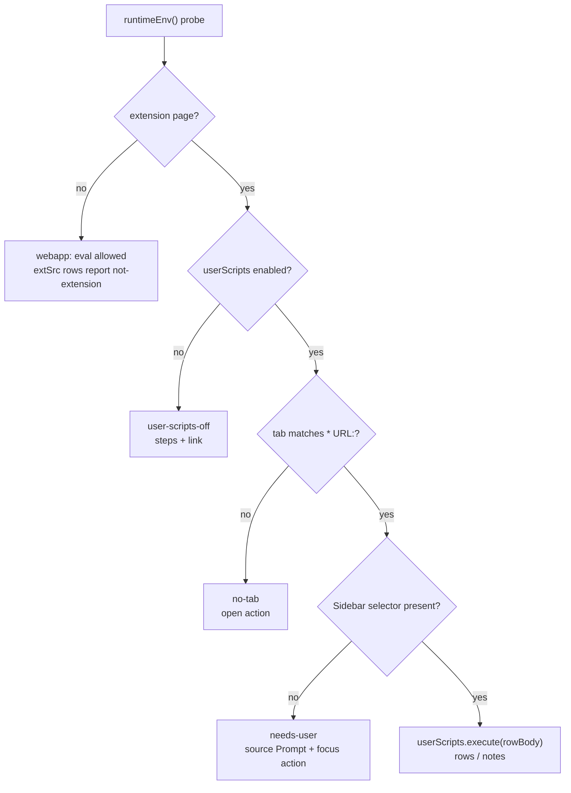

# Plan — `extSrc` (extension-only `type='src'` rows) + the `runsrc` fallback

Opening prompt for a new implementation session. Read this file to the end, then
[`docs/script-post.md`](script-post.md) for the gathered CSP facts and the ScriptCat prior art.
Do not re-litigate the decisions in §2; they follow from that doc.

> **Status (2026-10-19): implemented, with the scope corrections in §2.6 and §9.** `tabsrc`
> was dropped: `extSrc` is one more case of `run_src`, so there is no separate tool, runner
> name, or UI entry, and `recr` already offers it at `rwr`. The shipped code is
> `src/rowMeta.ts`, `src/runsrc.ts` (routing), `src/extsrc.ts`, `src/extsrcRows.ts`; the
> current-state doc is [extsrc.md](extsrc.md).

## 1. Facts already established (do not rediscover)

- `src/runsrc.ts` evaluates a `type='src'` row two ways: `new AsyncFunction('ctx', body)` for
  function bodies, `import('data:text/javascript,…')` for module bodies.
- The tabext options page is an MV3 extension page. Its CSP
  (`tabext/ext/manifest.json:68`) is `script-src 'self' 'wasm-unsafe-eval' http://localhost`,
  so both branches are refused there; `'unsafe-eval'` cannot be enabled in MV3.
- The app is bundled as `tabext/ext/built.out/routes.js` (the options page) and is the only
  bundle carrying `runsrc`. `bg.js` carries neither `recr` nor `runsrc`.
- Four `runBody` call sites: `src/ui/wFeedRun.ts:115`, `src/srctag.ts:2444` via
  `loadAdaptersFromStore:2468`, `src/ui/restGrouper.ts:1004`, `src/recr.ts:1027`.
- `WEBFEED_EXTRACT_BODY` (`src/webfeedRows.ts`) is a function body whose only call is
  `globalThis.webfeed.extractFromDoc({ db: ctx.db, args, console })`; `POST_ITEMS = 6`
  (`src/wFeed.ts:49`) is under that body's default `showRows: 10`.
- `tabext/ext/manifest.json` already declares the `userScripts` permission and `<all_urls>`.
- ScriptCat's essence, with links and file paths: `docs/script-post.md` §Prior art.

## 2. Decisions

1. **M1 is the only CSP change shipped now.** `runsrc` gains a cached capability probe, a
   registry of compiled counterparts keyed by **exact body text**, and a named refusal.
   Eval-capable realms keep today's path byte-for-byte; the registry is never consulted there.
2. **No new row type.** Capability is declared inside the `type='src'` text as userscript-style
   metadata comments (§5). The gate, the UI badge, and the pre-run check all read that one
   parse.
3. **`extSrc` v1 runs through `chrome.userScripts.execute`** (ScriptCat's Path A), not through a
   sandbox page. A sandboxed page cannot use `chrome.*` and has an opaque origin, so it cannot
   target a tab. The postMessage bridge stays deferred to the future greet host
   (`docs/script-post.md` §M2) — `extSrc` does **not** need it.
4. **Pre-run verification is the only new ceremony.** Everything that can fail is checked
   before a row runs, and reported with an action, not a stack trace. Mid-run surprises are a
   bug.
5. **Row body = in-page extractor; Chrome plumbing = typed TS.** Unlike `webfeed` (engine pure
   TS, row text = the driver), an `extSrc` body runs *inside the target tab* and therefore
   cannot hold `chrome.*`; the runner resolves the tab and passes the source block in. Record
   this asymmetry in the docs.
6. **Naming (decided):** no `extsrc`/`tabsrc` split. The feature keeps the row and the
document (`extsrc.md`, `extsrc/extract.js`); the runner is `src/extsrc.ts` and is reached
only through `run_src` — no separate tool, UI entry, or verb.

## 3. Simplifications adopted, and refactors deliberately not done

Adopted:

- **One verdict, one place:** a single `runtimeEnv()` replaces the three checks that would
  otherwise appear in M1, `extSrc`, and the UI (extension page? eval? module import?
  `userScripts` present/enabled? tab access?).
- **One report shape:** generalize `WFeedRunReport` to `SrcRunReport`
  (`{ at, rows, notes, error?, state }`), used by the feed read, `run_src`, and `tabsrc`.
  Do not create a second one.
- **One seed path:** `extsrc.md` and `extsrc/extract.js` seed through the existing
  `TagSeedRow`/`TagSeedTable` helper from `src/srctagRows.ts` (the mechanism `webfeedRows.ts`
  already uses). No new table, no new seeder.
- **One capability declaration:** metadata comments parsed once (`rowMeta`), not a `type` field,
  not a table column.

Not done now (wait for a second real consumer):

- Do not generalize `wFeedRun`'s block write-back. `extSrc` v1 returns rows only, the caller
  decides what to save.
- Do not build the sandbox/port, `configureWorld` messaging, or a persistent frame host.
- Do not add `srctag/embed.js`/`classify.js` twins; their body is the implementation.

## 4. Work, in order

### P1 — M1 in `runsrc` (independent of `extSrc`)

Files: `src/runsrc.ts`, `src/webfeedRows.ts`, `src/ui/routes.tsx`, `src/ui/wFeedRun.ts`,
`src/recr.ts`.

- `canEvalBody(): boolean` — construct a trivial `AsyncFunction` once, cache verdict + reason.
- `registerBodyTwin(body: string, run: (ctx) => Promise<unknown>)`, `bodyTwinFor(body)`;
  key = exact text.
- `runBodyWithPath(body, ctx): Promise<{ value, path: 'body' | 'twin' }>`; `runBody` delegates
  and returns only `value`. `RecrScriptContext` is not extended.
- `runBody` order: eval available → today's code; else twin; else `SrcEvalBlockedError` naming
  the CSP and the host that can run it (the app's own origin).
- `src/webfeedRows.ts` exports `WEBFEED_BODY_TWINS` (a `Map`), with the twin reproducing the
  body's **return value** (`ref`, `total`, formatted `sources`, `notes`,
  `das.slice(0, showRows || 10)`, no `attempts`) — `run_src` shows that JSON to a model.
- `src/ui/routes.tsx` registers it next to `installWebfeedGlobal()`.
- `src/ui/wFeedRun.ts` uses the traced form and appends `compiled` or `row` to `notes`.
- `src/recr.ts` (`run_src`) appends the path the same way.

Acceptance:

- In the webapp nothing changes: same control flow, same `export`/`import` SyntaxError
  tie-breaker, twin never consulted (test asserts a twin returning a marker is *not* used when
  eval works).
- Parity test runs the real `WEBFEED_EXTRACT_BODY` through `runBody` (vitest may eval) and the
  twin over the same stubbed `db`/`args`, then `toEqual`s both results.
- Extension page: a feed read reports the compiled path in `notes` and the same items.
- Edited body (one character) + no eval → refusal, never the twin.

### P2 — `runtimeEnv` and `rowMeta`

Files: `src/runsrc.ts` (env) and a small `src/rowMeta.ts` (or `src/srcMeta.ts`; pick one name).

- `runtimeEnv()` → `{ host: 'webapp'|'extension-page'|'worker'|'test', eval: {ok, reason},
  dataImport: {ok, reason}, userScripts: {present, enabled, reason}, tabs: {ok, reason} }`.
  Probe once, cache. Model the `userScripts` probe on ScriptCat's
  `checkUserScriptsAvailable` (`src/pkg/utils/utils.ts` there): property access, then
  `getScripts`, then a register/unregister round-trip for browsers that report the API but
  deny it.
- `rowMeta(body)` parses leading `// @…` comments: `@requires extension|tab|user-scripts`,
  `@match <url pattern>`, `@max <n>`, `@prompt <text>`. Unknown `@…` keys are kept, not
  dropped. This is the only new declaration surface.
- UI: a badge on the row/preview when `@requires` is present; in the webapp the row still
  lists but running it returns the verification report.

Acceptance: the four existing call sites are untouched; `rowMeta` is pure and unit-tested;
`runtimeEnv()` returns `host: 'extension-page'` under `chrome-extension://` and
`'webapp'` at `http://localhost:*`.

### P3 — `extsrc` engine (`src/extsrc.ts`)

Responsibilities, in this order:

1. `parseExtSrcDoc(md)` — the `extsrc.md` dialect (§5), same parser idiom as
   `parseWebfeedDoc`.
2. `planTabSources(doc, tabs, env)` — match each source's `* URL:` against open tabs
   (`chrome.tabs.query`), one plan entry per source: `{ source, tabId?, state }` where `state`
   is `ready | no-tab | not-extension | user-scripts-off | unsupported`.
3. `verifyExtPlan(plan, env)` — fold the plan and env into one pre-run report; every non-ready
   state carries `{ message, steps: [{ text, url? }] }` (§6).
4. `runTabSource(planItem, rowBody)` — `chrome.userScripts.execute({ target: { tabId },
   world: 'USER_SCRIPT', js: [{ code }] })` with the wrapper below; return the structured
   result. No `eval`, no `new Function` on the extension side.
5. `toRows(result)` — accept `{ rows: [{ txt, ref, tags? }], notes, needsUser? }` and return
   `Da[]` with `tid` unset, the way `webfeed` does.

Wrapper (Chrome compiles this, not us):

```js
(async (ctx) => { <row body> })(<ctx>)
```

`ctx` for an `extSrc` body is `{ ref, args, console }` only — **no `db`** (the body runs in a
page origin). `args` carries the parsed source block, `max`, and the selectors.

Acceptance: a source with no matching tab returns `no-tab` naming the pattern and offering an
open action; a missing sidebar returns `needs-user` with the `@prompt` text; the same inputs
produce the same plan without running any code.

### P4 — `extsrc.md` and the tab body (`src/extsrcRows.ts`)

Seed through `TagSeedRow`/`TagSeedTable` (same helper as `webfeedRows.ts`):

- `extsrc.md` — the document.
- `extsrc/extract.js` — the in-page body; reads `ctx.args.source`, checks
  `source.sidebar` presence first, returns `needsUser` when absent, otherwise collects
  `{ txt, ref }` for up to `max` items, optionally scrolling a container / clicking a “more”
  control between passes, and returns `{ rows, notes }`.

Dialect (same `secret.md` style as `webfeed.md`):

```md
## Sources

### gemini
* URL: https://gemini.google.com/*
* Sidebar: [data-test-id="chat-history"]
* Item: a[href^="/app/"]
* Mode: dom
* Max: 200
* Prompt: open the chat sidebar (☰) in the Gemini tab

### deepseek
* URL: https://chat.deepseek.com/*
* Sidebar: .chat-history
* Item: a[href^="/a/chat"]
* Mode: html
* Max: 200
* Prompt: open the history sidebar in the DeepSeek tab
```

`Mode: dom` reads attributes from matched elements; `Mode: html` returns `outerHTML` slices for
the row body to parse. `Prompt` is what the runner shows as a notice when `Sidebar` is absent.
The row body's metadata declares `// @requires tab` and `// @requires user-scripts`.

Acceptance: the seeded document is inert until a caller runs it (same rule as `webfeed.md`);
seeding never overwrites a live row; a fixture page exercises both modes in vitest (happy-dom)
by calling the body text through `runBody` (eval works in tests).

### P5 — feedback catalogue

One table drives the copy; reuse `noticeStore`/`stts` for delivery. Steps are user-facing text,
not troubleshooting notes.

| state | when | message | steps / action |
|:--|:--|:--|:--|
| `not-extension` | webapp runs a `@requires extension/tab` row | “<ref> needs the extension” | open the sibling app at its own origin; badge explains why |
| `user-scripts-off` | `chrome.userScripts` absent, disabled, or the toggle is off | “Allow User Scripts is off for Tab Seer” | `chrome://extensions` → Tab Seer → Details → **Allow User Scripts** (Chrome ≥ 138: enable Developer mode first) + link `https://developer.chrome.com/docs/extensions/reference/api/userScripts` |
| `no-tab` | no open tab matches `* URL:` | “no open tab matches <pattern>” | action: open the source URL; re-check button |
| `needs-user` | `Sidebar:` selector absent | the source's `Prompt` | action: focus the tab; re-check button |
| `empty` | selectors match nothing | “<n> items read, 0 matched” | names the selector that missed |
| `error` | the body threw in the tab | the error message + the row ref | — |
| `eval-blocked` | M1 refusal | names the CSP + the app's origin | — |

Acceptance: every row above is produced by a unit test with a fake `env`/`tabs`; the
`user-scripts-off` text is asserted verbatim so the instructions do not drift.

### P6 — docs and checks

- `docs/extsrc.md` (current-state: the dialect, the runner, the failure catalogue, the
  asymmetry in §2.5), `docs/webfeed.md` + `docs/recr-agloop.md` §7 pointers, and
  `docs/script-post.md` updated to say `extSrc` chose `userScripts` and why the bridge is still
  deferred.
- Tests: `test/runsrc.test.ts` (new), `test/extsrc.test.ts` (new: parse, plan, verify, mapping,
  body on a fixture), one case in `test/startagfeed/wFeedRun.test.ts` for the compiled path.
- Commands: `npx vitest run test/runsrc.test.ts test/extsrc.test.ts test/startagfeed` and
  `npx tsc --noEmit` (compare per-file counts; the repo has a known baseline).
- Extension smoke is Windows-side: `node esbuild.mjs` in `tabext`, load unpacked, run one
  source against a real Gemini/DeepSeek tab, then repeat with “Allow User Scripts” off to see
  the `user-scripts-off` report. Do **not** `pnpm install` in `tabext` from this checkout.

## 5. Row metadata (the only new surface)

```js
// @requires tab
// @requires user-scripts
// @match https://gemini.google.com/*
// @max 200
const api = globalThis.webfeed; // still allowed: a page body may call a global the app publishes
```

Rules: metadata is parsed from leading `//` lines only; an unknown key is preserved and
reported; `@requires` is a capability request, never an authorization — the existing gate
(`rwr` for `run_src`) stays the authorization point, and the tabsrc runner must not lower it.

## 6. Guardrails

- Never add an eval site. In the extension the only code compiler is Chrome
  (`userScripts.execute`), and the only fallback is a registered twin.
- Do not change `runBody`'s two existing branches; the order is eval → twin → refuse.
- Do not branch on `extChrom()` (`window.chrome` exists on ordinary pages); branch on
  `runtimeEnv()`.
- Do not invent a new row `type`, table, or column. No new store.
- Do not write scraped rows automatically; return them.
- Keep the seeded documents inert until a caller runs them, and never overwrite a live row.
- Do not `as unknown`; cast at the typed edges (`FeedDb`, `Da`) once, with a comment only if
  the shape is not obvious.
- If a removal of existing behavior looks necessary, ask first.

## 7. Verification order



## 8. Definition of done

- Webapp: every pre-existing script path behaves exactly as before; M1 twin only when eval is
  unavailable; a feed read still writes its block.
- Extension page: the feed read reports the compiled path; `extSrc` rows verify before running
  and never show a raw CSP error; the `user-scripts-off` report names the setting and the steps.
- `extsrc.md` + `extsrc/extract.js` seeded, documented, and inert until run.
- Tests listed in P6 pass; docs updated; no new eval site; no new row type.

## 9. Decisions taken before coding

1. **Names:** `extsrc` only. `tabsrc` is not a thing; `run_src` is the only entry point.
2. **Result destination:** `Da` rows only, `tid` unset. No feed-style block is written.
3. **UI entry:** none of its own. The model reaches it through `run_src`; a person runs the
   same call from the chat, and the readout is that tool's result.
4. **Exposure:** yes, `recr` already exposes it — the `rwr` gate and the `run_src` tool are
   unchanged; only the tool description gained the `@requires tab` sentence.

## 10. Commit summary

> runsrc: fall back to a text-keyed compiled twin only where a realm refuses eval, so the
> webapp and the tabext options page both boot the same `routes.tsx`; add `extSrc`
> (`extsrc.md` + `extsrc/extract.js`) to scrape an existing tab through `chrome.userScripts`,
> with a pre-run report for every missing capability, and gather the CSP facts and ScriptCat
> prior art in `docs/script-post.md`.
