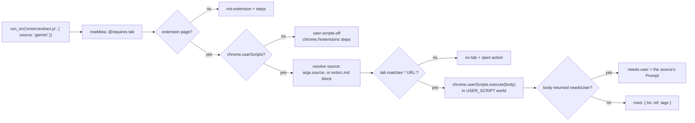

# extsrc — the extension-only `run_src` case

`extsrc` is not a tool and not a row type. It is the shape a `type='src'` row takes
when it can only be answered by a live browser tab: a chat history sidebar, a
rendered list behind a login. The row keeps `type='src'` and declares the need in its
header; `run_src` routes it to the extension, and `recr` already offers it at `rwr`.

`webfeed.md` declares sources a server answers. `extsrc.md` declares the ones only a
tab can answer. Both are `type='md'` rows read through `ctx.db` by the caller.

## Where it sits

| Piece | File | Owns |
|---|---|---|
| Header | `src/rowMeta.ts` | the `// @requires` / `@match` / `@max` / `@prompt` parse |
| Routing | `src/runsrc.ts` | `@requires tab` detection, the tab-runner seam, the refusal a realm without eval gives |
| Runner | `src/extsrc.ts` | capability probe, source resolution, tab match, `chrome.userScripts.execute`, the failure catalogue |
| Rows | `src/extsrcRows.ts` | the `extsrc.md` text, the `extsrc/extract.js` body, seed and clear helpers |
| Boot | `src/ui/routes.tsx` | `installExtSrcRunner()` beside the two `install*Global()` calls |
| Model | `src/recr.ts` | `run_src` already exposes it; the gate level is unchanged |
| Tests | `test/extsrc.test.ts`, `test/runsrc.test.ts` | the dialect, the catalogue, the wrapped body on a fixture |



## The row header

A row declares its needs in leading `// @key value` comments, the userscript dialect:

```js
// @requires tab
// @requires user-scripts
// @match https://gemini.google.com/*
// @max 200
// @prompt open the chat sidebar (☰) in the Gemini tab
```

`rowMeta` stops at the first line that is neither blank nor a `//` comment, so a
`@`-looking string in the body is never metadata. `@requires tab|extension|user-scripts`
all mean the same thing: this row reads a live tab, and only the extension can run it.
`@match` lets a row run without a source document; `@prompt` is the line the user sees
when the page needs one manual step.

The gate is not affected: `run_src` stays at `rwr`, and the same `gate.md` decision
that authorizes a row authorizes its tab access.

## The document

`extsrc.md` uses `secret.md`'s dialect: `## Sources`, one `### name` block per source,
`* Key: value` bullets.

```md
## Sources

### gemini
* URL: https://gemini.google.com/*
* Sidebar: [data-test-id="chat-history"]
* Item: a[href^="/app/"]
* Mode: dom
* Max: 200
* Prompt: open the chat sidebar (☰) in the Gemini tab
* Tags: gemini chat
```

| Key | Meaning |
|---|---|
| `URL` | match pattern for `chrome.tabs.query`; the first matching tab is read, or every one when the block says `Tabs: all` |
| `Tabs` | `all` runs the body in every matching tab and merges the rows by ref, which is how one login per tab (`gemini.google.com/u/1` … `/u/9`) is read |
| `Sidebar` | must exist before the list does; absent, the run stops with `Prompt` |
| `Item` | selector for one history entry |
| `Mode` | `dom` reads text and href; `html` also keeps each `outerHTML` under `rec.html` |
| `Scroll` | optional container to exhaust before reading a virtualized list |
| `Max` | cap on returned rows; unset (or `0`) leaves the cap to the body |
| `Tags` | extra tags beside the source name |

## The body

`extsrc/extract.js` runs **inside the target tab**. Its `ctx` is `{ ref, args, console }`
— no `db`, because the page's origin is not the app's. It reads the source block from
`ctx.args.source` and returns `{ rows, notes }`, or `{ needsUser }` when the sidebar is
closed. Rows are `Da`-shaped with `tid` unset, the way `webfeed` returns them; nothing is
written until a caller decides to.

`chrome.userScripts.execute` compiles the wrapper Chrome-side; the extension never
evaluates row text. That is the same split ScriptCat makes for page scripts, and it is
why `extsrc` does not need the deferred sandbox bridge ([script-post.md](script-post.md)).

## What a failure says

| state | when | what the user sees |
|---|---|---|
| `not-extension` | the webapp runs a `@requires tab` row | the row needs the extension; open the app from the Tab Seer options page |
| `user-scripts-off` | `chrome.userScripts` is withheld, or the probe's register round-trip fails | `Allow User Scripts` is off, with the `chrome://extensions` steps, the Chrome 138 Developer-mode note, and the API reference link |
| `no-tab` | no open tab matches `URL` | the pattern, and "open it in a tab, then run again" |
| `needs-user` | the `Sidebar` selector is absent | the source's `Prompt` |
| `missing-source` | no matching block and no `@match` | seed `extsrc.md`, or pass `args.source` inline |
| `empty` | `Item` matched nothing | a note naming the selector that missed |

The first two are checked once per page and cached. A refusal throws
`SrcUnavailableError`; `run_src` prints its `message` and every step, so a model sees
the same instructions a person does.

## Limits

- Selectors are the site's and will drift. The row and the document are the place to
  fix them; nothing in the engine knows a particular site.
- A tab row never writes rows. Saving, tagging, or turning them into a feed block stays
  the caller's step, as with `webfeed`.
- The browser must allow user scripts for the extension (Chrome 120+; 120–137 behind
  Developer mode, 138+ behind the `Allow User Scripts` switch). `chrome.userScripts` is
  declared in `tabext/ext/manifest.json`; no manifest change is needed.
- A row that a realm cannot eval and that has no compiled counterpart still refuses
  with `eval-blocked`; `extsrc` rows never take that path because they leave the realm.

## References

- `docs/script-post.md` — the CSP facts, the realm matrix, and the ScriptCat prior art.
- `docs/webfeed.md` — the sibling document for sources a server answers.
- `src/runsrc.ts`, `src/rowMeta.ts`, `src/extsrc.ts`, `src/extsrcRows.ts`.
- `test/extsrc.test.ts`, `test/runsrc.test.ts`.
