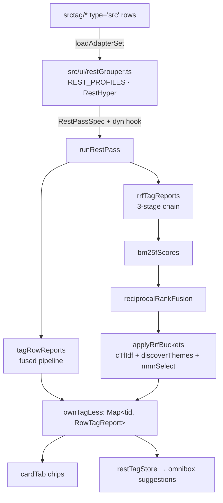

# The rest-list tagging engine (rstag)

`src/rstag.ts` is the engine behind the rest list's tag chips: the pass every tag grouper
runs, and the 3-stage pipeline the `rrf` grouper scores with. [sTag.md](sTag.md) owns the
*evidence* — what a tag layer is for, `srctag`'s channels, the dynamic `type='src'` rows,
the write path. This document owns what the list does with that evidence: the pass, the
pipeline, its pre-processing, the knobs a reader turns, and the measurements those knobs
were chosen from.

The engine is where the family is heading. The fused `rstag`/`rstext` preset is the older
reading — a weighted channel sum — and `rrf` is the matured one: candidates from an exact
matcher, ranked by BM25F, fused by rank rather than by score, then expanded per burst. The
[maturation plan](#maturation-and-retirement) below says what replaces what, and what has
to keep working while it does.

## Where it sits

```
src/ui/restGrouper.ts   REST_PROFILES · RestHyper · the srctag/* adapters · grouping
        │  RestPassSpec { dim, score, limit, pinsPriority, aim, pipeline, dyn }
        ▼
src/rstag.ts            runRestPass · restTagMap · restTextMap · caps · 3 stages
        │
        ▼
src/srctag.ts           tokenizer · trie · TextRank · TagParts · explainTag
```



The dependency runs one way: the UI imports the engine, the engine imports `srctag`'s
primitives, and nothing imports the UI. That is what lets the engine be tested without
Dexie, and it is the direction a future move of `srctag`'s lexical core has to keep.

The split is along what each side can know:

| Module | Knows | Does not know |
|---|---|---|
| `src/ui/restGrouper.ts` | which groupers exist, their defaults, the tuner's overrides, the `srctag/*` adapter rows, the rows and pins on screen | how a row is scored |
| `src/rstag.ts` | how a pass is run and scored, what the pre-processing drops | the store, the DOM, React, any grouper ref |
| `src/srctag.ts` | tokenizing, the trie, TextRank, the vector maths, the channel vocabulary, the write path | which list is on screen |

## The pass

`runRestPass(das, spec, opts)` is the body every grouper shares:

1. **Cap.** Newest `tid` first, sliced to `opts.limit ?? spec.limit`.
2. **Resolve the priority tags.** `opts.priorityTags`, else the pin cards' `#tag` headings
   when `spec.pinsPriority`, else the scored rows' own tags. For the `rrf` pipeline the
   fallback skips provenance tags — a `dev_saOpera` on every row is the capture context,
   not a topic, and its terms are dropped from the evidence anyway.
3. **Resolve the dynamic channels**, by calling `spec.dyn(priorityTags)` when the profile
   has one. The hook is the seam that keeps the store and the network out of the engine: a
   caller with no store simply supplies no hook and the pass runs on the lexical channels.
4. **Score**, through `tagRowReports` (the fused pipeline) or `rrfTagReports` (the chain),
   with the dimension, bucket, weights, window, aim and pre-processing the spec names.
5. **`ownTagLess`.** Key the reports by `tid` and drop every tag the row already carries,
   so a chip only ever shows what the pass would *add*.
6. **Return** `Map<tid, RowTagReport>` — the shape `cardTab.tsx` renders and
   `restTagStore` ranks.

`RestPassSpec` is the fixed half of a pass; [sTag.md](sTag.md) documents `RestTagOptions`
as the caller's half.

| Spec field | Meaning |
|---|---|
| `dim`, `bucket` | the ordering the window and clusters are measured on, and whether each hostname is scored as its own working set |
| `score` | channel weights and cut-offs, folded over `DEFAULT_TAG_SCORE` |
| `limit`, `pinsPriority`, `aim` | the cap, the priority source, and the focus/promote knobs (`false` leaves the raw scores) |
| `pipeline` | `fusion` (the default) or `rrf` |
| `bm25`, `rrf`, `buckets`, `global` | the `rrf` pipeline's stage knobs |
| `dyn` | `(priorityTags) => Promise<TagRowsOptions>`: the dynamic channels, resolved by the caller that can reach the store |

Two entry points exist beside `runRestPass` so a caller can ask for a named reading
without a profile: `restTagMap` and `restTextMap`, both the fused pipeline with the aim
half off, the first over the insertion dimension and the second over the visit-time one
with the rows bucketed by hostname. Both are re-exported from `ui/restGrouper.ts`, which is
where the rest list and its tests reach them.

## Pre-processing

Four kinds of term sit on a row without being about it. Every keyword extractor has some
version of this step — TextRank's keyword pre-processing and YAKE's stop list both drop
them, and a hybrid retriever's document-frequency filter is the same idea. All four are
removed from the *inputs*, before stage 2.

- **A function word**, from `GlobalConfig.stop` (`DEFAULT_STOP_WORDS`). The tokenizer's
  `STOP_WORDS` is shared with every other pipeline and cannot grow without moving them, so
  the engine carries its own list of the English words that one leaves out: a short
  title's `vs`, `how` and `any` are central to its TextRank walk and rare enough to pass
  the frequency floor, which is how they become chips on a list of search queries. The
  tuner's `stop` box shows the shipped list.
- **A global term.** `globalTerms` counts the document frequency over the title, the URL
  and the row's own tags together and drops a term held by more than `maxDf` (0.6) of the
  rows. `minRows` (8) is the size below which a pass keeps every term: three rows make a
  term hold 100% of them at df 3, so a share with no corpus behind it is not a
  measurement.
- **A provenance tag**, by prefix (`PROVENANCE_TAG_PREFIXES`: `suffix_`, `dev_`, `ref_`).
  `suffix_` is the title tail `fc.txtRx` strips (`suffix_GoogleSearch`), `dev_` is what
  `sdb.dev_PREFFIX` names, and `ref_` is the domain tag that family reserved. Their terms
  are dropped from the row's own sources whatever their frequency — per row, not per pass,
  so a `dev_android` row does not silence `android` in another row's title.
- **A named term**, from `GlobalConfig.exclude`. `runRestPass` fills it from
  `RestTagOptions.filters` through `filterTerms`, which splits a value on its separators
  and again on camelCase boundaries — `suffix_GoogleSearch` is also `suffix`,
  `googlesearch`, `google` and `search` — and `cardTab.tsx` passes the filters it is
  rendering. A term the list is itself about tells a reader nothing about one row of it.

Removing a term from the *inputs* rather than filtering the result is the whole point: a
global term left in the token bag reaches a graph walk and comes back through a rank, and
a curated tag left in the trie proposes itself again. `excludedTerms` resolves the
frequency floor and the named terms once per pass, so "global" means global to the list
the reader is looking at whatever the window switch says; the provenance terms are added
per row before that row is tokenized.

## The 3-stage chain

The chain exists because an exact matcher is a recall layer, not a ranking one.

| Stage | What runs | Where |
|---|---|---|
| 1. Candidates | `TurboTextTagger.match`, plus the row's own tokens and the classifier's labels | `srctag` |
| 2. Statistical ranking | `bm25fScores`, BM25F over weighted fields | `rrfRowsInSet` |
| 3a. Fusion | `reciprocalRankFusion`, by rank rather than by score | `rrfRowsInSet` |
| 3b. Expansion | `cTfIdf` + `discoverThemes` + `mmrSelect`, what a burst is about | `applyRrfBuckets` |

### Stage 2: BM25F

`Bm25Config.fields` weights the three things a row says about itself — `title`, `url` and
the row's own `tags` — and each field's term frequencies are length-normalized by `b` and
pooled into one pseudo-frequency before `k1` saturates it and the corpus IDF scales it.
That is the whole of BM25F: one ranking function over a structured row rather than one
score per field that a caller has to reconcile. A field the config does not name, or
weights at 0, is not read at all — not read at weight 0, which would still put its length
into the corpus statistics and so move every other term's score.

The corpus is the pass's own working set, so under `bucket: 'domain'` it is one site's rows
and "rare" means rare within that site.

`url` is its own weight rather than a second copy of `TagRowsOptions.urls`: `urls` governs
the token bag the trie, the graph walks and the semantic list read, and the field reads the
row's URLs whenever its weight is above 0. The profile ships both off, because under a list
of one site's pages the hostname and the browser in the query string are on every row and
say nothing about any one of them — and because a URL term's IDF collapses when that is so,
the field alone cannot clean up a pattern it is the source of.

### Stage 3a: reciprocal rank fusion

`reciprocalRankFusion(lists, k)` sums `1 / (k + rank)` over the lists holding each term.
Ranks rather than scores are what gets combined, so a BM25F weight and an embedding cosine
need no calibration against each other — the reason this is the fusion step and not another
weighted sum. The preset enables up to six lists, one per channel with a weight above 0 and
something to say: BM25F, the row's TextRank walk, the burst's, the trie's curated tags, the
classifier's labels, and — when a `dyn` adapter supplies an embedder, which
`restDynCapable` offers because `RRF_TAG_SCORE` names the `embed` weight — a semantic list
ordering candidates by cosine against the row. Rows and candidate terms go into one batched
`embed` call, so a semantic list costs a request per pass rather than per term.

The fused score is normalized by the best the enabled lists could jointly give one term, so
1 means "the top of every list this pass ran". `rrfExplainCfg` divides the *weights* rather
than the result, which is what keeps `channels[].contribution` adding up to `score` — the
invariant every chip tooltip is read against. A consequence is worth knowing before tuning:
`1/(k+1)` is the most one list can give, so a term that tops a single list reaches 0.22 of a
six-list normalization and 0.33 once the dynamic pair is off — it clears `minScore` 0.12
either way, and on six lists it does not clear the aim pass's 0.4, which is what asking for
corroboration by two signals means here.

The statistical stage reports under its own channel, `bm25` (`TagParts.bm25`,
`TAG_CHANNEL_LABEL.bm25`), so a tooltip reads `bm25 0.02×20.33=0.33`: the value is a
reciprocal-rank term and the weight is the list's own share of the normalization. Its
weight defaults to 0, so every preset that does not name it scores exactly as it did before
the channel existed.

### Stage 3b: buckets

`applyRrfBuckets` is `applyTagAim`'s shape — focus, then promote — with the promote half
reading each burst as a class. `cTfIdf` scores a bucket's terms by their frequency *inside
it* times the log of how rare they are across the buckets, so a term every bucket holds is
discounted and the term one bucket holds is what that bucket is about; `discoverThemes`
folds in the bucket's own TextRank walk (`BucketConfig.graph`), and `mmrSelect` takes the
`promoteTop` most distinctive ones that are still apart from each other
(`BucketConfig.lambda`), so three ways of saying one word do not all become sub-tags. The
minted tag is `anchor/theme` with `origin: 'sub'`, the same shape the aim pass produces, so
the chips and the `themes` reading need no special case.

Evidence comes from the *pre-focus* lists, the same choice `applyTagAim` makes and for the
same reason: a filter cannot read a signal it has already erased. The consequence here is
that c-TF-IDF sees the terms focus dropped, so a sub-tag can name a term no chip above it
shows.

## The knobs

The profile (`REST_PROFILES.rrf`) and the live override (`RestHyper`) are the UI's; the
tuner strip, its label and its hover text are documented in
[sTag.md](sTag.md) — one row per control, one line of prose per knob in
`src/ui/restHelp.ts`. What matters here is which of them actually move a result, measured
on the user's own table rather than assumed:

| Knob | What it does to the `rrf` reading |
|---|---|
| `topK` | the only control that shortens a row's chip list |
| `stop`, `max df`, `urls`, `w url`, the provenance rule | what the chips are worth — the pre-processing is the quality knob |
| `rrf k` | the printed suggestion count, a long way; a row's chip count, barely |
| `min`, `aimMin` | almost nothing: the fused scale is flat (see [risks](#risks)) |
| `minLen` | removes short words from both graph walks — and every CJK bigram with them |
| `k1`, `b`, `w title`/`w tags` | a few percent on a rank-fused list |
| `promote ≥`, `themes ≤`, `mmr λ`, `graph λ` | whether a burst mints a sub-tag, and which words it picks |
| `rows` | how much of the list is scored at all; everything the panel counts is over these rows |

## Measurements

The numbers behind the defaults come from `test/srctag-cdp.test.ts`, which reads the live
`tagDB_0` out of the page on `localhost:5173` over CDP and scores those rows in Node. The
`rrf` half is two grids: `RRF_CASES` moves one stage knob at a time over the newest
`SRCTAG_RRF_LIMIT` (600) rows, and `FILTER_CASES` runs one *filtered* list — the rows
carrying `suffix_GoogleSearch` — through `runRestPass` with `{ filters: [...] }`, so the
wiring a user actually has is what gets measured. Both tables are written to
`test-artifacts/srctag-sweep.md`; the harness itself, and the `srctag` channel sweep beside
it, are described in [sTag.md](sTag.md).

The grid over the newest 600 rows (2026-10-12, the URL out, `topK` 5 and the stop list on):

| Case | sugg | distinct | empty | sub rows | jaccard | top roots |
|---|---|---|---|---|---|---|
| `preset` | 2346 | 1636 | 9 | 72 | 1.000 | `ai 81 · deepseek 39 · 前消 16 · youtube 13` |
| `urls on` | 3327 | 1509 | 1 | 261 | 0.526 | `google 193 · gx 165 · opera 118 · ai 114` |
| `k1 0.5` / `k1 3` | 2466 / 2464 | 1656 / 1652 | 9 | 119 / 118 | 0.957 | `ai 112 · deepseek 39 · youtube 39` |
| `b 0` / `b 1` | 2464 / 2466 | 1656 / 1655 | 9 | 118 / 119 | 0.956 | `ai 110 · deepseek 39 · youtube 39` |
| `title only` / `tags only` | 2333 / 1241 | 1636 / 14 | 9 / 5 | 72 / 573 | 0.998 / 0.005 | `ai 81 · deepseek 26` / `com 506 · youtube 506 · AI 163` |
| `k 1` / `k 10` / `k 200` | 878 / 2068 / 2346 | 448 / 1478 / 1639 | 0 / 10 / 9 | 132 / 54 / 72 | 0.267 / 0.869 / 0.985 | `ai 116 · sleep 85` at `k 1` |
| `maxDf 1` (floor off) / `0.2` | 2346 / 2346 | 1636 / 1636 | 9 | 72 | 1.000 | identical to the preset |
| `stop off` | 2364 | 1637 | 9 | 72 | 0.962 | `ai 81 · 前消 16 · vs 14 · youtube 13` |
| `no bm25` | 1310 | 146 | 3 | 446 | 0.084 | `sleep 368 · use 366 · AI 163` |
| `no priority` | 2322 | 1639 | 9 | 60 | 0.996 | `ai 81 · 前消 16` |
| `no graph` | 2298 | 1700 | 9 | 44 | 0.801 | `AI 46 · ai 32 · deepseek 25` |
| `no buckets` | 2243 | 1621 | 9 | 0 | 0.991 | `ai 49 · deepseek 13` |
| `promote ≥ 2` / `≥ 5` | 2460 / 2271 | 1674 / 1625 | 9 | 127 / 23 | 0.975 / 0.993 | `ai 113` / `ai 49` |
| `themes ≤ 1` | 2315 | 1630 | 9 | 72 | 0.996 | `ai 81 · deepseek 26` |

Four facts fall out of it. The statistical stage carries the breadth: dropping the `bm25`
list collapses 1636 distinct tags to 146, and without it the graph walks fill the list with
bare function words (`sleep`, `use`). The graph walks are what the time goes on (61ms
without them against ~150ms with) and what gives a sub-tag its anchor. The bucket half is
monotone in its own threshold: `promote ≥ 2` leaves 127 rows carrying a sub-tag, the
default 3 leaves 72, `promote ≥ 5` leaves 23. And the fusion's `k` moves the *printed*
suggestion count a long way (`k 1` keeps 878 against 2346) while barely moving a row's chip
count.

Two knobs this table cannot show, because a varied table has little to spare: `stop` (2364
against 2346 suggestions) and `maxDf` (identical at every threshold from 0.2 to 1 — the top
chip root holds 14% of the rows, so no term is global). Both are visible on the filtered
list below.

`mean` and `max` in the artifact mix two scales on purpose: a fused score is normalized to
1, while a promoted sub-tag's score is the number of rows that proposed it, so the preset's
`max` of 5.000 is a theme five rows share. `TagExplanation.origin` is what tells the two
apart.

### One filtered list, read four ways

The 378 rows carrying `suffix_GoogleSearch` are one search engine's own result pages: every
one of them has the same hostname, and a `dev_*` and `suffix_*` tag.

| Case | sugg | distinct | sub rows | sub tags | top roots |
|---|---|---|---|---|---|
| `urls on, w url 1` | 2354 | 707 | 236 | 15 | `gx 462 · opera 291 · google 271 · utf 230 · gws 129 · serp 42` |
| `urls off, w url 1` | 1577 | 1257 | 7 | 3 | `database 12 · risk 7 · convexity 6 · macro 5` |
| `urls off, w url 0` | 1577 | 1260 | 7 | 3 | `ideas 12 · risk 7 · convexity 6 · macro 5` |
| `… floor on` | 1577 | 1260 | 7 | 3 | same |
| `… floor on, f= named` | 1573 | 1257 | 7 | 3 | same |

Three things are visible. Reading the URL is the pattern: `gx`, `google`, `opera` and `utf`
are the chips on the list, and they drive the theme groups too — 236 rows carry a promoted
sub-tag against 7 once the URL is out. The corpus floor alone is *not* enough there, because
with the URLs out of the token bag the residual patterns are the rows' own provenance tags,
which the per-row rule drops whatever their frequency. And naming the filter is worth a
handful of chips (1577 → 1573): the terms `suffix`, `googlesearch`, `google` and `search`
would otherwise return through a *title* that happens to contain the engine's name.

### Why the `priority` reading looks flooded

The reading counts every tag the scored rows keep, and on a list of mostly-distinct titles
that is a long tail: over the 200 rows of the same list, 994 distinct tags where 879 are
kept by one row alone. Two things are worth understanding before tuning it, and one is a
reading change that has already been made.

- **`min` and `aimMin` cannot thin it.** A fused score is `Σ w / (k + rank)` normalized by
  the best the enabled lists could give, and a short title has only a handful of candidates,
  so every one of them sits in the first few ranks of every list and scores within a few
  tenths of the top. Raising the cut-off from 0.12 to 0.3 changed *nothing* on that list;
  `topK` is the knob that shortens it, which is why the profile ships 5.
- **`minLen` is the wrong shape for the adverbs.** It counts characters, so raising it to
  remove `vs` (2) also removes every CJK bigram (2) — a whole token in this tokenizer. The
  `stop` list is what removes a function word without touching a language that has no
  spaces.
- **Most bars are one row's business.** The panel draws the tags kept by more than one row
  and reports the rest as `+ N kept by a single row`, because a tag one row keeps says what
  that row is about, not what the list is.

Measured on that list, in the order the tuner lists the knobs:

| Reading | chips/row | distinct bars | bars drawn | function-word chips |
|---|---|---|---|---|
| before (`topK` 8, no stop list) | 5.78 | 994 | 115 | 59 |
| stop list only | 5.61 | 988 | 110 | 7 |
| tuned (`topK` 5 + stop list) | 4.22 | 768 | 66 | 7 |
| tuned + `topK` 4 | 3.59 | 659 | 51 | 6 |

## Maturation and retirement

Two pipelines exist today, and `RestPassSpec.pipeline` selects between them. The direction
is that the chain replaces the weighted sum, and that `srctag.ts` shrinks to the part a
`type='src'` row has to be able to call.

**Now.** `rstag`/`rstext` run the fused pipeline; `rsfreq`/`rstrank`/`rstt` isolate one
channel family through the same code; `rrf` runs the chain. All six are chip readings over
`rsdt`'s blocks, all six go through `runRestPass`, and they share the tuner strip and the
sweep.

**Next.** The chain becomes the default reading for the tag groupers: `rrf` already answers
the same two questions (which curated tag a row is under; which term a burst keeps
proposing), with a candidate stage, a field-weighted ranker and a rank fusion instead of a
hand-tuned sum. The work is to make the older presets *presets of the chain* — the
visit-time reading becomes the chain on that window, the channel-family readings become
masks over its lists — and then to retire the fused path, its channel weights and the sweep
cases that only measure it. `rrf`'s measurements above are the evidence that nothing is
lost: the stage ablations show which signal carries which part of the reading.

**Finish.** `src/srctag.ts` keeps only what the dynamic half needs:

| Keep in `srctag.ts` | Why it cannot move |
|---|---|
| `srctagApi()` / `installSrctagGlobal()` and every name on that object | a seeded `type='src'` row calls them by name through `globalThis.srctag`; the rows are *data*, so a rename breaks them at runtime with no build to catch it |
| `runBody` glue (`loadTagAdapter`, `loadAdaptersFromStore`, the refs) | the dynamic rows' entry point |
| the write path (`planTagUpdates`, `commitTagUpdates`, the ports) with its types | the app-side port in `ui/tagApply.ts` and the provenance contract |
| the adapter clients (`createEmbedClient` and siblings, `embedWithCache`, `TagVectorCache`) | the rows re-implement them as text, and a caller holding a key uses them directly |

Everything else — the tokenizer, the trie, TextRank, the vector maths, `TagParts`,
`explainTag`, the aim pass — moves into `rstag.ts`. `TagParts` and `RowTagReport` are the
contract between the engine and the chips, so they move first and their names do not change.
`explainTag`'s channel labels are printed in tooltips, so `TAG_CHANNEL_LABEL` stays the
vocabulary it is.

**Acceptance for any of those steps.** The `globalThis.srctag` names still resolve; the
chips render from a `RowTagReport` with the same fields; `test/restGrouper.test.ts` and
`test/rstag.test.ts` pass unchanged; the sweep still writes both grids.

## Risks

Findings worth knowing before changing this code, ordered by how likely they are to be
missed. `guarded` means a mechanism or a test holds the risk today.

| Risk | Why it bites | State |
|---|---|---|
| A fused score is flat, so a cut-off looks broken | `Σ w/(k+rank)` over ~6 candidates spans a few tenths; measured, `minScore` 0.12 → 0.3 changes nothing on a 200-row list | guarded: `topK` 5 ships, and the tooltips say the cut-off is inert here |
| `minLen` read as a stop list | it counts characters, so a floor that removes `vs` also removes every CJK bigram, and BM25F still proposes short words because it reads the title directly | guarded: `GlobalConfig.stop` exists and the tooltip warns; watch any future length knob |
| Pre-processing applied to the result instead of the inputs | a global term left in the token bag is re-ranked by the graph walks and returns as a chip, so the fix looks right and does nothing | guarded: `excludedTerms` and the per-row provenance filter run before tokenizing |
| `urls` and `w url` read as one switch | `w url` alone is nearly inert — a term on every row's URL has df ≈ 100%, so IDF buries it and `topK` cuts it — while a reader expects the field knob to clean URL noise | guarded: both ship off, and the profile comment says which one acts |
| A share-based rule with no corpus | three rows make every term "global", so a short list loses its chips entirely; this is what `minRows` was added for | guarded: `minRows` 8 in `DEFAULT_GLOBAL`; any new share needs the same guard |
| A fused list handed to `rankTags` unsorted | `rankTags`/`dedupeTags` read their input in score order and keep survivors in that order, so the "top" chip is whichever list was built first | guarded: `rrfRowsInSet` sorts before the cut; the rule for anyone adding a list |
| Global and local evidence measured on different sets | `maxDf` counts over the whole pass while `bm25fCorpus` is per domain bucket, so a term global to one site but rare overall survives the floor | open, accepted: documented; harmless on the measurements above |
| Promoted sub-tags unreachable on some windows | a `tid` window cuts only where two insert ids are more than `burstGap` (1) apart, so the whole set is one cluster; a `visitTime` window over a diverse list cuts 186 bursts of ~1 row, so `promoteMin` 3 never fires | watch: the `themes` reading shows the burst count; no code fix, it is what the window means |
| A sub-tag's `score` is a row count, not a fused score | any aggregate that sums scores mixes two scales — the sweep's `mean` and `max` do | guarded: `parts.group` and `origin: 'sub'` mark it, and the tooltip names the channel |
| `Σ contributions == score` depends on dividing the weights | `rrfExplainCfg` divides the weights rather than the result; dividing the result instead breaks the invariant behind every chip tooltip | guarded: `test/rstag.test.ts` asserts it per report |
| The engine is not reachable from a script | `srctagApi()` lives in `srctag.ts`; importing `rstag` there would make a cycle (`srctag → rstag → srctag`) | open: no `run_src` row can drive the chain today. The retirement step is where this resolves — the API moves, the cycle disappears |
| Cost grows with `rows` | a BM25F corpus per bucket, one TextRank walk per row and one per window; 600 rows ≈ 150ms and the app caps at 200 | watch: raising `rows` on a large table |
| The committed sweep artifact is easy to truncate | `vitest run … -t <name>` writes only the sections that ran over the committed file | guarded: the test file's header and [sTag.md](sTag.md) both say to re-run the whole file |

## Related

- `docs/sTag.md` — the tag layer: what the evidence is, `srctag`'s channels, the dynamic
  `type='src'` rows, the write path, and the tuner and panel the knobs render in.
- `docs/filter_search.md` — the read path the chips feed.
- `src/rstag.ts`, `src/srctag.ts`, `src/ui/restGrouper.ts`, `src/ui/restTuner.tsx`,
  `src/ui/restViz.tsx`, `src/ui/restHelp.ts`.
- `test/rstag.test.ts`, `test/restGrouper.test.ts`, `test/srctag-cdp.test.ts`.
