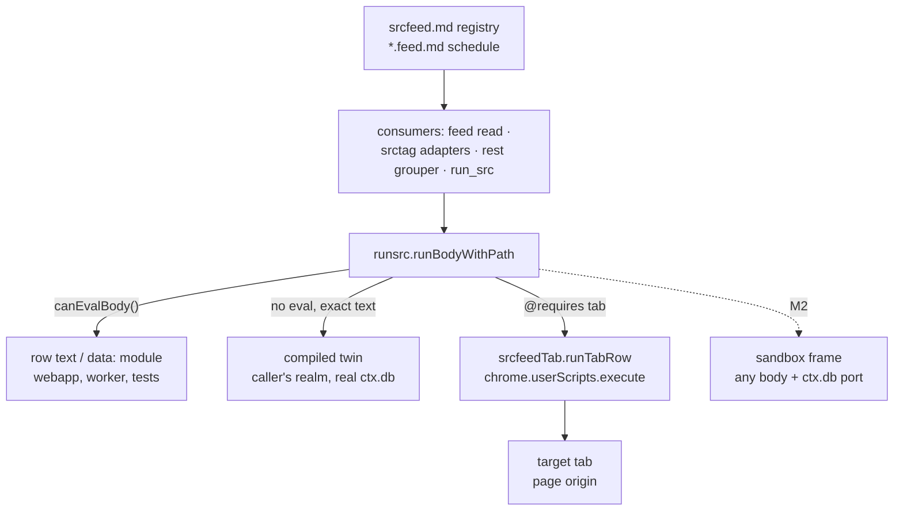
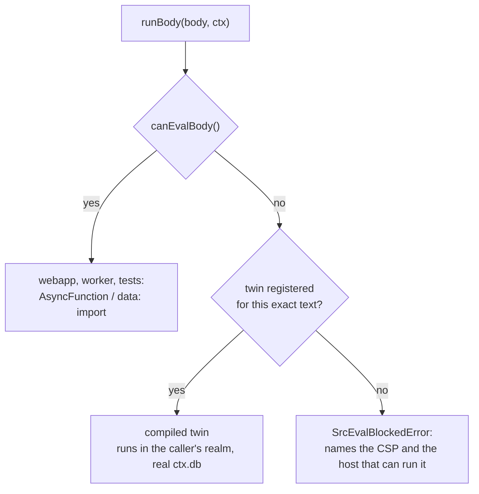

# Script posting (`run_src` bodies outside the webapp)

`routes.tsx` boots the app in two hosts: the webapp (its own origin, `http://localhost:5173`
in dev) and, through `tabext`, an MV3 options page (`chrome-extension://<id>/options.html`).
Everything a `type='src'` row can drive — the feed read, the tag adapters, a custom rest
grouper, `recr`'s `run_src` tool — goes through one evaluator, `src/runsrc.ts`, and that
evaluator needs a realm allowed to eval. The webapp is; an extension page is not.

This file gathers the facts, the prior art that settles the design, the M1 shipment
(probe, twins, tab runner, and the registry/refresh path), and the M2 bridge deferred to
the future host. The registry parse, feed read and refresh UI are current state, not
deferred work: [srcfeed.md](srcfeed.md#parsing) and
[srcfeed.md](srcfeed.md#the-pin-card-token-and-the-refresh-ui) own them.

## Big picture

Every `type='src'` row reaches one evaluator, and the host decides which path it can
take. The same split covers the feed registry/read/refresh path, the tag adapters,
the rest grouper, and `run_src`:



| Milestone | State | Adds | Still refused |
|---|---|---|---|
| M1 | shipped | webapp eval; exact-text twins; tab runner; registry/read/refresh UI | an edited body with no twin and no `@requires tab` in the extension (`eval-blocked`) |
| M2 | deferred | a sandbox frame for any body; the `ctx.db` port; cancellation | bodies that return DOM nodes or functions |

M1 is current state: the registry/read/refresh path plus the evaluation fallbacks.
M2 is the only deferred piece. [srcfeed.md](srcfeed.md) owns the per-step registry,
read, refresh and tab details; the rest of this file owns the host boundary and the
M2 plan. [Related documents](#related-documents) maps every doc and says why
`extsrc-plan.md` is kept.

## The constraint

`tabext/ext/manifest.json:68` sets

```
"extension_pages": "script-src 'self' 'wasm-unsafe-eval' http://localhost ; object-src 'self' ;"
```

so `runBody`'s two branches fail there:

| branch | needs | fails with |
|---|---|---|
| `new AsyncFunction('ctx', body)` | `'unsafe-eval'` | `Evaluating a string as JavaScript violates the following Content Security Policy directive … script-src 'self' 'wasm-unsafe-eval' http://localhost` |
| `import('data:text/javascript,…')` | `data:` under `script-src` | refused by the same header (already noted in `moduleSourceUrl`'s JSDoc) |

`'unsafe-eval'` cannot be added: MV3 refuses it in `extension_pages` at load. The app is
bundled as `ext/built.out/routes.js` (the options page) and is the only bundle carrying
`runsrc`; `bg.js` carries neither `recr` nor `runsrc`, so the service worker never evaluates
a row today and must not start.

## Who calls `runBody`, and what a blocked realm does

| Call site | Row | After M1 |
|---|---|---|
| `src/srcfeed.ts` | a `Src:` source row | the row text or its twin runs, and the readout keeps its items; a source with no `Src:` uses the built-in walk and never evals |
| `src/srctag.ts` (`loadTagAdapter` ← `loadAdaptersFromStore`) | `srctag/embed.js`, `srctag/classify.js` | no twin exists, so the row is skipped with the named refusal; the sweep keeps the lexical channels and `hashEmbed` |
| `src/ui/restGrouper.ts` | a custom `type='src'` grouper row | the refusal is logged and the list falls back to flat; the default `qarf` never evals |
| `src/recr.ts` (`run_src`) | any `type='src'` row | the twin, or a refusal that lists the steps; a `@requires tab` row goes to the extension's tab runner |

The default boot path needs one thing only: the feed read. Nothing else breaks silently —
but three of the four failures reach a user or a model as a raw Chrome message.

## Prior art: ScriptCat

ScriptCat (`scriptscat/scriptcat`) is an MV3 userscript manager with the same problem —
arbitrary user code, a CSP that forbids eval — and its answer is uniform: **compile once,
execute only in a realm that may eval, and bridge the privileged objects into it.**

DeepWiki: [overview](https://deepwiki.com/scriptscat/scriptcat),
[extension architecture](https://deepwiki.com/scriptscat/scriptcat/1.1-extension-architecture),
[sandbox environment](https://deepwiki.com/scriptscat/scriptcat/3.2-sandbox-environment).

| # | Mechanism | Code |
|---|---|---|
| 1 | All three execution paths share one compilation step: `with(arguments[0]\|\|this.$){ … return (async function(){ <user code> }).call(this); }`, compiled with `new Function` | `src/app/service/content/utils.ts`, `src/app/service/content/exec_script.ts`, [architecture-execution.md](https://github.com/scriptscat/scriptcat/blob/main/docs/references/architecture-execution.md) |
| 2 | Page scripts go to Chrome's own compiler, `chrome.userScripts.register(...)` in the `MAIN`/`USER_SCRIPT` world, and the extension sets *that world's* CSP | `src/app/service/service_worker/runtime.ts` (`configureWorld({ csp: "script-src 'self' 'unsafe-inline' 'unsafe-eval' *", messaging: true })`) |
| 3 | Background and scheduled scripts get no page: the service worker asks the offscreen document to host them and it forwards evaluation into the **sandbox iframe** | `src/app/service/sandbox/runtime.ts` (`execScript`, `BgExecScriptWarp`, cron map), Path B/C in architecture-execution.md |
| 4 | The sandbox page is declared, not configured: `"sandbox": { "pages": ["src/sandbox.html"] }` | `src/manifest.json` |
| 5 | On Chrome they write **no** sandbox CSP — the Chrome build deletes `content_security_policy.sandbox` and relies on Chrome's default, which allows `'unsafe-eval'`; only Firefox gets the explicit string | `scripts/build-config.js` (`createChromeManifest`, `FIREFOX_SANDBOX_CSP`, `applyFirefoxSandboxManifest`) |
| 6 | Privileged objects are never copied into the eval realm — `GM_*` reaches it over their message channel — because a sandboxed page has an opaque origin: no `chrome.*`, no extension storage | `message_serialization: "structured_clone"` in `src/manifest.json` |
| 7 | Availability is probed, never assumed: property access, then a method call, then a register/unregister round-trip, with a Vivaldi carve-out; their e2e flips the user toggle in a throwaway profile | `src/pkg/utils/utils.ts` (`checkUserScriptsAvailable`), `e2e/README.md`, `e2e/fixtures.ts` (`chrome.developerPrivate.updateExtensionConfiguration({ userScriptsAccess: true })`) |
| 8 | Their agent's `execute_script` tool has two targets and says which is which: `page` (`chrome.scripting.executeScript`, cannot be interrupted, timeout only stops the caller waiting) and `sandbox` (isolated, genuinely cancelled) | `src/app/service/agent/core/tools/execute_script.ts` |

**Essence in one line:** the body is compiled once and executed only in a realm that may
eval — a page's user-script world, or a sandboxed extension page — with privileged objects
reaching it over a message channel.

Paths in the table are relative to `scriptscat/scriptcat` at
[`125d58b5`](https://github.com/scriptscat/scriptcat/tree/125d58b5); the wiki pages are
[overview](https://deepwiki.com/scriptscat/scriptcat),
[extension architecture](https://deepwiki.com/scriptscat/scriptcat/1.1-extension-architecture),
[script execution environment](https://deepwiki.com/scriptscat/scriptcat/3-script-execution-environment),
[sandbox environment](https://deepwiki.com/scriptscat/scriptcat/3.2-sandbox-environment),
[tool system](https://deepwiki.com/scriptscat/scriptcat/8.2-tool-system-and-mcp-integration).

## Which realm can do what

| realm | eval | owns the app's `tagDB_0` | reachable from the options page |
|---|---|---|---|
| webapp page (own origin) | yes | yes, when it is the origin the app was opened at | n/a |
| extension page (options, popup) | no | yes | itself |
| service worker | no | yes | yes, but no DOM |
| offscreen document | no — an extension page | yes | yes |
| content script / `world:'MAIN'` | page-dependent | no — the page's origin | only on http(s) tabs |
| `chrome.userScripts` world | yes (CSP set by `configureWorld`) | no — the target page's origin | only on http(s) tabs |
| sandboxed page (`sandbox.pages` + iframe) | yes | no — opaque origin | yes, by message only |

The app's store is the reason the escape hatches do not compose: eval and `ctx.db` only
coincide in a page the app itself owns.

## M1 — shipped now: probe, twins, honest reasons

The change is transparent by construction: `runsrc` keeps both existing branches untouched
whenever the realm can eval, and the webapp never consults anything new.

| File | Change |
|---|---|
| `src/rowMeta.ts` | the `// @requires` / `@match` / `@max` / `@prompt` parse; stops at the first body line |
| `src/runsrc.ts` | `canEvalBody()` — probe once, cache verdict and reason (the `checkUserScriptsAvailable` shape); `registerBodyTwin`/`registerBodyTwins` keyed by **exact body text**; `runBodyWithPath` returns the path (`body`/`twin`/`tab`); `runBody` delegates; `SrcUnavailableError` carries `code` and `steps`; the constructor-syntax-error tie-breaker is unchanged |
| `src/srcfeedRows.ts` | `webFeedReport` + `SRCFEED_BODY_TWINS` for `WEBFEED_EXTRACT_BODY` and the seeded `srcdom` body: each body's own call to the engine, with the same `sources` lines and `showRows` slice |
| `src/ui/routes.tsx` | `registerBodyTwins(SRCFEED_BODY_TWINS)` and `installSrcFeedTabRunner()` beside the two `install*Global()` calls |
| `src/srcfeed.ts` | runs each `Src:` row through the traced form and reports the compiled or tab path in the readout |
| `src/srcfeedStore.ts` | the Dexie port a feed read reaches the store through |
| `src/ui/FeedTip.tsx` | the preview: schedule, due auto-read (5-minute window), refresh button, and readout |
| `src/recr.ts` | `run_src` uses the traced form, appends the path, and prints `SrcUnavailableError.steps`; the tool description names `@requires tab` |
| `src/srcfeedTab.ts`, `src/srcfeedRows.ts` | the tab runner, its capability probe and failure catalogue, plus the seeded `extdom/*` bodies and the legacy `extsrc.md` adapter — see [srcfeed.md](srcfeed.md) |

The registry and refresh path belong to this M1 shipment, not to the deferred bridge:

| Surface | Shipped in | Current-state detail |
|---|---|---|
| Registry parse, legacy adapter | `parseSrcFeedDoc`, `parseExtSrcDoc`, `legacySrcRegistry` | [srcfeed.md](srcfeed.md#parsing) |
| Feed read, block write, `next:` | `runSrcFeed` | [srcfeed.md](srcfeed.md#one-read) and [srcfeed.md](srcfeed.md#the-pin-card-token-and-the-refresh-ui) |
| Refresh UI | `FeedTip`, `feedDraft` | [srcfeed.md](srcfeed.md#the-pin-card-token-and-the-refresh-ui) |
| Tab runner | `runTabRow`, `tabFailure` | [srcfeed.md](srcfeed.md#the-tab-port) |
| Probe, twins | `canEvalBody`, `runBodyWithPath` | this file |

Deliberately not in M1: a twin for `srctag/embed.js` and `srctag/classify.js`. Their body
*is* the implementation (read the provider block out of `secret.md`, call the API, return an
adapter), so there is no compiled equivalent to route to; in an extension page they stay
skipped by `loadAdaptersFromStore`, which already reports that and keeps the lexical
channels. No twin means no eval, and a user-edited body is never swapped for different code:
the match is exact text, so one edited character means refusal, not a silent substitute.



The cost is one honest gap: in the extension an **edited** `webfeed/extract.js` does not run.
That is what M2 exists to close.

### `extsrc` — the M1 tab case

`extsrc.md` is not a current-state document; it is the legacy registry input
`parseExtSrcDoc` reads, and every entry runs `extsrc/extract.js`. The former
`docs/extsrc.md` is folded into [srcfeed.md](srcfeed.md#the-tab-port) (the header
table, the runner and the failure catalogue); this file keeps the M1/M2 boundary.

A row whose header says `// @requires tab` never takes any of the three paths above:
`runsrc` hands it to the tab runner, which checks the extension, checks
`chrome.userScripts`, matches a tab, and hands the body to
`chrome.userScripts.execute`. Chrome compiles that body; the extension never evaluates
it. The row stays `type='src'`, stays behind the `rwr` gate, and needs no new tool —
`run_src` already offers it.

## M2 — deferred: a script post for the greet service host

The bridge waits for the host it belongs to: a responsive-hooked greet service host on
tabext, which is long-lived and can hold one frame for every caller instead of one per read.

| Step | Deliverable | Depends on |
|---|---|---|
| 1 | `ext/sandbox.html` and a sandbox host entry in `tabext/esbuild.mjs`; the manifest gains `"sandbox": { "pages": ["sandbox.html"] }` | tabext build |
| 2 | `postMessage` protocol: `{ id, body, ctx: { ref, args } }` in, `{ id, ok, value \| error }` out, with `console` lines streamed | 1 |
| 3 | `ctx.db` port shaped like `dexieTagPort` (`src/srctag.ts:2614`) with the operations rows use | 2 |
| 4 | cancellation by dropping or reloading the frame | 2 |
| 5 | move edited/no-twin `srctag` and `srcdom` bodies onto the frame; keep the twins as fallback | 3 |
| 6 | tests: sandbox eval, an edited body, cancellation, and a `ctx.db` round-trip | 2–5 |

The constraints that decide the plan:

- Chrome needs no sandbox CSP entry (ScriptCat's Chrome build ships without one); the
  existing `content_security_policy.sandbox` string is kept only for parity and would be
  the place `'unsafe-eval'` goes for Firefox.
- Same-origin is impossible — a sandboxed page gets an opaque origin — so the frame is
  framed by the options page and reached by `postMessage`.
- The `ctx.db` port answers only the calls rows use:
  `where('[ref+type]').equals(k).toArray()`, `toArray`, `get`, `add`, `update`, and the
  `where('type').equals(t).toArray()` the feed's `existingRows` needs. Values cross by
  structured clone; a body returning a DOM node or a function is refused by name.
- Cancellation comes free: dropping or reloading the frame stops a body that never settles,
  which `run_src` cannot do today in any realm. ScriptCat's `target:'sandbox'` makes the same
  trade against its uninterruptible `target:'page'`.
- Rejected: the service worker (no eval, no DOM, and ScriptCat keeps evaluation out of its
  own), the offscreen document (an extension page; ScriptCat uses it only as a DOM-capable
  host forwarding into the sandbox), and `chrome.userScripts` for the app's own store (its
  world belongs to the target page's origin, so `tagDB_0` and `embs` there are a different
  database). `chrome.userScripts` **is** what `extsrc` uses, precisely because an `extsrc`
  row reads a page and owns no store.

## Verifying

1. A scratch copy of `ext/manifest.json` with `'unsafe-eval'` added to `extension_pages`:
   confirm Chrome refuses to load it, so the header is not a knob.
2. Options page: `new Function('return 1')()` throws; a scratch `sandbox.pages` frame runs it;
   `indexedDB.open('tagDB_0')` inside that frame opens an empty database — the measurement
   that justifies M2's port.
3. `test/runsrc.test.ts`: the selection is a pure function of `(body, canEval)` — twin on
   exact text, refusal on an edited body, refusal on an unknown body, and no twin consulted
   when eval is available.
4. `test/startagfeed/srcfeedRun.test.ts`: a read with eval blocked reports the compiled path in
   `notes` and the same items as the row-text read.
5. Real hosts: a feed read in the options page (compiled path) beside the same read at
   `http://localhost:5173` (row text), plus `test/srctag-cdp.test.ts` untouched.
6. tabext's `node_modules` in this checkout is Windows-only, so the extension build and load
   stay a Windows-side step; only `npx tsc --noEmit` runs here.

## Open questions

1. Does the future greet host own the frame, or does the options page keep one and hand it
   over? (Both work; the port's owner decides who answers `ctx.db` calls.)
2. Is an edited seeded adapter without `@requires tab` (`srcdom/sinaCNmedia`) expected to
   run in the extension before M2 exists — the registered twin covers only the exact seed
   text, so an edit refuses with `eval-blocked`. The `extdom/*` rows carry `@requires tab`
   and run through the tab runner, so they are not affected.
3. The `srctag` adapter rows stay skipped in an extension page until M2; is that acceptable for
   a sweep run from the options page, or should a twin for the built-in provider walk be added
   to `srctag.ts` as a separate change?

## Related documents

| Document | Owns | State |
|---|---|---|
| `docs/script-post.md` (this file) | the big picture, the CSP facts, the realm matrix, the ScriptCat prior art, the M1/M2 boundary, and the M2 plan | living overview |
| `docs/srcfeed.md` | the registry parse and precedence, the feed document, one read, the tab port, the refresh UI, and the failure catalogue | current state |
| `docs/extsrc-plan.md` | the decisions (§2, §9), adopted simplifications (§3), work order P1–P6, guardrails (§6), verification order (§7), definition of done (§8), and commit summary (§10) | historical plan |
| `docs/recr-agloop.md` | `run_src`, the `rwr` gate, and the `secret.md` dialect | current state |

`extsrc-plan.md` is still needed because it records what this overview only summarizes:
why M1 used `chrome.userScripts` instead of a sandbox, why no new row type, why twins
are keyed by exact text, and which pre-run checks are mandatory. Those decisions are
the "do not re-litigate" constraints; the current-state docs must not restate them.
The plan's file names are historical (`src/extsrc.ts`, `src/extsrcRows.ts`,
`wFeedRun`), and its status table maps each to the shipped module.
