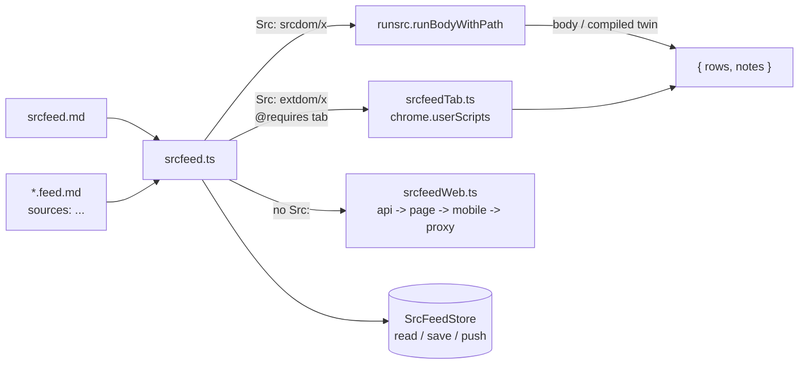

# srcfeed — one registry, one read

`srcfeed` reads the dynamic rows a source entry declares and hands them back with
`tid` unset. A feed item exists only on the wire, so nothing is written until a
caller pins, tags or clicks a row; the feed document keeps only the items a read
found. That is the same split [sTag.md](startag/sTag.md) keeps between scoring and
writing.

`srcfeed.md` declares every source once. A feed document — any `*.feed.md` — names
entries from that registry and keeps its own schedule and the blocks its reads
wrote. An entry with a `Src:` row is read by that row (a site adapter, or a tab
adapter in the extension); an entry without one follows the built-in web walk.

`srcfeed.md` is the only registry to write. `webfeed.md` and `extsrc.md` are
legacy: an installation that still holds them is read through the adapter in
`src/srcfeed.ts` until it seeds `srcfeed.md`. Their `type='src'` rows
(`webfeed/extract.js`, `extsrc/extract.js`) keep working through `run_src`.

## Where it sits

| Piece | File | Owns |
|---|---|---|
| Registry + read | `src/srcfeed.ts` | `srcfeed.md`, the `*.feed.md` dialect, the read loop, trimming, the block write, `globalThis.srcfeed` |
| Store port | `src/srcfeedStore.ts` | `daRead` / `daEdit` / `greet` behind `SrcFeedStore` |
| Web walk | `src/srcfeedWeb.ts` | the `## Sources` dialect, strategies, backoff, payload readers, the row plan, the commit port, `globalThis.webfeed` |
| Tab port | `src/srcfeedTab.ts` | the extension probe, tab match, `chrome.userScripts.execute`, the refusal catalogue |
| Rows | `src/srcfeedRows.ts` | the seeded registry and bodies, `w.feed.md`, `y.feed.md`, `x.feed.md`, compiled twins |
| Readout | `src/ui/FeedTip.tsx` | the hover preview the pin card's `{*.feed.md}` token shows |
| Tokens | `src/ui/cs1Token.ts`, `src/ui/cs1.tsx` | `{ref}` and `#tag` tokens split out of a pin card heading |
| Routing | `src/runsrc.ts` | `@requires tab` detection, the tab-runner seam, `eval-blocked` |

The engine imports no Dexie or React: a read reaches the store through
`SrcFeedStore`, so a test passes its own port and the app passes
`srcfeedStore.ts`.

## The registry (`srcfeed.md`)

```md
## Sources

### sina
* URL: https://www.sina.cn/media/1402400261
* Src: srcdom/sinaCNmedia
* Proxy Headers:
  - X-Return-Format: html
* Tags:
  - media

### dsc
* URL: https://chat.deepseek.com/*
* Src: extdom/dsc
* Item: a[href^="/a/chat"]
* Prompt: open the history sidebar in the DeepSeek tab
* Tags:
  - deepseek

## Fallback

* Proxy URL: https://r.jina.ai/
* Retries: 2
```

| Key | Where | Meaning |
|---|---|---|
| `* URL:` | entry | the page; `rec.src` on every row, and the tab match pattern for a tab adapter. An entry with only `* API:` is valid |
| `* Src:` | entry | ref of the `type='src'` row that reads this entry end to end; omit it for the web walk |
| `* Type:` | entry | row `type`; `url` by default |
| `* API:` | entry | `- name: url` requests the web walk tries first, read as JSON |
| `* Session:` | entry | names the caller's session-aware reader; skipped when the caller supplies none |
| `* Mobile:` | entry | mirror the `mobile` strategy requests; empty derives one when the URL carries an id |
| `* Proxy Headers:` | entry | headers the `proxy` request adds, one `- name: value` per line |
| `* Limit:` | entry | rows kept from this source; `0` keeps every row |
| `* Sidebar:` | entry | selector that says the page needs a manual step; consulted only when `Item:` matched nothing |
| `* Item:` | entry | selector for one tab entry; the list it matches decides whether the page was read |
| `* Scroll:` | entry | container to exhaust before reading a virtualized list |
| `* Mode:` | entry | `dom` reads text and href; `html` also keeps each `outerHTML` under `rec.html` |
| `* Max:` | entry | tab rows returned, 200 by default |
| `* Prompt:` | entry | what the user sees when `Item:` matched nothing |
| `* Tags:` | entry | `- tag` lines every row of this entry carries |
| `* Proxy URL:`, `* Retries:`, `* Base delay ms:`, `* Cap delay ms:`, `* Timeout ms:`, `* Limit:` | `## Fallback` | the web walk's retry budget, proxy root, and default cap |

A block with no `URL:` is skipped, and an unknown label is ignored, so a
hand-edited document still parses. `## Fallback` defaults are the table's values
above when the section is absent.

### Legacy registries (`webfeed.md`, `extsrc.md`)

`srcfeed.md` is the only registry to write; a held `webfeed.md` or `extsrc.md` is a
read-only input, not another place to declare a new source. The legacy dialect is
the same `## Sources` / `### name` / `* Key:` one above. A held `webfeed.md` may
carry:

```md
### wallstreetcn
* URL: https://wallstreetcn.com/live/global
* API:
  - lives: https://api-one.wallstcn.com/apiv1/content/lives?channel=global-channel&limit=30
* Tags:
  - finance
  - cn

### sina-fly51fly
* URL: https://www.sina.cn/media/1402400261
* Proxy Headers:
  - X-Return-Format: html

### weibo-fly51fly
* URL: https://weibo.com/u/2337530130
* Session: weibo
```

The legacy `webfeed/extract.js` body accepts `ctx.args` overrides for one call:
`sources`, `url`, `name`, `limit`, `proxy`, `retries`, `baseDelayMs`, `timeoutMs`,
and `existing`, which is how one `run_src` call reads a single block or a URL the
document does not hold. `extsrc.md` entries run the legacy tab body
`extsrc/extract.js`.

## The feed document (`*.feed.md`)

The dialect belongs to the suffix, not to one name. `w.feed.md` is the default ref
and the one the seeder writes; any other `*.feed.md` a pin card points at is read
the same way.

```md
# w.feed

## Setup
freq: 2hr
next: 2026-10-16T09:00:00Z
sources: wallstreetcn sina

## Notes
the user's own prose

## Posts as of 2026-10-16T07:00:00Z
- **wallstreetcn** 央行… — https://wallstreetcn.com/livenews/42
```

| Field | Meaning |
|---|---|
| `freq:` | the span between reads, e.g. `2hr`, `30 min`, `2d`; no `freq` and no `next` means nothing reads on its own |
| `next:` | when the next read is due; every read writes `last read + freq` |
| `sources:` | entry names, separated by spaces or commas; **empty reads every entry without a `Src:` row** |
| other `key:` lines | kept and shown by the readout, never acted on |

A tab source is never implicit: running one would execute in whichever tab matches
first. A name the registry does not hold is a per-source note, not a failed read.

A section whose name opens with `Posts` is one read's output, and its heading's
stamp is the read's time. A read inserts its block **directly under `## Setup`** —
newest first, older blocks below it — or at the end of the document when nothing
follows `Setup`; `next:` moves in place. A read that finds no new item writes no
block but still moves `next:`.

**A ref with no row yet.** `feedDraft(ref)` is the text such a ref opens with: the
same template, titled after the ref (`x.feed.md` opens as `# x.feed`). The editor
uses it for a tab whose ref has no row (`src/ui/editor.tsx`), so the buffer holds a
feed document from the first keystroke and nothing is persisted until the user
saves it.

`{srcfeed.md}` is the exception: opening it when no feed document exists at all runs
`seedSrcFeedRows` first, so the registry, the site adapter, the two tab adapters and
the example feeds land in one step. An existing `webfeed.md` or `extsrc.md` is a
registry too (read through the adapter), so the example is not written over it; a
tombstoned registry is a deletion, not a missing one. The seed helper keeps any live
row it finds.

## Paths



## One read

1. Read the feed document and the registry (`srcfeed.md`, else the legacy adapter).
2. For each named entry, run its `Src:` row through `runsrc` — the row text, its
   compiled twin, or the tab runner — or walk the web strategies when it has none.
   A missing seeded `Src:` row (`srcdom/sinaCNmedia`, `extdom/dsc`, `extdom/ge`) is
   created from the seed catalogue before the row is read; a tombstoned one is left
   deleted.
3. Normalize each row: `rec.feed` = entry name, `rec.strategy` = the path, a stamp,
   and the entry's tags.
4. Trim each source at the oldest post the last read stored for it — the last line
   that source has in the newest block that names it, matched by the post's URL when
   it carries one, because an item's `[转发 …]` counts tick between reads — then drop
   every row the document already holds for that source, by URL or else by text
   without its counts. A source shared by two feeds stops at the same row in both.
5. Write one `## Posts as of <stamp>` block and move `next:` to the read's stamp
   plus `freq`. Write nothing when no source answered.

The anchor is a position in the live list, and a list that keeps a pinned head at
its top holds it near that top: trimming alone would then stop at the pins on every
read. The stored-key pass leaves only the rows above the anchor that the document
has never listed — the pinned head, and any chat the page lists twice. One
consequence is deliberate: a chat that is only retitled or reactivated keeps its
URL, so it counts as stored and is not written again.

The written row is pushed like any edit. A document whose `next` has passed is read
once by itself when the preview opens (at most once per five minutes per ref), so a
stale feed catches up as soon as it is looked at.

## The built-in web walk

One entry without `Src:` is tried by several strategies in order, and the first
that answers with items ends the walk:

| Strategy | Request | Read as |
|---|---|---|
| `api` | each `* API:` URL | JSON |
| `cookied` | the caller's reader, for a `* Session:` entry | its items, or a body |
| `direct` | `* URL:` | JSON, else the document's posts, else Markdown |
| `mobile` | the page's mobile mirror | JSON, else the document's posts, else Markdown |
| `proxy` | `<proxy>/<URL>` | Markdown, or the document's posts when the entry asks for HTML |

`mobileUrl` carries the numeric id a URL already names over to
`https://m.weibo.cn/u/<id>`, so `weibo.com/u/2337530130` and
`sina.cn/media/1402400261` reach the same account on two sites. A URL with no id
yields none, and `* Mobile:` overrides the derivation.

A body is read for what it is: JSON when it parses, the posts of an HTML document
when it is one, else Markdown. An HTML body is read **only** for its posts, so a
page with no post markup yields no items and the walk tries the next strategy. A
`sina.cn/media/<id>` page renders server-side: one item is one
`<a class="post-link">`, `post-text` is the post, `post-repost` the quote,
`post-actions` the numbers (转发, 评论, 赞), `time` the stamp, and the anchor's
`href` the post's URL. The stamp is Beijing time. A post with no `href` keeps a
ref hashed from its body, so the counting numbers never change its identity. In a
browser `sina.cn` sends no `Access-Control-Allow-Origin`, so `direct` and `mobile`
fail and the walk reaches `proxy`; the seeded entry asks the proxy for HTML with
`* Proxy Headers: - X-Return-Format: html`, because the proxy's Markdown drops the
markup the posts are read from. The same applies to any entry whose posts only
exist in HTML.

Every request retries on what a retry can fix — a thrown error, a timeout, 429,
5xx — with `base * 2^attempt` capped, and gives up on what it cannot: a 403, a
redirect into a login page, a 200 that carries a wall, or an empty body
(`blockedText`). Giving up is per strategy, not per source: the next strategy is
the answer to a wall. The delay is exponential and jittered; tests pass
`random: () => 1` to make the sequence exact.

**Rows and persistence.** `planFeedRows` turns items into `FeedDa` rows with no
`tid`, and `commitFeedRows(port, das)` writes them when a caller pins, tags or
clicks. Tagging needs no adapter: `srctag.tagRows(rows)` accepts a `tid`-less row.

## The tab port

A row whose header says `// @requires tab` reads a live page. It cannot run in the
caller's realm — an MV3 extension page forbids eval, and a webapp has no tab
access — so `srcfeedTab.ts` runs it through `chrome.userScripts.execute` in the
matching tab. Chrome compiles the code; the extension never evaluates row text.

The body receives `ctx = { ref, args, console }` — no `db`, because it runs in the
page's origin. It reads its entry from `ctx.args.source` and returns
`{ rows, notes }`, or `{ needsUser }` when `Item:` matched nothing and the entry
names a `Prompt`.

| state | when | what the user sees |
|---|---|---|
| `not-extension` | the webapp runs a tab row | the row needs the extension |
| `user-scripts-off` | `chrome.userScripts` is withheld, or the probe fails | `Allow User Scripts`, the `chrome://extensions` steps, the Chrome 138 Developer-mode note, and the API link |
| `no-tab` | no open tab matches `URL` | the pattern, and "open it in a tab, then run again" |
| `needs-user` | `Item:` matched nothing and the entry names a `Prompt` | the entry's `Prompt` |
| `missing-source` | the caller passed no source block | run it through a `.feed.md` source |
| `eval-blocked` | no twin, and this realm forbids eval | open the app at its own origin, or add `@requires tab` |

A refusal throws `SrcUnavailableError`; `run_src` prints its message and steps, so
a model sees the same instructions a person does.

## The pin card token and its readout

A pin card heading may carry a `{ref}` token next to its `#tag` tokens
(`src/ui/cs1Token.ts`, rendered by `Cs1Renderer`). A click opens the ref as a tab,
and a `*.feed.md` ref with no row opens on `feedDraft`'s template. The hover shows:

- every other ref previews as the row it names;
- any `{*.feed.md}` previews the feed (`src/ui/FeedTip.tsx`): the frequency, when
  the next read is due, the `srcfeed.md` entries it reads and the host of each —
  with a `not in srcfeed.md` note for a name the registry does not hold — and the
  items of the newest `## Posts as of …` block;
- its `refresh` button runs one read now, into that ref.

## Seeding and `run_src`

Seeding is explicit, exactly as for the `srctag/*` rows — and opening a pin card's
`{srcfeed.md}` token on a fresh installation runs it for you:

```ts
import { seedSrcFeedRows } from './src/srcfeedRows';
import { db } from './src/sdb';
await seedSrcFeedRows(db.das);   // keeps any live row the user already has
```

A live row is never overwritten; `clearSrcFeedRows` tombstones what was written so
the removal syncs. A single missing catalogue row can be written on its own with
`await sdbSrcFeedStore().ensure('srcdom/sinaCNmedia')`; a normal read does that for
any `Src:` ref it cannot find, so a refresh is usually all it takes. The catalogue
also carries the legacy `extsrc/extract.js` body, so an old `extsrc.md` heals the
same way. A custom `Src:` ref that is missing is reported, never guessed. With the rows in place:

```
run_src { ref: 'srcdom/sinaCNmedia', args: { source: { name: 'sina', url: 'https://www.sina.cn/media/1402400261' } } }
run_src { ref: 'webfeed/extract.js', args: { sources: ['wallstreetcn'], limit: 5 } }
```

The first is the site adapter with the entry `srcfeed` would pass; the second is
the legacy document body, whose report names the strategy that answered each source.

## Tests and the live findings

| Test | Covers |
|---|---|
| `test/startagfeed/srcfeedRun.test.ts` | mixed web/`Src:`/tab/twin reads, trimming and the stored-key dedupe under a pinned head, `next:`, legacy `webfeed.md` |
| `test/startagfeed/srcfeedDoc.test.ts` | the `*.feed.md` dialect and its write rules |
| `test/startagfeed/srcfeedWeb.test.ts` | the strategy walk, payload readers, the legacy body, the live findings |
| `test/srcfeedTab.test.ts` | the tab body, the item-first sidebar check, the refusal catalogue, the environment probe |
| `test/runsrc.test.ts` | `@requires tab` routing, the compiled twin registry |

`srcfeedWeb.test.ts` opts into the network with `WEBBFEED_E2E=1`; it reads the
legacy seeded sources and writes `test-artifacts/webfeed-findings.json`. Measured
2026-10-15:

| Source | `api` | `cookied` | `direct` | `mobile` | `proxy` (`r.jina.ai`) | Answers |
|---|---|---|---|---|---|---|
| `wallstreetcn` | 200 JSON | — | — | — | — | **`api`**, 3 rows |
| `sina.cn/media/…` | — | — | 200 | not reached | — | **`direct`**, 3 rows |
| `zhihu.com/people/…` | 200 `{"data": []}` | — | 403 | — | 200 CAPTCHA (`安全验证`) | none |
| `weibo.com/u/…` | 200 visitor system | throws | 200 visitor system | 200 visitor system | 200 visitor system | none |

A dash means the strategy did not run: `sina` answers at `direct`, so its derived
mobile mirror is never requested, and the `zhihu` page carries no id for
`mobileUrl`. `m.weibo.cn` is not a way around the wall: the weibo and sina mirror
hosts redirect there and land on `visitor.passport.weibo.cn`'s challenge, so the
readable copy is the `sina.cn` mirror. Both walls are 200s, which is why
`blockedText` exists. A run where no source answers warns and passes;
`WEBBFEED_E2E_STRICT=1` turns that into an assertion.

## Related

- `docs/startag/sTag.md` — the tag layer the extracted rows feed.
- `docs/recr-agloop.md` — `run_src`, the `rwr` gate, and the `secret.md` dialect.
- `docs/script-post.md` — the CSP facts, the realm matrix, and the ScriptCat prior art.
- `docs/extsrc-plan.md` — the plan that introduced the tab runner.

