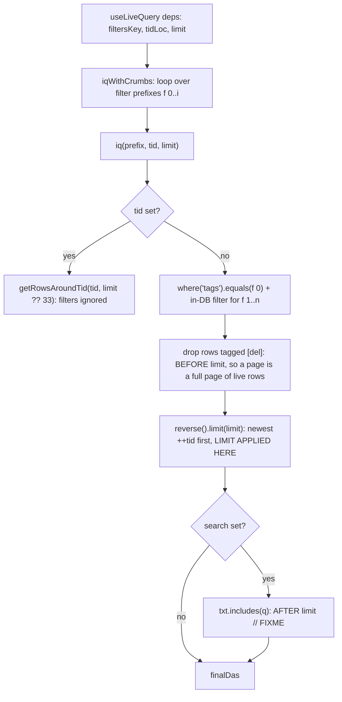

# Filter read path

`f` (filters csv) drives one reader: `useLiveQuery` -> `iqWithCrumbs` -> `iq`. `limit` decides how many matching rows are read; the `[del]` tombstone drop runs inside the query, so a page holds `limit` live rows and a short page means the table has no older ones. The one place a query reaches rows is the search box, and it reads the page rather than the query ([below](#the-search-box)); `iq` keeps its own `search` argument (`src/sdb.ts:100`) unused.

## Order of operations

Dexie applies a collection `filter()` before `limit()`, so the tombstone drop is part of the query (`src/sdb.ts:143`) and a page shorter than asked for means the table has no older live rows. Order is descending `++tid` (insertion), not `rec.visitTime`. `search` is still a post-limit filter, with its own `FIXME`.

## View switch

`treeCac['tabSeer']` selects the view, `treeCac['cardSeer']` the pin-row renderer, `treeCac['restGrouper']` how the rows below the pins are grouped (`src/sdb.ts:133-137`), and `treeCac['cropWidth']` how wide a cropped row may grow before it scrolls.

| Setting | Value | View |
|---|---|---|
| `tabSeer` | `'card'` | `BadCardTab` (`src/ui/tabs.tsx:41`), fixed 555-row window |
| `tabSeer` | anything else | `CardTab` (`src/ui/cardTab.tsx`), window grows by page |
| `cardSeer` | `'cs1'` | pin rows render `Cs1Renderer` (`src/ui/cs1.tsx`): a heading's `#tag` buttons select the tag and its `{ref}` tokens open the row in the editor (a missing `*.feed.md` opens on its template, unpersisted), with a feed ref previewing the feed ([webfeed.md](../webfeed.md#the-pin-card-token-and-its-readout)) |
| `cardSeer` | `'cs2'` | pin rows render the cropped preview row (`Cs2Renderer`) |
| `restGrouper` | `'rsdt'` (the block-only default) | rest rows split into one block per exact `dt`, newest first (`src/ui/restGrouper.ts`) |
| `restGrouper` | `'rsid'` | `rsdt` plus one visit-time subgroup per exact `rec.visitTime` inside each date block; rows without a visit time stay under the date heading |
| `restGrouper` | `'rstag'` / `'rstext'` | the `rsdt` blocks unchanged, plus each row's `srctag` suggestions as dotted-outline chips in a cropped, scrollable strip (solid and italic for a promoted `parent/theme` sub-tag); hovering a chip names the channels that produced it and every scored row proposing it ([sTag.md](sTag.md#read-only-chips-restgrouper-rstag)) |
| `restGrouper` | `'rsfreq'` / `'rstrank'` / `'rstt'` | the same blocks and chips scored by one channel family instead of the fused mix — TF-IDF, the two TextRank walks, or the TurboText trie — with the pin cards' `#tag` headings as the priority tags, the aim pass on, and a visualization switch plus hyperparameters above the blocks ([sTag.md](sTag.md#algorithm-groupers-rsfreq-rstrank-rstt)) |
| `restGrouper` | `'rrf'` | the same blocks and chips scored by the 3-stage chain of `src/rstag.ts` — TurboText candidates, BM25F over the title and the row's tags, then a rank fusion of that with the semantic and TextRank lists — with the pin cards' headings as the priority tags, sub-tags discovered per burst by c-TF-IDF, and the URL plus any provenance tag or filter term dropped before scoring ([rstag.md](rstag.md)) |
| `restGrouper` | `'qarf'` (what a fresh table opens on, `DEFAULT_REST_GROUPER`) | the same chain and the same blocks, fused with a weight that follows each row: a title of rare tokens leans on the lexical lists and a title of common words on the neighbour walks, off corpus IDF statistics the pass already has. `qarf α` 0 is `rrf` exactly ([rstag.md](rstag.md#the-adaptive-weight-qarf)) |
| `restGrouper` | `'none'` or empty | rest rows render flat, without headings |
| `restGrouper` | any other ref | the `type='src'` row of that ref returns the blocks; a block carries `items`, `subgroups`, or both. A missing row, a throwing body, or a result that is not an array of blocks falls back to flat |
| `cropWidth` | any CSS width | the cap every `.crop-scroll` row scrolls past; default `max(33.33%, 222px)` |

Every built-in sorts the rows by `tid` descending before grouping, so each block
reads in insertion order (`iq` already returns that order).

`cardSeer`, `restGrouper` and `cropWidth` apply without a reload: all three are
read through `useTreeCac` (`src/ui/useTreeCac.ts`), which subscribes to the `tree`
row the settings menu writes. `tabSeer` still reads `treeCac` directly at render.

## Row cropping

One rule crops every row that can outgrow its column — a cs1 match
(`.cs1-match`), a cs2 `da-row` in either card tab, and a rest-tag chip strip
(`.rest-tag-chips`): `.crop-scroll` in `index.html` caps the width, scrolls
sideways, and draws a 1px WebKit hairline bar instead of the 8px global
scrollbar. The whole text stays in the DOM and is clipped rather than sliced, so
browser find-in-page still matches the hidden tail; `scrollbar-width` stays
unset, because specifying it would make Chromium drop the `::-webkit-scrollbar`
rules.

The width is one setting: `src/ui/cropWidth.ts` writes `treeCac['cropWidth']` to
`--crop-w` on `documentElement`, and the rule falls back to `max(33.33%, 222px)`
while no row has read it.

## CardTab vs BadCardTab

| | CardTab | BadCardTab |
|---|---|---|
| call | `iqWithCrumbs(filtersStable, undefined, Number(tidLoc), limit)` (`src/ui/cardTab.tsx:86`) | identical (`src/ui/tabs.tsx:48`) |
| deps | `[filtersKey, tidLoc, limit, retryKey]` (`:89`) | `[filtersKey, tidLoc]` (`src/ui/tabs.tsx:52`) |
| limit | `useState(PAGE)` with `PAGE = 555` (`:71`), reset when `filtersKey`/`tidLoc` change (`:97-99`) | constant 555 (`src/ui/tabs.tsx:42`) |
| growth | sentinel `IntersectionObserver` for the list's lifetime (`:210-216`) sets `atEnd`; a state effect widens the window while `canGrow = !tidLoc && !loading && das.length >= limit` (`:201`, `:220-222`). `loading` is `page.limit !== limit` (`:94`), the rows carrying the limit they were read at | none |
| slow read | a load still in flight after `LOAD_TIMEOUT_MS` (`:21`) reports "Still loading after 8s" with a `Retry`, which re-runs the read through `retryKey` (`:225-229`) | none |
| rows | pin rows in a 66vh split, then rest rows grouped by `restGrouper` | same |
| page end | `Loading...` / `Loading more...` / `Scroll for more` / `No more data` / `No data found`, plus a manual `Load more` while the last page came back full (`:233-238`) | `No data found` only when the page is empty |

Same call and same arguments at the same `limit`: CardTab never returns rows BadCardTab would not return; only the growth differs. `FilterBar` reads the same way at a fixed 555 for its crumb options (`src/ui/FilterBar.tsx:51`).

## Looks like fewer CardTab results, but is not the query

| Cause | Evidence |
|---|---|
| Pins occupy a fixed 66vh, each row squeezed to `66/pinCount vh` with its own `overflow: auto` | `src/ui/cardTab.tsx:124`, `:129` |
| `.rest-das` has no height, so `.left-panel` scrolls the whole view instead | `src/ui/cardTab.tsx:145`, `index.html:36` |
| `card-tab`, `pin-cards`, `pin-card-row`, `rest-das`, `rest-group`, `rest-group-head`, `end-message` have no rule in `index.html` or `src/tw4.css` | inline styles only |
| the sentinel reports the state but no row count, so a window of 555 rows and one of 5550 read the same | `src/ui/cardTab.tsx:233` |

## Crumb cache

Only crumbs are cached: `availableDas(tags)` keyed by `{f, s, t, l}` (`src/sdb.ts:210-215`); `iq` re-runs per prefix on every read (`:227`). Crumbs therefore inherit both the limit and the tombstone drop.

## The search box

The user bar's omnibox (`SearchOmnibox`, `src/ui/tap.tsx`) is the one query that reaches
rows, and it does not go through `f`: it reads a page with no filter and no limit
(`iq([])`) and filters it in JavaScript, so typing never re-runs a Dexie query and never
touches the crumb cache. The match is one substring, lower-cased, against a row's `ref`
**or** its `txt`, capped at 12 rows — so `ref` is reachable here, which `iq`'s own
`search` argument (`txt` only) cannot do, and a multi-word query matches only where the
whole phrase appears.

The box shows three zones, in the order they are consulted:

| Zone | When | Read from |
|---|---|---|
| matches | a query is typed (180 ms debounce) | the page above |
| suggested | the box is focused and empty | `restTagStore.rank` — the last rest-list pass's own reports |
| recent | the box is focused and empty, below the suggestions | `availableDas` over the page, top 5 |

`Up`/`Down` move the highlight, `Enter` opens the highlighted row in the editor, `Escape`
closes the list, and `Shift+Enter` tags only that row with the query. The `#<tags>` row
tags every match, and a click on a suggested tag applies it to the rows that suggested
it. Both are `src/ui/tagApply.ts`: add-only, written through `daEdit` so the `rec.ver`
shelf survives, with the applied tags offered back as an undo toast. The query's tokens
are the priority tags of that write (`tokenize`, capped at `MAX_QUERY_TAGS`), which is
what keeps a long query from drowning each row's own terms.

Focus also widens the bar: the box takes the toolbar's free width and its panel reaches
the screen's left edge. The chrome, the drag handle and the settings rows around it are
[ui.md](ui.md#the-bar-and-the-settings-rows)'s.

## Tagging (`src/srctag.ts`, `src/srctagRows.ts`)

How a row's `tags[]` are scored and written is documented in [sTag.md](sTag.md), split by
methodology: the static channels in `src/srctag.ts` (TF-IDF, TextRank, the TurboText
keyword automaton, `hashEmbed`, the priority and classifier shares) and the dynamic
`type='src'` rows `run_src` evaluates (`srctag/embed.js`, `srctag/classify.js`,
`srctag/suggest.js`, `srctag/suggest-ds.js`). The rest list's own pass and the `rrf`
grouper's pipeline are [rstag.md](rstag.md).

This document keeps what the read path needs: `rstag` and `rstext` in the View switch
above render those suggestions as chips, and the hover preview prints the per-channel
shares `explainTag` computes.

## Hover preview

Any row of the list previews itself on hover — the cs1 pin-card matches
(`.cs1-match`, `src/ui/cs1.tsx`) and every rest row (`Cs2Renderer`,
`src/ui/cardTab.tsx` and `src/ui/tabs.tsx`), `http(s)` and recr rows included. Only
the cs2 pin row keeps its native `title` tooltip.

One popover serves the whole list (`src/ui/Tip.tsx`): a single `mouseover` /
`focus` pair on a `display: contents` wrapper, a 160 ms hover delay, and a
200-entry markdown cache. Rows register themselves through `setTip` in a `ref`
callback, so no list re-render is needed to keep previews current.

The body follows `da.type`: `md` renders markdown (math deferred, below) inside
`.tip-md`, which restores the heading weight, list markers and block margins
Tailwind's preflight flattens; `src` shows the row through the editor pane's
CodeMirror setup read-only, highlighted as JavaScript whenever the ref's suffix
names no other grammar; every other type prints `txt || ref` as plain text, which
is what a link row shows. A row may instead register a `kind` and get that kind's
own body: the cs1 `{w.feed.md}` token renders the feed readout in place of the row,
so the preview shows the schedule, the sources read and the stored items rather than
the markdown of the document that holds them
([webfeed.md](../webfeed.md#the-pin-card-token-and-its-readout)). The first line carries
the sync ages, `tid: <n>` when the row has one, and the row's tags as chips colored
by `getColorChar11` — the same color `cs1` gives that tag's button.

The popover is placed flush under the row (`top: row.bottom - 1`) with its left
edge on the list container's, so every row of one list previews in the same
column and the pointer can still travel down into it. `tipFittedLeft` slides the
rendered panel left when a wide body would leave the viewport's right edge.
Leaving the row starts a 220 ms close timer that the popover cancels on entry, so
a hover that ends on the preview stays open.

## Markdown parse and render

`src/md.ts` holds two markdown-it instances, `mdParse` (`html: true`) and
`mdRender` (`html: false`). Rows come from another device through Postgres, so
display escapes raw HTML; parsing keeps it as a node so a slice reproduces the
source. Both disable `table` and `strikethrough` to match the line-based split
the rows were captured against.

`src/mdTree.ts` builds an mdast-shaped tree from markdown-it tokens: block ranges
from `token.map` through a line-offset table, inline offsets by scanning between
block markers. The row builders (`src/ui/remark-list.ts`, `src/conv_md_yaml.ts`,
`fc.md2tag`) keep their offset arithmetic unchanged and read that tree.

Math is `$..$` (inline) and `$$..$$` (display). Rules emit `` holding the TeX; `hydrateMath` imports `temml` on the first formula and
replaces each placeholder with MathML. `temml` therefore stays in its own chunk
and the preview never waits for it.
