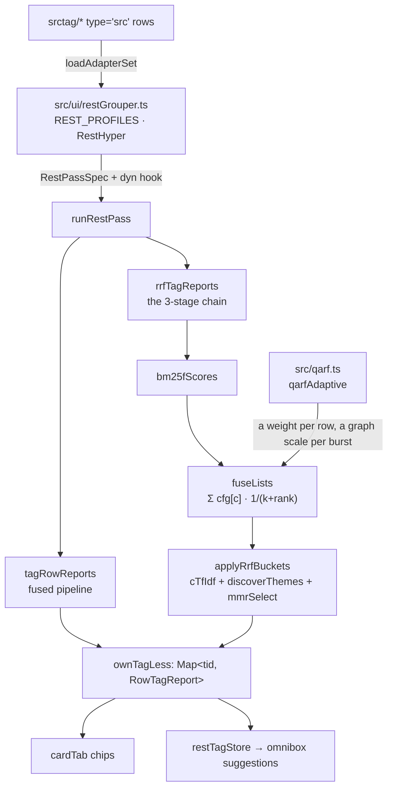
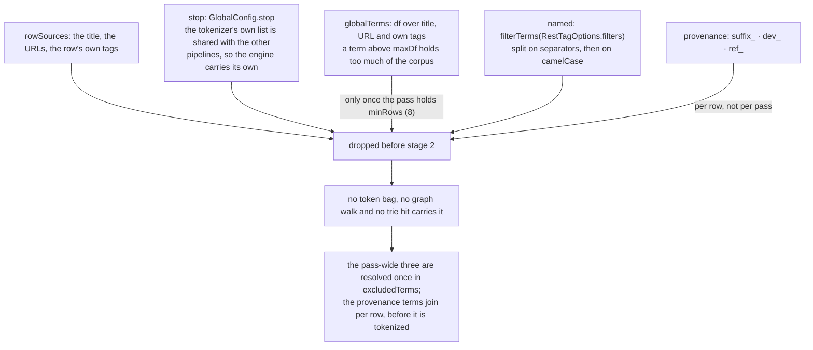
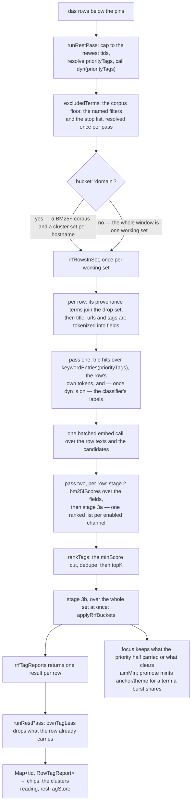
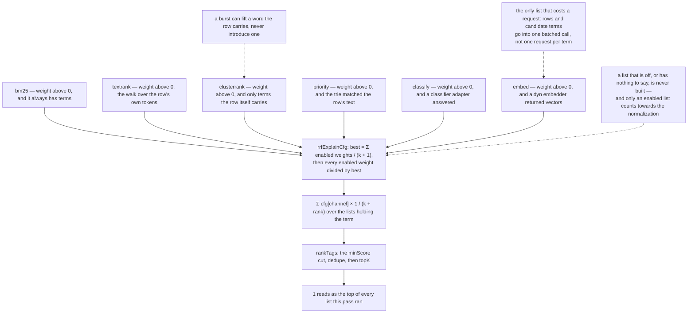
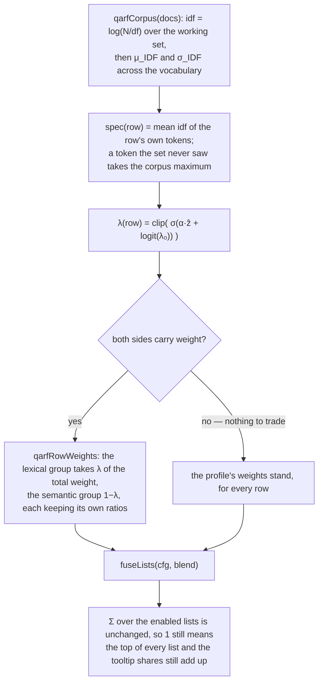
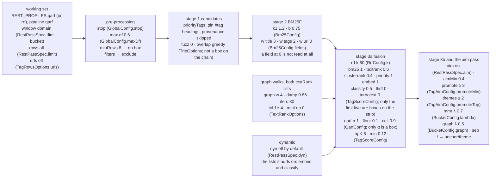
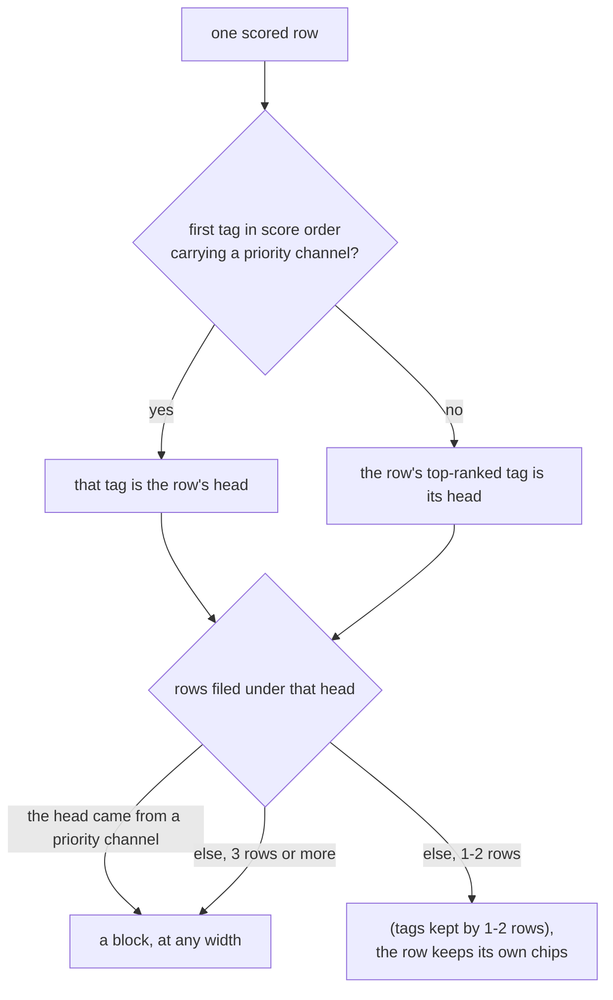

# The rest-list tagging engine (rstag)

`src/rstag.ts` is the engine behind the rest list's tag chips: the pass every tag grouper
runs, and the 3-stage chain the `rrf` and `qarf` groupers score with. `src/qarf.ts` is the
adaptive half of that chain — the fusion weight the `qarf` grouper reads off each row
instead of one channel split for the whole pass. [sTag.md](sTag.md) owns the *evidence* —
what a tag layer is for, `srctag`'s channels, the dynamic `type='src'` rows, the write
path. This document owns what the list does with that evidence: the pass, the chain, its
pre-processing, the knobs a reader turns, and the measurements those knobs were chosen
from. The readings those reports are drawn as — the sea, the pin bands and the disc — are
[ui.md](ui.md)'s.

The engine is where the family is heading. The fused `rstag`/`rstext` preset is the older
reading — a weighted channel sum — and the chain is the matured one: candidates from an
exact matcher, ranked by BM25F, fused by rank rather than by score, then expanded per
burst. `rrf` fuses it with the profile's weights; `qarf` fuses the same lists with a weight
that follows the row, so a title of rare tokens leans on the exact lexical lists and a
title of common words on the neighbour walks. `qarf` is the stored default and `rrf` stays
selectable, and at `qarf α` 0 the two are the same reading exactly — which is what makes
their difference measurable. The [maturation plan](#maturation-and-retirement) below says
what replaces what, and what has to keep working while it does.

## Where it sits

```
src/ui/restGrouper.ts   REST_PROFILES · RestHyper · the srctag/* adapters · grouping
        │  RestPassSpec { dim, score, limit, pinsPriority, aim, pipeline, qarf, dyn }
        ▼
src/rstag.ts            runRestPass · restTagMap · restTextMap · caps · the 3 stages
        │
        ├──────────────────────────────┐
        ▼                              ▼
src/qarf.ts             the adaptive weight: corpus IDF, λ(q), the per-burst scale
        │
        ▼
src/srctag.ts           tokenizer · trie · TextRank · TagParts · explainTag
```



The dependency runs one way: the UI imports the engine, `qarf` imports the engine for its
chain mechanics, the engine imports `srctag`'s primitives, and nothing imports the UI or
`qarf` back. That is what lets the engine be tested without Dexie, and it is the direction
a future move of `srctag`'s lexical core has to keep. `runRestPass` therefore reaches the
adaptive chain through `RestPassSpec.qarf` — the profile, which imports both, hands the
weighting and the chain's entry point over.

The split is along what each side can know:

| Module | Knows | Does not know |
|---|---|---|
| `src/ui/restGrouper.ts` | which groupers exist, their defaults, the tuner's overrides, the `srctag/*` adapter rows, the rows and pins on screen | how a row is scored |
| `src/rstag.ts` | how a pass is run and scored, what the pre-processing drops, how a row's ranked lists are fused | the store, the DOM, React, any grouper ref |
| `src/qarf.ts` | how specific a row's own text is against its working set, and what that does to its channel split | the chain's stages, the store, the DOM, React |
| `src/srctag.ts` | tokenizing, the trie, TextRank, the vector maths, the channel vocabulary, the write path | which list is on screen |

## The pass

`runRestPass(das, spec, opts)` is the body every grouper shares:

1. **Cap.** Newest `tid` first, sliced to `opts.limit ?? spec.limit`.
2. **Resolve the priority tags.** `opts.priorityTags`, else the pin cards' `#tag` headings
   when `spec.pinsPriority`, else the scored rows' own tags. For either chain pipeline the
   fallback skips provenance tags — a `dev_saOpera` on every row is the capture context,
   not a topic, and its terms are dropped from the evidence anyway.
3. **Resolve the dynamic channels**, by calling `spec.dyn(priorityTags)` when the profile
   has one. The hook is the seam that keeps the store and the network out of the engine: a
   caller with no store simply supplies no hook and the pass runs on the lexical channels.
4. **Score**, through `tagRowReports` (the fused pipeline) or `rrfTagReports` (the chain,
   with the adaptive weighting when the spec names one), with the dimension, bucket,
   weights, window, aim and pre-processing the spec names.
5. **`ownTagLess`.** Key the reports by `tid` and drop every tag the row already carries,
   so a chip only ever shows what the pass would *add*.
6. **Return** `Map<tid, RowTagReport>` — the shape `cardTab.tsx` renders and
   `restTagStore` ranks.

`RestPassSpec` is the fixed half of a pass; [sTag.md](sTag.md) documents `RestTagOptions`
as the caller's half.

| Spec field | Meaning |
|---|---|
| `dim`, `bucket` | the ordering the window and clusters are measured on, and whether each hostname is scored as its own working set |
| `score` | channel weights and cut-offs, folded over `DEFAULT_TAG_SCORE` |
| `limit`, `pinsPriority`, `aim` | the cap, the priority source, and the focus/promote knobs (`false` leaves the raw scores) |
| `pipeline` | `fusion` (the default), `rrf`, or `qarf` |
| `bm25`, `rrf`, `buckets`, `global` | the chain's stage knobs |
| `qarf` | the adaptive half of a `qarf` pass: the per-row weighting and the chain's entry point, handed over by the profile so the two modules stay acyclic |
| `dyn` | `(priorityTags) => Promise<TagRowsOptions>`: the dynamic channels, resolved by the caller that can reach the store |

Two entry points exist beside `runRestPass` so a caller can ask for a named reading
without a profile: `restTagMap` and `restTextMap`, both the fused pipeline with the aim
half off, the first over the insertion dimension and the second over the visit-time one
with the rows bucketed by hostname. Both are re-exported from `ui/restGrouper.ts`, which is
where the rest list and its tests reach them.

## Pre-processing

Four kinds of term sit on a row without being about it. Every keyword extractor has some
version of this step — TextRank's keyword pre-processing and YAKE's stop list both drop
them, and a hybrid retriever's document-frequency filter is the same idea. All four are
removed from the *inputs*, before stage 2.



- **A function word**, from `GlobalConfig.stop` (`DEFAULT_STOP_WORDS`). The tokenizer's
  `STOP_WORDS` is shared with every other pipeline and cannot grow without moving them, so
  the engine carries its own list of the English words that one leaves out: a short
  title's `vs`, `how` and `any` are central to its TextRank walk and rare enough to pass
  the frequency floor, which is how they become chips on a list of search queries. The
  tuner's `stop` box shows the shipped list.
- **A global term.** `globalTerms` counts the document frequency over the title, the URL
  and the row's own tags together and drops a term held by more than `maxDf` (0.6) of the
  rows. `minRows` (8) is the size below which a pass keeps every term: three rows make a
  term hold 100% of them at df 3, so a share with no corpus behind it is not a
  measurement.
- **A provenance tag**, by prefix (`PROVENANCE_TAG_PREFIXES`: `suffix_`, `dev_`, `ref_`).
  `suffix_` is the title tail `fc.txtRx` strips (`suffix_GoogleSearch`), `dev_` is what
  `sdb.dev_PREFFIX` names, and `ref_` is the domain tag that family reserved. Their terms
  are dropped from the row's own sources whatever their frequency — per row, not per pass,
  so a `dev_android` row does not silence `android` in another row's title.
- **A named term**, from `GlobalConfig.exclude`. `runRestPass` fills it from
  `RestTagOptions.filters` through `filterTerms`, which splits a value on its separators
  and again on camelCase boundaries — `suffix_GoogleSearch` is also `suffix`,
  `googlesearch`, `google` and `search` — and `cardTab.tsx` passes the filters it is
  rendering. A term the list is itself about tells a reader nothing about one row of it.

Removing a term from the *inputs* rather than filtering the result is the whole point: a
global term left in the token bag reaches a graph walk and comes back through a rank, and
a curated tag left in the trie proposes itself again. `excludedTerms` resolves the
frequency floor and the named terms once per pass, so "global" means global to the list
the reader is looking at whatever the window switch says; the provenance terms are added
per row before that row is tokenized.

## The 3-stage chain

The chain exists because an exact matcher is a recall layer, not a ranking one.



The knobs each of those stages reads, and the values the two chain groupers ship, are
mapped in [the parameter map](#the-knobs).

| Stage | What runs | Where |
|---|---|---|
| 1. Candidates | `TurboTextTagger.match`, plus the row's own tokens and the classifier's labels | `srctag` |
| 2. Statistical ranking | `bm25fScores`, BM25F over weighted fields | `rrfRowsInSet` |
| 3a. Fusion | `fuseLists`, by rank rather than by score, with the adaptive weight when the pass names one | `rrfRowsInSet`, `qarf` |
| 3b. Expansion | `cTfIdf` + `discoverThemes` + `mmrSelect`, what a burst is about | `applyRrfBuckets` |

### Stage 2: BM25F

`Bm25Config.fields` weights the three things a row says about itself — `title`, `url` and
the row's own `tags` — and each field's term frequencies are length-normalized by `b` and
pooled into one pseudo-frequency before `k1` saturates it and the corpus IDF scales it.
That is the whole of BM25F: one ranking function over a structured row rather than one
score per field that a caller has to reconcile. A field the config does not name, or
weights at 0, is not read at all — not read at weight 0, which would still put its length
into the corpus statistics and so move every other term's score.

The corpus is the pass's own working set, so under `bucket: 'domain'` it is one site's rows
and "rare" means rare within that site.

`url` is its own weight rather than a second copy of `TagRowsOptions.urls`: `urls` governs
the token bag the trie, the graph walks and the semantic list read, and the field reads the
row's URLs whenever its weight is above 0. The profile ships both off, because under a list
of one site's pages the hostname and the browser in the query string are on every row and
say nothing about any one of them — and because a URL term's IDF collapses when that is so,
the field alone cannot clean up a pattern it is the source of.

### Stage 3a: rank fusion

`fuseLists(lists, cfg, k)` scores every candidate a row's lists hold as
`Σ cfg[channel] × 1 / (k + rank)`. Ranks rather than scores are what gets combined, so a
BM25F weight and an embedding cosine need no calibration against each other — the reason
this is the fusion step and not another weighted sum. (`reciprocalRankFusion` is the
two-argument form of the same sum, kept for callers that want it without a chain.)

The preset enables up to six lists, one per channel with a weight above 0 and
something to say: BM25F, the row's TextRank walk, the burst's, the trie's curated tags, the
classifier's labels, and — when a `dyn` adapter supplies an embedder, which
`restDynCapable` offers because `RRF_TAG_SCORE` names the `embed` weight — a semantic list
ordering candidates by cosine against the row. Rows and candidate terms go into one batched
`embed` call, so a semantic list costs a request per pass rather than per term.



The fused score is normalized by the best the enabled lists could jointly give one term, so
1 means "the top of every list this pass ran". `rrfExplainCfg` divides the *weights* rather
than the result, which is what keeps `channels[].contribution` adding up to `score` — the
invariant every chip tooltip is read against. A consequence is worth knowing before tuning:
`1/(k+1)` is the most one list can give, so a term that tops a single list reaches 0.22 of a
six-list normalization and 0.33 once the dynamic pair is off — it clears `minScore` 0.12
either way, and on six lists it does not clear the aim pass's 0.4, which is what asking for
corroboration by two signals means here.

The statistical stage reports under its own channel, `bm25` (`TagParts.bm25`,
`TAG_CHANNEL_LABEL.bm25`), so a tooltip reads `bm25 0.02×20.33=0.33`: the value is a
reciprocal-rank term and the weight is the list's own share of the normalization. Its
weight defaults to 0, so every preset that does not name it scores exactly as it did before
the channel existed.

### The adaptive weight (qarf)

A fixed channel split assumes the same rankers are equally informative on every row. On a
rest list they are not: a title of rare, specific tokens is what the exact lexical lists
ranks well, and a title of common words — a paraphrasis of an intent — is what the
neighbour walks and the embedding list rank well. `qarf` reads that off corpus IDF
statistics the pass already has, following QARF (Rafeeq et al., DATA 2026). The sea's own
seed, its `base`/`trace`/`maxGraph` overrides, and the generated taxonomy are
[row=star.tagger.md](row=star.tagger.md)'s:

$$
\mathrm{idf}(t)=\log\frac{N}{df(t)},\qquad
\mathrm{spec}(q)=\frac1n\sum_i \mathrm{idf}(t_i),\qquad
\hat z(q)=\frac{\mathrm{spec}(q)-\mu_{IDF}}{\sigma_{IDF}}
$$

$$
\lambda(q)=\mathrm{clip}_{[\ell,u]}\Bigl(\sigma\bigl(\alpha\cdot\hat z(q)+\mathrm{logit}(\lambda_0)\bigr)\Bigr)
$$

Two things make this xbb's reading rather than the paper's. **The row is the query and the
candidate tags are the documents**, so λ is read per row from that row's own token bag
against the working set it is scored in — one corpus per site under `bucket: 'domain'`.
And the paper's two rankers become **two groups of lists**: the lexical side is `bm25` and
`priority`, the semantic side is `textRank`, `clusterRank` and — when `dyn` supplies them —
`embed` and `suggest`. `λ₀` is the lexical share the profile's own weights already stand
for, which is what `logit(λ₀)` shifts the sigmoid onto.



The rescale divides the *weights* rather than the result, exactly as `rrfExplainCfg` does,
and it keeps the pass's total weight — so a fused score of 1 keeps its meaning, and
`channels[].contribution` still adds up to `score` on a row whose weights moved. A report
therefore carries the weights that produced *that row's* score (`TagRowResult.weights`),
and a hover is explained with them rather than with the pass's.

At `α = 0` the sigmoid is flat at `λ₀`, so the two chain groupers score identically — that
is the control setting a sweep is read against, and it is exact rather than approximate,
because `qarfAdaptive` returns no blend at all rather than a blend that computes the same
numbers. The clip bounds the share, so no row silences either side; when one side carries
no weight at all — a pass with no semantic list enabled — there is nothing to trade and the
profile's weights stand.

### The adaptive theme stage

The same fixed-weight failure sits one stage later. `discoverThemes` mixes a burst's
c-TF-IDF with that burst's own TextRank walk through one `graph` weight: a burst of rare
tokens is about the terms only it holds, and a burst of common words about the terms it
keeps returning to. `qarf` reads a λ per burst from its pooled tokens and scales the walk
by `qarfLambda(−ẑ, ½) / ½`, which is 1 at average specificity — so `α = 0` leaves `graph`
exactly as the profile sets it, and a burst of rare tokens leans on the class statistic
while a burst of common ones leans on the walk.

The form is multiplicative rather than the convex blend of the row-level half, because the
existing mixer is multiplicative: `cTfIdf × (1 + graph × rank)`. A convex blend over
normalized halves could not reproduce today's score at the neutral point, and reproducing
it is the constraint the whole design is held to.

### Stage 3b: buckets

`applyRrfBuckets` is `applyTagAim`'s shape — focus, then promote — with the promote half
reading each burst as a class. `cTfIdf` scores a bucket's terms by their frequency *inside
it* times the log of how rare they are across the buckets, so a term every bucket holds is
discounted and the term one bucket holds is what that bucket is about; `discoverThemes`
folds in the bucket's own TextRank walk (`BucketConfig.graph`), and `mmrSelect` takes the
`promoteTop` most distinctive ones that are still apart from each other
(`BucketConfig.lambda`), so three ways of saying one word do not all become sub-tags. The
minted tag is `anchor/theme` with `origin: 'sub'`, the same shape the aim pass produces, so
the chips and the `themes` reading need no special case.

Evidence comes from the *pre-focus* lists, the same choice `applyTagAim` makes and for the
same reason: a filter cannot read a signal it has already erased. The consequence here is
that c-TF-IDF sees the terms focus dropped, so a sub-tag can name a term no chip above it
shows.

## The knobs

The profile (`REST_PROFILES.qarf`, with `rrf` beside it) and the live override (`RestHyper`)
are the UI's; the tuner strip, its label and its hover text are documented in
[sTag.md](sTag.md) — one row per control, one line of prose per knob in
`src/ui/restHelp.ts`. What matters here is which of them actually move a result, measured
on the user's own table rather than assumed:

The map below is the whole pipeline read as controls: one node per stage, in order, with
the tuner's own label first and the field the profile or the pass reads in parentheses.



| Knob | What it does to the chain's reading |
|---|---|
| `topK` | the only control that shortens a row's chip list |
| `stop`, `max df`, `urls`, `w url`, the provenance rule | what the chips are worth — the pre-processing is the quality knob |
| `qarf α` | whose reading it is: 0 is `rrf` exactly, and above 0 each row's channel split follows its own specificity. It moves the chip lists (jaccard 0.93 at α 1, 0.85 at α 4) and leaves the one- and two-row tail roughly where it was |
| `rrf k` | the printed suggestion count, a long way; a row's chip count, barely |
| `min`, `aimMin` | almost nothing: the fused scale is flat (see [risks](#risks)) |
| `minLen` | removes short words from both graph walks — and every CJK bigram with them |
| `k1`, `b`, `w title`/`w tags` | a few percent on a rank-fused list |
| `promote ≥`, `themes ≤`, `mmr λ`, `graph λ` | whether a burst mints a sub-tag, and which words it picks |
| `rows` | how much of the list is scored at all; everything the panel counts is over these rows. The chain ships it empty (the box reads `all`), so a fresh mount scores the whole window |

### The clustered reading

`rrf` and `qarf` are the groupers that render their pass rather than decorating the date
blocks: their profiles start on `viz: 'clusters'`, where `vizBlocks` files every row under
the tag it kept and the list draws one block per tag. Every row appears once, which is what
makes the reading a partition rather than a second chip layer; `chips` stays one keystroke
away, and [sTag.md](sTag.md#the-clustered-reading) owns the layout and the head chip's hover
text.

That reading is why `rows` ships uncapped: a tag cluster is a statement about the whole
window, so a prefix of it would make the heads depend on where the reader is scrolled. The
cost is paid per pass, so a widened window is what to watch — the [risk](#risks) below
carries the numbers.

The three subsections below read the live table once (2026-10-14: the newest 600 rows, 599
of them scored — the pin card is not one — with one `pin` card whose 22 `#tag` headings
are the priority list, `dyn` off, ~200ms a pass), taken through the same CDP scan the
[measurements](#measurements) use and filed with `tagClusters`.

#### How a row gets its head

`headTag` is one line: the first tag in a report's score order whose explanation carries a
`priority` channel, else `report.tags[0]`. That is the same test the focus half applies,
so a head is by construction a word a pin card's `#tag` heading or a trie entry proposed —
and the priority half can only lift a word the row's own text already carries, never
introduce one. A curated tag is a head however few rows it reaches, because the pin card
named it; any other tag needs `CLUSTER_MIN_ROWS` (3) rows before it is one.



The headings therefore lead the list, but a heading is not a block: it is a lift on a word,
and a block is what happens when that lift wins the row. Measured over those 599 rows:

| Heading | rows whose text matched it | rows whose chips keep it | rows filed under it |
|---|---|---|---|
| `deepseek` `md` `risk` `quant` `tag` `awesome` | 13 · 11 · 5 · 3 · 2 · 2 | 13 · 11 · 5 · 3 · 2 · 1 | 13 · 11 · 5 · 3 · 2 · 1 — a block each |
| `harness` | 5 | 5 | 0 |
| `AI` | 69 | 0 | 0 |
| `LLM` `Agent_Incentives` | 6 · 2 | 0 · 0 | 0 |
| the remaining 12 | 0 | 0 | 0 |

Three ways a heading draws nothing, all in that table. Twelve matched no text at all, so
the trie never proposed them. `harness` is kept by five rows and still heads none: each of
them keeps `deepseek` too, which outscores it, so the row is filed under the heading that
won — `harness` emerges as a *chip* under `#deepseek`, and stage 3b mints
`deepseek/harness`, which 13 rows of that block carry. `AI` is the other way round: the
trie proposes the heading's own form while the tokenizer and BM25F read the lowercase
token, so no lexical list carries it, it scores the priority list's top (0.33) and the
five chips `topK` keeps all beat it — while its lowercase token `ai` heads 31 rows with no
priority lift at all. So the reading is not a pin card's tag list drawn as blocks; it is
the part of that vocabulary the rows' own evidence out-scored under.

The head is what *files* the row; what the block holds is the rest of the chips its rows
kept. `tagClusters` counts those per head and the head line lists the ones two or more of
its rows keep, which is where that `harness` shows up beside `#deepseek` — as the word or
as the `deepseek/harness` stage 3b minted, counted once either way, and printed in italics
when minted. Measured over the 599 rows, 16 of the 30 heads carry one: `#deepseek` the
theme stage's `#harness` and `#dsh` (13 rows each, the whole block) and `#conversation` on
two, `#ai` its `#powered` (30) then five terms on two each. A tag one row of a cluster
keeps is left out, the rule the panel's bars draw by, so `#harness` heading a single row
says nothing there and says a lot as the twelfth row's chip under `#deepseek`.

#### One cluster, top to bottom

Three of the thirteen rows of `#deepseek`, as `chips` prints them (score order; `+` the
sub-tags stage 3b appended after the `topK` cut):

| Row | chips |
|---|---|
| `ZSeven-W/dsh-ios: DeepSeek Harness (DSH) plugin …` | `deepseek` 0.931 · `harness` 0.914 · `dsh` 0.612 · `simulator` 0.605 · `conversation` 0.589 + `deepseek/harness` 5.000 · `deepseek/dsh` 3.000 |
| `DeepSeek` (chat.deepseek.com) | `deepseek` 0.867 + the same two sub-tags |
| `梁文锋署名，DeepSeek发新论文，剑指大规模Agent训练` | `deepseek` 0.802 · `大规` 0.523 · `剑指` 0.521 · `发新` 0.513 · `指大` 0.508 + the same two sub-tags |

The three positions are the three answers a reader can want. **First** is the head — on
the first row `deepseek` 0.931 is `priority 0.333 + bm25 0.282 + textRank 0.182 +
clusterRank 0.133`, a pin heading carried by every list the pass ran — so the row files
under the word the pin card already gave it. **Middle** is the row's own vocabulary, which
is what makes a chip list worth reading and what never becomes a block: `harness` 0.914 on
that row (`priority 0.328 + bm25 0.279 + textRank 0.177 + clusterRank 0.131`) is a pin
heading in its own right and heads nothing, because `deepseek` outranks it on the row.
**Last** is the `topK` cut: `conversation` 0.589 is the fifth chip and a sixth candidate
is dropped without reaching the report, so a chip list is the top of a ranking rather than
everything the pass found — and the `AI` row of the table above is what that looks like
when the heading is the candidate that misses. A sub-tag's `group` is the count of rows
that proposed it (5 and 3 here), so a theme reads as a refinement of the head over it
rather than as a tag of its own.

#### Why the one- and two-row tags are still shown

That same read files 599 rows into 32 blocks: 30 heads holding 168 rows, one `(tags kept
by 1-2 rows)` holding 422, and one `(no suggestion)` holding 9. The tail is the pass's own
shape rather than an artifact of the threshold — of the 1630 distinct tags it kept, 1297
are kept by exactly one row and 211 by exactly two, so 375 of the 405 tags that head some
row reach fewer than `CLUSTER_MIN_ROWS` rows. Drawn, those would be 375 blocks of one or
two rows: a tag per row rather than a tag index of the window.

They are still shown, as one block, for three reasons. The reading is a partition, so a
row has to land somewhere. A row's chips stay with it there, because a word one row keeps
still says what that row is about — `#complexities` and `#hierarchical` are two of the
375, and the chip list one of them opens (`complexities 0.527 · high 0.518 · engineering
0.516 · euv 0.513 · na 0.510`) is the same top-of-a-ranking shape every other block's rows
carry. And the count is evidence: 422 rows against 168 under the heads is the reading
saying how thin the support below those heads is, which a list that quietly dropped its
tail could not say. The `priority` panel draws the same line at a lower threshold — its
bars are the tags kept by more than one row, and the rest is a `+ N kept by a single row`
note — so a tag needs two rows to draw a bar and three to head a block.

## The readings

The pass's reports are read three ways, and all three are the UI's: the **star** (the sea at
`#/`), the **pin reading** (`pinReach`) and the **graph** (a window opened with `rgraph=1`).
They are [ui.md](ui.md)'s — the wall's packing and tiers, the seed the sea reads, the motion
over it, and the bands `pinReach` cuts. This document stops at the reports.

## Measurements

The numbers behind the defaults come from `test/srctag-cdp.test.ts`, which reads the live
`tagDB_0` out of the page on `localhost:5173` over CDP and scores those rows in Node. Three
grids run over it: `RRF_CASES` moves one stage knob at a time over the newest
`SRCTAG_RRF_LIMIT` (600) rows, `QARF_CASES` moves the adaptive weight over the same set,
and `FILTER_CASES` runs one *filtered* list — the rows carrying `suffix_GoogleSearch` —
through `runRestPass` with `{ filters: [...] }`, so the wiring a user actually has is what
gets measured. All three are written to `test-artifacts/srctag-sweep.md`; the harness
itself, and the `srctag` channel sweep beside it, are described in [sTag.md](sTag.md).

The grid over the newest 600 of 1499 rows (2026-10-15, the URL out, `topK` 5 and the stop
list on; the anchor is the `rrf` grouper's own preset):

| Case | sugg | distinct | empty | sub rows | jaccard | top roots |
|---|---|---|---|---|---|---|
| `preset` | 2341 | 1629 | 9 | 71 | 1.000 | `ai 80 · deepseek 39 · 前消 16 · youtube 13` |
| `urls on` | 3313 | 1502 | 1 | 256 | 0.524 | `google 191 · gx 161 · opera 115 · ai 114` |
| `k1 0.5` / `k1 3` | 2460 / 2458 | 1649 / 1645 | 9 | 118 / 117 | 0.957 | `ai 110 · deepseek 39 · youtube 39` |
| `b 0` / `b 1` | 2458 / 2460 | 1649 / 1648 | 9 | 117 / 118 | 0.956 | `ai 110 · deepseek 39 · youtube 39` |
| `title only` / `tags only` | 2328 / 1233 | 1629 / 16 | 9 / 5 | 71 / 565 | 0.998 / 0.007 | `ai 80 · deepseek 26` / `com 499 · youtube 499 · AI 161` |
| `k 1` / `k 10` / `k 200` | 888 / 2066 / 2341 | 450 / 1474 / 1632 | 0 / 10 / 9 | 132 / 53 / 71 | 0.269 / 0.869 / 0.987 | `ai 116 · sleep 85` at `k 1` |
| `maxDf 1` (floor off) / `0.2` | 2341 / 2341 | 1629 / 1629 | 9 | 71 | 1.000 | identical to the preset |
| `stop off` | 2359 | 1630 | 9 | 71 | 0.963 | `ai 80 · deepseek 39 · 前消 16 · vs 14` |
| `no bm25` | 1306 | 151 | 3 | 437 | 0.087 | `sleep 360 · use 358 · AI 161` |
| `no priority` | 2318 | 1634 | 9 | 60 | 0.994 | `ai 81 · 前消 16 · dsh 14` |
| `no graph` | 2293 | 1694 | 9 | 43 | 0.801 | `AI 46 · ai 31 · deepseek 25` |
| `no buckets` | 2239 | 1614 | 9 | 0 | 0.991 | `ai 49 · deepseek 13 · youtube 13` |
| `promote ≥ 2` / `≥ 5` | 2463 / 2267 | 1670 / 1618 | 9 | 133 / 23 | 0.973 / 0.993 | `ai 111` / `ai 49` |
| `themes ≤ 1` | 2310 | 1623 | 9 | 71 | 0.996 | `ai 80 · deepseek 26` |
| `mmr λ 0` / `λ 1` / `graph λ 0` | 2341 | 1629 | 9 | 71 | 1.000 | identical to the preset |

Four facts fall out of it. The statistical stage carries the breadth: dropping the `bm25`
list collapses 1629 distinct tags to 151, and without it the graph walks fill the list with
bare function words (`sleep`, `use`). The graph walks are what the time goes on (87ms
without them against ~190ms with) and what gives a sub-tag its anchor. The bucket half is
monotone in its own threshold: `promote ≥ 2` leaves 133 rows carrying a sub-tag, the
default 3 leaves 71, `promote ≥ 5` leaves 23. And the fusion's `k` moves the *printed*
suggestion count a long way (`k 1` keeps 888 against 2341) while barely moving a row's chip
count.

Two knobs this table cannot show, because a varied table has little to spare: `stop` (2364
against 2346 suggestions) and `maxDf` (identical at every threshold from 0.2 to 1 — the top
chip root holds 14% of the rows, so no term is global). Both are visible on the filtered
list below.

`mean` and `max` in the artifact mix two scales on purpose: a fused score is normalized to
1, while a promoted sub-tag's score is the number of rows that proposed it, so the preset's
`max` of 5.000 is a theme five rows share. `TagExplanation.origin` is what tells the two
apart.

### The adaptive weight, α by α

The control setting reproduces the grid above exactly — same suggestion count, same
distinct count, jaccard 1.000 — which is what makes every later row's distance from it
attributable to the adaptive weighting rather than to a second change.

| Case | sugg | distinct | λ̄ | σλ | λ clip | sub rows | jaccard |
|---|---|---|---|---|---|---|---|
| `α 0 (= rrf)` | 2341 | 1629 | 0.667 | 0.000 | 0.00 | 71 | 1.000 |
| `α 0.5` | 2337 | 1627 | 0.596 | 0.129 | 0.02 | 70 | 0.964 |
| `α 1 (default)` | 2345 | 1620 | 0.546 | 0.198 | 0.05 | 74 | 0.928 |
| `α 2` | 2350 | 1612 | 0.497 | 0.265 | 0.16 | 78 | 0.888 |
| `α 4` | 2386 | 1612 | 0.472 | 0.315 | 0.36 | 78 | 0.849 |
| `α 1, clip 0.2/0.8` | 2345 | 1619 | 0.553 | 0.183 | 0.09 | 74 | 0.931 |
| `α 1, clip 0.01/0.99` | 2345 | 1620 | 0.544 | 0.204 | 0.02 | 74 | 0.928 |
| `α 1, no burst` | 2345 | 1620 | 0.546 | 0.198 | 0.05 | 74 | 0.928 |

`λ̄` is 0.667 at the control setting, which is exactly the lexical share the profile's own
weights stand for — `bm25` 1 and `priority` 1 against `textRank` 0.6 and `clusterRank` 0.4,
with no `dyn` adapter supplying the other two — so the anchor is the neutral point and not
an approximation of it.

Three facts about what follows. **λ̄ sits below that neutral at every setting above 0**
(0.546 at the default): μ_IDF is the mean over a vocabulary dominated by long tails, so
the typical row's title terms are more common than the average term of the table. The
weighting therefore moves the average row *towards* the neighbour walks and only holds the
rare-token rows back above it — a tilt, not a jitter. **The spread is real but bounded**:
σλ 0.198 at `α 1` and 0.265 at `α 2`, far from zero, so this is the per-row adaptivity the
paper documents rather than the corpus-level recalibration it also finds — but 5% of rows
already sit on the clip at the default and 36% at `α 4`, which is where the bound and not
the specificity is deciding. **The clip is what limits the spread**, as it must: the tighter
band gives σλ 0.183 against 0.204 for the wider one.

What it does to the reading is modest and concentrated in the long tail: jaccard 0.928
against the fixed reading at the default, 0.849 at `α 4`, while the empty count, the number
of rows carrying a promoted sub-tag and the number of distinct sub-tags barely move. The
theme-stage lever (`α 1, no burst`) changed *nothing* measurable on this window — the same
suggestion count and the same 15 sub-tags — so on a table whose bursts are this wide the
free-level chips move, if at all, through the row-level half. See [risks](#risks).

### One filtered list, read four ways

The 378 rows carrying `suffix_GoogleSearch` are one search engine's own result pages: every
one of them has the same hostname, and a `dev_*` and `suffix_*` tag.

| Case | sugg | distinct | sub rows | sub tags | top roots |
|---|---|---|---|---|---|
| `urls on, w url 1` | 2354 | 707 | 236 | 15 | `gx 462 · opera 291 · google 271 · utf 230 · gws 129 · serp 42` |
| `urls off, w url 1` | 1577 | 1257 | 7 | 3 | `database 12 · risk 7 · convexity 6 · macro 5` |
| `urls off, w url 0` | 1577 | 1260 | 7 | 3 | `ideas 12 · risk 7 · convexity 6 · macro 5` |
| `… floor on` | 1577 | 1260 | 7 | 3 | same |
| `… floor on, f= named` | 1573 | 1257 | 7 | 3 | same |

Three things are visible. Reading the URL is the pattern: `gx`, `google`, `opera` and `utf`
are the chips on the list, and they drive the theme groups too — 236 rows carry a promoted
sub-tag against 7 once the URL is out. The corpus floor alone is *not* enough there, because
with the URLs out of the token bag the residual patterns are the rows' own provenance tags,
which the per-row rule drops whatever their frequency. And naming the filter is worth a
handful of chips (1577 → 1573): the terms `suffix`, `googlesearch`, `google` and `search`
would otherwise return through a *title* that happens to contain the engine's name.

### Why the `priority` reading looks flooded

The reading counts every tag the scored rows keep, and on a list of mostly-distinct titles
that is a long tail: over the 200 rows of the same list, 994 distinct tags where 879 are
kept by one row alone. Two things are worth understanding before tuning it, and one is a
reading change that has already been made.

- **`min` and `aimMin` cannot thin it.** A fused score is `Σ w / (k + rank)` normalized by
  the best the enabled lists could give, and a short title has only a handful of candidates,
  so every one of them sits in the first few ranks of every list and scores within a few
  tenths of the top. Raising the cut-off from 0.12 to 0.3 changed *nothing* on that list;
  `topK` is the knob that shortens it, which is why the profile ships 5.
- **`minLen` is the wrong shape for the adverbs.** It counts characters, so raising it to
  remove `vs` (2) also removes every CJK bigram (2) — a whole token in this tokenizer. The
  `stop` list is what removes a function word without touching a language that has no
  spaces.
- **Most bars are one row's business.** The panel draws the tags kept by more than one row
  and reports the rest as `+ N kept by a single row`, because a tag one row keeps says what
  that row is about, not what the list is.

Measured on that list, in the order the tuner lists the knobs:

| Reading | chips/row | distinct bars | bars drawn | function-word chips |
|---|---|---|---|---|
| before (`topK` 8, no stop list) | 5.78 | 994 | 115 | 59 |
| stop list only | 5.61 | 988 | 110 | 7 |
| tuned (`topK` 5 + stop list) | 4.22 | 768 | 66 | 7 |
| tuned + `topK` 4 | 3.59 | 659 | 51 | 6 |

## Maturation and retirement

The fused weighted sum and the chain both exist, and `RestPassSpec.pipeline` selects
between them. The direction is that the chain replaces the weighted sum, that the adaptive
weight is the chain's default reading, and that `srctag.ts` shrinks to the part a
`type='src'` row has to be able to call.

**Now.** `rstag`/`rstext` run the fused pipeline; `rsfreq`/`rstrank`/`rstt` isolate one
channel family through the same code; `rrf` runs the chain with the profile's weights and
`qarf` runs it with a weight per row. All seven are chip readings over `rsdt`'s blocks, all
seven go through `runRestPass`, and they share the tuner strip and the sweep. `qarf` is
what a fresh table opens on.

**Next.** The chain becomes the default reading for the older presets too: it already
answers the same two questions they do (which curated tag a row is under; which term a
burst keeps proposing), with a candidate stage, a field-weighted ranker and a rank fusion
instead of a hand-tuned sum. The work is to make `rstext` and the three algorithm groupers
*presets of the chain* — the visit-time reading becomes the chain on that window, the
channel-family readings become masks over its lists — and then to retire the fused path,
its channel weights and the sweep cases that only measure it. The stage ablations above are
the evidence that nothing is lost, and the `qarf` grid is the evidence that the weighting
can be handed over to the data.

**Finish.** The lexical core has one home to move to, and it is `src/qarf.ts` rather than
`src/rstag.ts`: `qarf.ts` already owns everything that is the chain's *reading* rather than
its mechanics, and it imports `rstag.ts` rather than the other way round, so a script-facing
API that reaches the engine has a cycle-free path through it. `src/srctag.ts` then keeps
only what the dynamic half needs:

| Keep in `srctag.ts` | Why it cannot move |
|---|---|
| `srctagApi()` / `installSrctagGlobal()` and every name on that object | a seeded `type='src'` row calls them by name through `globalThis.srctag`; the rows are *data*, so a rename breaks them at runtime with no build to catch it |
| `runBody` glue (`loadTagAdapter`, `loadAdaptersFromStore`, the refs) | the dynamic rows' entry point |
| the write path (`planTagUpdates`, `commitTagUpdates`, the ports) with its types | the app-side port in `ui/tagApply.ts` and the provenance contract |
| the adapter clients (`createEmbedClient` and siblings, `embedWithCache`, `TagVectorCache`) | the rows re-implement them as text, and a caller holding a key uses them directly |

Everything else — the tokenizer, the trie, TextRank, the vector maths, `TagParts`,
`explainTag`, the aim pass, and the chain's own stages — moves into `src/qarf.ts`.
`TagParts` and `RowTagReport` are the contract between the engine and the chips, so they
move first and their names do not change. `explainTag`'s channel labels are printed in
tooltips, so `TAG_CHANNEL_LABEL` stays the vocabulary it is.

**Acceptance for any of those steps.** The `globalThis.srctag` names still resolve; the
chips render from a `RowTagReport` with the same fields;
`test/startagfeed/restGrouper.test.ts`, `test/rstag.test.ts` and
`test/startagfeed/qarf.test.ts` pass unchanged; `qarf α` 0 still reproduces `rrf`
exactly; and the sweep still writes all three grids.

## Risks

Findings worth knowing before changing this code, ordered by how likely they are to be
missed. `guarded` means a mechanism or a test holds the risk today.

| Risk | Why it bites | State |
|---|---|---|
| A fused score is flat, so a cut-off looks broken | `Σ w/(k+rank)` over ~6 candidates spans a few tenths; measured, `minScore` 0.12 → 0.3 changes nothing on a 200-row list | guarded: `topK` 5 ships, and the tooltips say the cut-off is inert here |
| `minLen` read as a stop list | it counts characters, so a floor that removes `vs` also removes every CJK bigram, and BM25F still proposes short words because it reads the title directly | guarded: `GlobalConfig.stop` exists and the tooltip warns; watch any future length knob |
| Pre-processing applied to the result instead of the inputs | a global term left in the token bag is re-ranked by the graph walks and returns as a chip, so the fix looks right and does nothing | guarded: `excludedTerms` and the per-row provenance filter run before tokenizing |
| `urls` and `w url` read as one switch | `w url` alone is nearly inert — a term on every row's URL has df ≈ 100%, so IDF buries it and `topK` cuts it — while a reader expects the field knob to clean URL noise | guarded: both ship off, and the profile comment says which one acts |
| A share-based rule with no corpus | three rows make every term "global", so a short list loses its chips entirely; this is what `minRows` was added for | guarded: `minRows` 8 in `DEFAULT_GLOBAL`; any new share needs the same guard |
| A fused list handed to `rankTags` unsorted | `rankTags`/`dedupeTags` read their input in score order and keep survivors in that order, so the "top" chip is whichever list was built first | guarded: `fuseLists` sorts before the cut; the rule for anyone adding a list |
| Global and local evidence measured on different sets | `maxDf` counts over the whole pass while `bm25fCorpus` is per domain bucket, so a term global to one site but rare overall survives the floor | open, accepted: documented; harmless on the measurements above |
| Promoted sub-tags unreachable on some windows | a `tid` window cuts only where two insert ids are more than `burstGap` (1) apart, so the whole set is one cluster; a `visitTime` window over a diverse list cuts 186 bursts of ~1 row, so `promoteMin` 3 never fires | watch: the `themes` reading shows the burst count; no code fix, it is what the window means |
| A sub-tag's `score` is a row count, not a fused score | any aggregate that sums scores mixes two scales — the sweep's `mean` and `max` do | guarded: `parts.group` and `origin: 'sub'` mark it, and the tooltip names the channel |
| `Σ contributions == score` depends on dividing the weights | `rrfExplainCfg` divides the weights rather than the result; dividing the result instead breaks the invariant behind every chip tooltip | guarded: `test/rstag.test.ts` asserts it per report |
| The engine is not reachable from a script | `srctagApi()` lives in `srctag.ts`; importing `rstag` there would make a cycle (`srctag → rstag → srctag`) | open: no `run_src` row can drive the chain today. The retirement step is where this resolves — the API moves to `qarf.ts`, and `srctag.ts` imports it rather than the reverse |
| A pin heading read as one block | a heading is a lift on a word, not a promise of a block: `#harness` is kept by 5 rows and heads none because `deepseek` outranks it, and `#AI` matched 69 rows' text and headed none because no lexical list carries the heading's own form | open: 6 of 22 headings headed a block on the 2026-10-14 read; a heading that wins nothing is simply absent from the list, and `chips` is where its word still shows |
| Cost grows with `rows` | a BM25F corpus per bucket, one TextRank walk per row and one per window; 600 rows ≈ 150ms, the two read paths cap at 200 and the chain ships uncapped | watch: raising `rows` on a large table, and a window widened past the 555-row page |
| The committed sweep artifact is easy to truncate | `vitest run … -t <name>` writes only the sections that ran over the committed file | guarded: the test file's header and [sTag.md](sTag.md) both say to re-run the whole file |
| The neutral point moves with the profile's weights | λ₀ is the lexical *share* of the enabled weights, so editing `RRF_TAG_SCORE`'s weights silently moves what `qarf α 0` means — it stays `rrf`, but the row-level tilt starts from a different place | by design: the two are the same preset, and a divergence would be a deliberate re-anchoring |
| λ̄ below the neutral read as a bug | μ_IDF is the mean over a long-tailed vocabulary, so the typical row is *less* specific than the average term and the weighting tilts the average row towards the neighbour walks; measured, λ̄ 0.546 against a neutral of 0.667 | watch: it is what the statistic means here, not a sign error |
| The theme-stage lever looks dead | on the 2026-10-15 window it changed nothing — same suggestions, same 15 sub-tags — so a reader concludes the burst hook is unwired | open: `test/startagfeed/qarf.test.ts` proves the hook moves `discoverThemes`, and the sweep row is what says it does not move *this* table |
| A per-row weight read as a pass-wide one | `TagRowResult.weights` is set only when a row's weights differ, so anything that aggregates weights or contributions across rows must read it per row rather than assume the pass's config | guarded: `rrfTagReports` explains each report with `r.weights ?? cfg` |

## Related

- `docs/startag/ui.md` — the readings: the sea, the `pinReach` bands and the disc, and the
  bar a reader tags from.
- `docs/startag/sTag.md` — the tag layer: what the evidence is, `srctag`'s channels, the
  dynamic `type='src'` rows, the write path, and the tuner and panel the knobs render in.
- `docs/startag/filter_search.md` — the read path the chips feed.
- `src/rstag.ts`, `src/qarf.ts`, `src/srctag.ts`, `src/ui/restGrouper.ts`,
  `src/ui/restVizData.ts`, `src/ui/restTuner.tsx`, `src/ui/restViz.tsx`, `src/ui/restHelp.ts`.
- `test/rstag.test.ts`, `test/startagfeed/qarf.test.ts`, `test/startagfeed/restGrouper.test.ts`,
  `test/srctag-cdp.test.ts`.
