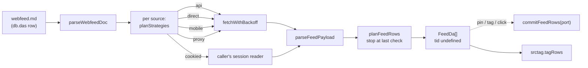
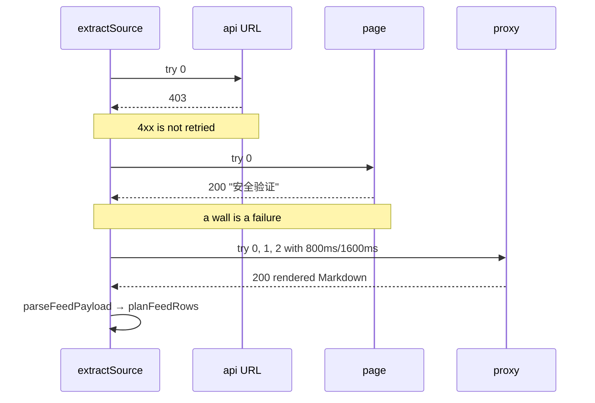

# Web feeds (webfeed)

`webfeed` reads the dynamic rows a source entry declares and hands them back
with `tid` unset. A feed item exists only on the wire, so nothing is written until
a caller pins, tags or clicks a row and commits it — the same split
[sTag.md](startag/sTag.md) keeps between scoring and writing.

The entries live in `srcfeed.md` and the read runs through `src/srcfeed.ts`; a
`webfeed.md` an installation already holds is still read, through the legacy
adapter in `srcfeed.ts`. An entry with a `Src:` row is read by that row (a site
adapter or a tab adapter); an entry without one follows the strategy walk below.

## Where it sits

| Piece | File | Owns |
|---|---|---|
| Engine | `src/srcfeedWeb.ts` | the document dialect, the strategy walk, backoff, the payload readers, the row plan, the commit port |
| Rows | `src/srcfeedRows.ts` | the legacy bodies, the seeds, and the compiled twins |
| Global | `src/ui/routes.tsx` | `installWebfeedGlobal()` at boot, so a `type='src'` row can reach the engine |
| Test | `test/startagfeed/srcfeedWeb.test.ts` | the dialect, the strategies, the readers, the body, and the live findings table |
| Schedule | `src/srcfeed.ts` | the `*.feed.md` dialect: its `## Setup` and its `## Posts as of …` blocks |
| Registry | `src/srcfeed.ts` | `srcfeed.md`: one entry per source, naming its `Src:` row |
| Read | `src/srcfeed.ts` | one read of the entries a feed names, and the block it writes back |
| Readout | `src/ui/FeedTip.tsx` | the hover preview the pin card's `{w.feed.md}` token shows |
| Tokens | `src/ui/cs1Token.ts`, `src/ui/cs1.tsx` | `{ref}` and `#tag` tokens split out of a pin card heading |
| Schedule test | `test/startagfeed/srcfeedDoc.test.ts`, `test/startagfeed/srcfeedRun.test.ts` | the dialect's write rules, and one read end to end |

The engine imports nothing from the app — no `sdb`, no Dexie, no DOM — the way
`src/srctag.ts` does not: rows are accepted structurally as `FeedDa`, the `fetch`
and `sleep` seams are injected, and writes go through a `FeedWritePort` the caller
supplies.



## The document

`webfeed.md` is a `type='md'` row read through `ctx.db`, in the dialect
`secret.md` uses: `##` opens a section, `###` opens a block, and `* Label:`
starts a list whose `- x: y` lines continue it.

```md
## Sources

### wallstreetcn
* URL: https://wallstreetcn.com/live/global
* Type: url
* API:
  - lives: https://api-one.wallstcn.com/apiv1/content/lives?channel=global-channel&limit=30
* Tags:
  - finance
  - cn

### sina-fly51fly
* URL: https://www.sina.cn/media/1402400261
* Proxy Headers:
  - X-Return-Format: html

### weibo-fly51fly
* URL: https://weibo.com/u/2337530130
* Session: weibo

## Fallback
* Proxy URL: https://r.jina.ai/
* Retries: 2
* Base delay ms: 800
* Cap delay ms: 8000
* Timeout ms: 15000
```

| Field | Where | Meaning |
|---|---|---|
| `* URL:` | block | the page, the `direct` strategy's request, and `rec.src` on every row |
| `* Type:` | block | row `type`; `url` by default |
| `* API:` | block | request URLs tried before the page, in written order, read as JSON |
| `* Session:` | block | names the caller's session-aware reader; the strategy is skipped when the caller supplies none |
| `* Mobile:` | block | mirror to request as the `mobile` strategy; empty derives one from the id the block's URL names |
| `* Proxy Headers:` | block | headers the `proxy` request adds, one `- name: value` per line; a block whose page is read for its posts asks the proxy for HTML here |
| `* Tags:` | block | tags each row carries, added to the `feed` tag every row gets |
| `* Limit:` | block | rows kept from this source; omit to use the fallback, `0` keeps every row |
| `* Proxy URL:` | `## Fallback` | proxy root, `https://r.jina.ai/` by default |
| `* Retries:` | `## Fallback` | extra tries after the first, per request |
| `* Base delay ms:` / `* Cap delay ms:` | `## Fallback` | the backoff's base and ceiling |
| `* Timeout ms:` | `## Fallback` | per-request abort |
| `* Limit:` | `## Fallback` | rows kept per source when the block names none; `0` keeps every row |

A block with no `URL:` is ignored, and an unknown label is skipped, so a
hand-edited document still parses. `ctx.args` overrides the document at call time
(`sources`, `url`, `name`, `limit`, `proxy`, `retries`, `baseDelayMs`,
`timeoutMs`, `existing`), which is what lets one `run_src` call read a single
block or a URL the document does not hold.

## The feed's own document (`*.feed.md`)

`webfeed.md` holds what a feed needs in order to be read at all; a `.feed.md` row holds the
other half — when the next read is due, which blocks it reads, and what the last reads
found. The dialect belongs to the suffix, not to one name: `w.feed.md` is what the seeder
writes (`src/srcfeed.ts`, `W_FEED_DOC`), and any other `*.feed.md` a pin card points at
is read the same way. It is read through `src/srcfeed.ts` (`isFeedRef`, `parseWFeedDoc`),
whose dialect is `webfeed.md`'s in the other direction: `##` opens a section and the
section's own lines carry the values.

The seeded `w.feed.md` is empty — no read behind it — schedules a read every two hours, and
names no source, so it reads every block `webfeed.md` declares:

```md
# w.feed

## Setup
freq: 2hr
next: 2026-10-16T09:00:00Z
sources:

## Notes
the user's own prose

## Posts as of 2026-10-16T07:00:00Z
- **wallstreetcn** 央行… — https://wallstreetcn.com/livenews/42
```

| Field | Meaning |
|---|---|
| `freq:` | the span between reads, e.g. `2hr`, `30 min`, `2d`; no `freq` and no `next` means nothing reads on its own |
| `next:` | when the next read is due; written as `last read + freq` by every read, and readable as a stamp so a hand-written one is obeyed |
| `sources:` | block names of `webfeed.md` to read; **empty reads every block it declares**, which is the default a new document opens with |
| other `key:` lines | kept and shown by the readout, never acted on |

A section whose name opens with `Posts` is one read's output, and its heading's stamp is
the read's time. A read inserts its block **directly under `## Setup`** — the newest
first, older blocks below it — or at the end of the document when there is nothing after
`Setup`; `next:` moves in place. A read that finds no item newer than the previous
block writes no block but still moves `next:`. The sources themselves are never repeated here, which is
what keeps one URL or API in one place.

A read keeps only the items newer than the newest post stored in the previous
`## Posts as of …` block: it matches that post in the new feed and trims from
there, newest first across sources, as `- **<block>** <item> — <ref>` lines.
Nothing else is written: the rows `webfeed` returns stay rows, and this document
is the only record of them. The readout labels an earlier failed strategy as
`fallback failed: …` when a later one answered, and says `read failed` only when
no source answered. A `*.feed.md` read asks for every row and ignores `* Limit:`;
the previous post, not a fixed count, bounds what it stores.

**A ref with no row yet.** `feedDraft(ref)` is the text such a ref opens with: the same
template, titled after the ref (`x.feed.md` opens as `# x.feed`). The editor uses it for a
tab whose ref has no row (`src/ui/editor.tsx`), so the buffer holds a feed document from the
first keystroke and **nothing is persisted** until the user saves it — the preview shows the
same template behind `no row yet — the editor opens on this template`, and a read
(`runSrcFeed({ ref, store })`) writes the row the
first time it has items to store.

## The pin card token and its readout

A pin card heading may carry a `{ref}` token next to its `#tag` tokens
(`src/ui/cs1Token.ts`, rendered by `Cs1Renderer`). The click is the editor — the ref
opens as a tab, and a `*.feed.md` ref with no row yet opens on `feedDraft`'s template
rather than on a blank draft, so a card can point at a feed it wants written. The hover is
the document's own readout:

- every other ref previews as the row it names;
- any `{*.feed.md}` previews the feed (`src/ui/FeedTip.tsx`): the frequency, when the next
  read is due, the `webfeed.md` blocks it reads and the host of each (`wallstreetcn.com`) —
  the blocks that answered when `sources:` is empty, and a `not in webfeed.md` note when the
  document names one that no longer exists — and the items of the newest
  `## Posts as of …` block, or, while the row does not exist, the template the editor opens on;
- its `refresh` button runs one read now, into that ref.

One read (`src/srcfeed.ts`) resolves each named entry: an entry with a `Src:` row
runs that row through `runsrc` (the row text, its compiled twin, or the matching tab
when the row says `@requires tab`), and an entry without one is read by the built-in
walk (`extractSource`) — the script row a user edits is the one a `Src:` entry names,
not a hidden engine default. It writes only when a source answered with at least one
item, so a source that refused every strategy leaves the document — and its due
time — as it was. A document whose `next` has passed is read once by itself when the
preview opens (at most once per five minutes per ref), so a stale feed catches up as soon
as it is looked at. The written row is pushed like any edit.

## The strategy walk

One source is tried by several strategies in order, and the first that answers
with items ends the walk:

| Strategy | Request | Read as |
|---|---|---|
| `api` | each `* API:` URL | JSON |
| `cookied` | the caller's reader, for a `* Session:` block | its items, or a body |
| `direct` | `* URL:` | JSON, else the document's posts, else Markdown |
| `mobile` | the page's mobile mirror | JSON, else the document's posts, else Markdown |
| `proxy` | `<proxy>/<URL>` | Markdown, or the document's posts when the block asks for HTML |

The `mobile` step exists because a mirror can be a different host rather than a
path on the same one: `mobileUrl` carries the numeric id a URL already names over
to `https://m.weibo.cn/u/<id>`, so `weibo.com/u/2337530130` and
`sina.cn/media/1402400261` — the same account on two sites — both reach it. A URL
with no id in it (`zhihu.com/people/fly51fly`) yields none, and `* Mobile:`
overrides the derivation for a mirror this rule does not name. It sits after
`direct` and before the proxy, because one more request to the site itself is
cheaper than handing the page to a renderer.

### The posts a page already serves

A body is read for what it is: JSON when it parses, the posts of an HTML document
when it is one, else Markdown. An HTML body is read **only** for its posts, so a
page with no post markup yields no items and the walk tries the next strategy —
which is what keeps a page's stylesheet from being read as content.

A `sina.cn/media/<id>` page renders server-side, so its posts are in the document
the page serves — no API and no session. One item is one `<a class="post-link">`,
and the page's own classes carry the rest: `post-text` is the post, `post-repost`
the quote it forwards, `post-actions` the numbers under it, `time` the stamp, and
the anchor's `href` the post's own URL, resolved against the page it was read from.
Those numbers are written in the page's order — 转发 (reposts), 评论 (comments),
赞 (likes) — and each row's text leads with them (`[转发 2 · 评论 0 · 赞 9] …`) so a
capped row cannot cut them off the end of a long post. The stamp is read as Beijing
time, which is the clock the page renders.

Nothing in that reader is keyed on an account id, so one block reads any media
page: point `* URL:` at another `https://www.sina.cn/media/<id>` and the same
reader answers. In a browser the page itself is out of reach — `sina.cn` sends no
`Access-Control-Allow-Origin`, so `fetch` fails at `direct` and `mobile` and the
walk reaches `proxy` — and `r.jina.ai`'s Markdown drops the markup the posts are
read from, which is why the seeded block asks the proxy for HTML with a
`* Proxy Headers:` line, `- X-Return-Format: html`. Asked for HTML, the proxy
answers the same document the site serves.

Every request retries on what a retry can fix — a thrown error, a timeout, 429,
5xx — with `base * 2^attempt` capped, and gives up on what it cannot: a 403, a
redirect into a login page, a 200 that carries a wall, or an empty body. That is
`blockedText`, and it is why `weibo.com` returns no rows instead of a
visitor-system page: the wall is a 200, so a status check alone would read it as
the feed. Giving up is per strategy, not per source: the next strategy is the
answer to a wall, another try at the same URL is not.

Backoff is exponential and jittered; a test passes `random: () => 1` to make the
sequence exact.



## Rows

`planFeedRows` turns items into `FeedDa` rows that satisfy `sdb`'s `Da` without
importing it:

```ts
{ txt: '快讯：…', ref: 'https://wallstreetcn.com/livenews/42', type: 'url',
  tags: ['feed', 'finance', 'cn'], dt: <item time or fetch time>,
  rec: { feed: 'wallstreetcn', strategy: 'api', src: 'https://wallstreetcn.com/live/global', fetchedAt: '…' } }
```

`tid` is absent by definition, `rec.feed` names the block, and `rec.strategy`
records which strategy produced the row — that field is what the findings table
below is built from.

**Stop at the last check.** A feed reads top-down, newest first, so the first item
the store already holds is where the previous read ended: the walk stops there and
returns only what is newer. `existing` supplies the known rows (read from
`db.das` when the caller passes a `db`), and `stopAtKnown: false` turns the rule
off for a caller that wants the whole list.

**Persistence is the caller's step.** `commitFeedRows(port, das)` writes rows
through a `FeedWritePort` and drops the `tid` on the way, so the store assigns a
fresh one. Nothing in this module calls it — a pin, a tag application or a click
is what turns an extracted row into a stored one. Tagging needs no new code at
all: `srctag.tagRows(rows)` accepts a `tid`-less row structurally.

## Reading a feed from a script

A fresh installation seeds `srcfeed.md` and its adapters; see
[srcfeed.md](srcfeed.md) for `seedSrcFeedRows`. An installation that still holds
`webfeed.md` reads it through the legacy adapter, and its `webfeed/extract.js`
row still runs. With the rows in place, a chat can drive one
extraction through `run_src` — which needs gate level `rwr` or above
([recr-agloop.md](recr-agloop.md)):

```
run_src { ref: 'webfeed/extract.js', args: { sources: ['wallstreetcn'], limit: 5 } }
```

The body returns a report rather than the rows — one line per source with the
strategy that answered, its attempts, an `answered` list, and the first few rows —
because `run_src` hands a string back to the model. The rows themselves are one
call away on the
page: `webfeed.extractFromDoc({ db, args })`.

## The live findings

`test/startagfeed/srcfeedWeb.test.ts` reads the four seeded sources over the real network and
writes `test-artifacts/webfeed-findings.json`. It is opt-in, because a feed that
never answers costs its whole timeout:

```sh
WEBBFEED_E2E=1 npx vitest run test/startagfeed/srcfeedWeb.test.ts
```

Measured 2026-10-15:

| Source | `api` | `cookied` | `direct` | `mobile` | `proxy` (`r.jina.ai`) | Answers |
|---|---|---|---|---|---|---|
| `wallstreetcn` | 200 JSON | — | — | — | — | **`api`**, 3 rows |
| `sina.cn/media/…` | — | — | 200 | not reached | — | **`direct`**, 3 rows |
| `zhihu.com/people/…` | 200 `{"data": []}` | — | 403 | — | 200 CAPTCHA (`安全验证`) | none |
| `weibo.com/u/…` | 200 visitor system | throws | 200 visitor system | 200 visitor system | 200 visitor system | none |

No dash means the strategy did not run: the `sina` block answers at `direct`, so
its own derived mobile mirror is never requested, and the `zhihu` page carries no
id for `mobileUrl` to carry over.

What that says:

- A site with a public JSON endpoint is read by `api` and never reaches the proxy;
  the wallstreetcn lives endpoint answers in about 1.5s.
- `sina.cn` renders server-side, and the posts it serves carry their own numbers
  and stamps, so `direct` is enough and a row is a post. The same account's
  `weibo.com` page is not: the Sina media mirror is the readable copy.
- `r.jina.ai` renders a page a plain fetch cannot, but it does not sign in: for
  `zhihu.com` it returns 知乎's CAPTCHA page, and for `weibo.com` the visitor
  system. Both are 200s, both are walls, and `blockedText` is what turns them into
  a failure rather than content.
- `fc.get_weibo_posts` is not a working strategy today: its baked-in cookie is
  expired, the API answers `<!doctype html`, and `JSON.parse` throws. The walk
  records that as the `cookied` attempt's error and moves on, which is the
  intended behaviour for a reader that breaks.
- `m.weibo.cn` is not a way around the visitor wall. `weibo.com/u/<id>`,
  `sina.cn/media/<id>` and every path under the mobile host redirect to
  `visitor.passport.weibo.cn`, whose page runs a `genvisitor2` script challenge —
  so no cookie follows a plain fetch and the second request lands on the same
  wall. Pointing the render proxy at the mobile host does not help either: it
  serves a browser, and the challenge page is still what comes back. The readable
  copy of those accounts is the `sina.cn` mirror, which is why that block is the
  one that answers.

A run where no source answers warns and passes — the same treatment the rest of
this repository gives an optional channel — while `WEBBFEED_E2E_STRICT=1` turns
"some source answered" into an assertion and `WEBBFEED_E2E_RETRIES` moves the
retry budget of the live run.

## Related

- `docs/startag/sTag.md` — the tag layer the extracted rows feed.
- `docs/recr-agloop.md` — `run_src`, the `rwr` gate, and the `secret.md` dialect
  this document borrows.
- `docs/startag/rstag.md` — the rest-list pass over tagged rows.
- `src/srcfeedWeb.ts`, `src/srcfeedRows.ts`, `src/runsrc.ts`, `test/startagfeed/srcfeedWeb.test.ts`.
