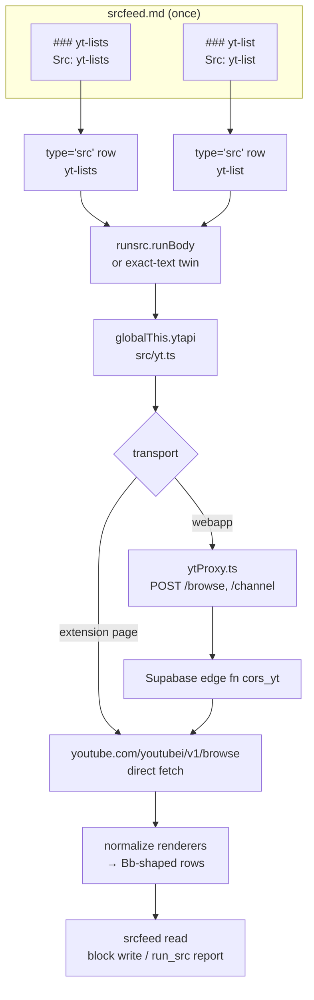
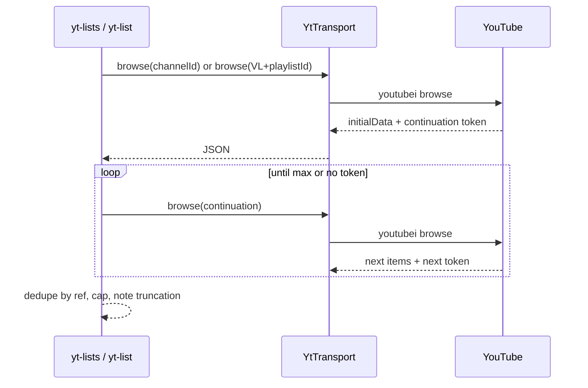

# Plan — YouTube playlist import (`yt-lists`, `yt-list`)

Opening prompt for an implementation session. Read this file to the end, then
[srcfeed.md](srcfeed.md) §Bilibili sources and `src/bb.ts` — the Bilibili rows are
the pattern this follows. Scope: **playlist listing and playlist item import only**.
No media download, no upload, no per-video request.

## 0. Request → scope

| Request phrase | Read as |
|---|---|
| "borrowing logic from yt-dlp" | port yt-dlp's URL forms, channel-tab discovery, InnerTube `browse` + continuation paging, renderer → flat row mapping |
| "just unlist (open) playlist" | accept **public and unlisted** (link-accessible) playlists; no private, no Watch Later / Liked / Favorites, no account cookies |
| "yt-lists" | the **mass list**: every playlist one channel exposes |
| "yt-list" | the **specified import**: the items of one playlist URL or id |
| "seed dynamic srcdom/runBody script … similar to bilibili sources" | two `type='src'` rows whose bodies call `globalThis.ytapi`, exact-text twins, seeded registry entries, one-time append migration |
| "if need supabase func cors_yt like cors_bb" | yes, for the webapp only; the extension page calls YouTube directly (`host_permissions: <all_urls>`) |

Commit-summary seed (short version of §7):

> Add seeded YouTube `yt-lists` and `yt-list` source rows that read a channel's
> public playlists and one playlist's items through yt-dlp-style InnerTube browse
> paging. The extension page calls YouTube directly; the webapp uses a new
> `cors_yt` Edge Function. Seeding, appending and compiled twins follow the
> Bilibili rows.

## 1. Ambiguities and platform facts

1. **Unlisted playlists cannot be mass-listed.** YouTube's channel Playlists tab
   returns public playlists only; an unlisted playlist never appears there. So
   `yt-lists` can only enumerate public lists, and an unlisted list enters by URL
   or id through `yt-list`. This is YouTube behavior, not a missing feature. The
   only way to enumerate an account's unlisted lists is that account's cookie —
   out of scope by the no-login rule.
2. **"Mass" means one channel per read**, every playlist that channel exposes,
   walked with continuation until the cap. Multiple channels are multiple feed
   entries (or several reads); one entry does not merge channels. Easier to change
   to `url:` arrays later than to remove.
3. **InnerTube has no CORS.** yt-dlp's playlist/channel browsing posts to
   `youtubei/v1/browse`, which sends no `Access-Control-Allow-Origin` for other
   origins. The webapp therefore needs `cors_yt`; the extension page can call
   YouTube directly under its `<all_urls>` host permission.
4. **Data API v3 is not used.** It is CORS-friendly and needs only a key, but it
   also cannot list unlisted playlists, adds a key + quota to manage, and would
   split the parsing path from the extension's. Keep it as the fallback only if
   InnerTube refuses Supabase's IP (§9).
5. **No account, no cookies.** `WL` (Watch Later), `LL` (Liked), `FL` (Favorites)
   and `RD` (mix/radio, unbounded) are refused with a named note. In scope:
   `PL…` (user playlist, public or unlisted), `UU…` (channel uploads) and
   `OLAK5uy_…` (album).
6. **Rows stay read-only**, exactly like `bb-*`: nothing is written until a caller
   pins or tags a row. "Import" here means the feed block receives the items; no
   video row is created.
7. **yt-dlp is Unlicense (public domain)**, so porting its browse logic is fine.
   Borrow the logic, not the downloader, format selection, PO-token or JS-challenge
   machinery — none of it is needed to read metadata.

Open questions to confirm before P2 (the plan assumes the first option):

| Question | Assumed answer |
|---|---|
| Does "unlist (open)" include public lists? | yes — public + unlisted |
| One channel per `yt-lists` read? | yes |
| `cors_yt` requires a Supabase session like `cors_bb`? | yes |
| Should `yt-lists` synthesize the channel's Uploads (`UU…`) row? | no, only tab playlists |

## 2. What we borrow from yt-dlp

| yt-dlp piece | Use here |
|---|---|
| `yt_dlp/extractor/youtube/_video.py` `_VALID_URL` | accepted playlist/watch/embed URL forms; `list=` wins over `v=` |
| `yt_dlp/extractor/youtube/_tab.py` `YoutubeTabBaseInfoExtractor` | channel tab discovery, `playlistVideoRenderer` / channel playlist renderers, continuation walking |
| `yt_dlp/extractor/youtube/_base.py` `ytcfg` bootstrap | InnerTube API key, client version, visitor data, context |
| `--flat-playlist` semantics | rows only; never fetch a video page |

Accepted URL forms (parse first, reject the rest):

```
https://www.youtube.com/playlist?list=PL…
https://www.youtube.com/watch?v=<id>&list=PL…      (list wins)
https://youtu.be/<id>?list=PL…
https://www.youtube.com/embed/videoseries?list=PL…
https://music.youtube.com/playlist?list=OLAK5uy_…
https://www.youtube.com/@handle[/playlists]
https://www.youtube.com/channel/UC…[/playlists]
https://www.youtube.com/c/<name>[/playlists]
https://www.youtube.com/user/<name>[/playlists]
a bare playlist id (PL… / UU… / OLAK5uy_…)
```

Playlist-list id → browse id is `VL` + id. Channel URL resolution ends at a
`UC…` id; the Playlists tab is found by title in the channel root's
`twoColumnBrowseResultsRenderer.tabs`, never by a hardcoded `params` blob.

Renderers handled (new first, old as fallback):

| Read | Current | Fallback |
|---|---|---|
| playlist items | `playlistVideoRenderer` (videoId, title.runs, lengthText, shortBylineText, index) | `playlistVideoListRenderer` walk |
| channel playlists | `lockupViewModel` (contentId, metadata rows, video count) | `gridPlaylistRenderer` (playlistId, title, videoCountText, navigationEndpoint) |
| next page | `continuationItemRenderer.continuationEndpoint.continuationCommand.token` | `nextContinuationData.continuation` |

## 3. Architecture



Read loop per source (client side, `yt.ts`), one upstream page per iteration:



The transport is the only seam. `yt.ts` owns parsing, paging, dedupe and row
mapping, so both hosts produce identical rows; a test substitutes the transport
and never touches the network.

## 4. `cors_yt` contract

`src/cors_yt.ts`, pasted as the function's `index.ts`, same deployment shape as
`cors_bb.ts` (Supabase JWT verified by the gateway, origin allowlist, rate
limit). No cookies, no QR, no session table.

| Route | Body | Answer |
|---|---|---|
| `POST /browse` | `{ browseId?, params?, continuation? }` | InnerTube JSON, trimmed to the subtree the readers need and capped |
| `POST /channel` | `{ url }` (channel/handle URL) | `{ channelId: 'UC…' }` |

Guards: JSON body ≤ 64k, 15 s upstream timeout, per-user token bucket
(300 tokens, 1/s refill — the `cors_bb` shape), desktop UA, `hl=en&gl=US`.
The function never accepts an arbitrary URL to fetch: `/browse` builds
`https://www.youtube.com/youtubei/v1/browse` itself and `/channel` parses the
URL and fetches only a `youtube.com` channel page. Bootstrap (`ytcfg` key,
client version, visitor data, context) is cached per function instance for one
hour.

`/browse` response size: return only the renderer arrays and the continuation
token, not the full page. That keeps the payload small and still leaves
normalization in one place (`yt.ts`), not two.

## 5. Row contract (`src/yt.ts`)

Mirror `bb.ts`: one `YtRow`/`YtOut` pair, `capOf` (args `limit`/`max`, entry
`Max:`, `MAX_ROWS = 5555`, `MAX_PAGES = 300`), `bbFailure`-style error mapping.

| Reader | Input | Rows |
|---|---|---|
| `ytLists(args)` | channel URL or handle from `args.url`, else the entry's `* URL:` | one row per playlist: `txt = "<title> · <count> videos"`, `ref = https://www.youtube.com/playlist?list=<id>`, tags `youtube playlist channel`, `rec = { playlist_id, title, count, channel }` |
| `ytList(args)` | playlist URL/id from `args.url`, else entry `* URL:`, else `args.list` | one row per item: `txt = "<title> — <channel> · <m:ss>"`, `ref = https://www.youtube.com/watch?v=<id>`, tags `youtube playlist`, `rec = { video_id, playlist_id, playlist_title, index, duration, channel }`; list order kept, no `dt` (same as a favorite folder) |

Notes and refusal states, as `needsUser` only for a fixable input:

| Case | Result |
|---|---|
| channel URL missing / unknown form | `needsUser` naming `@handle`, `/channel/UC…`, `/c/`, `/user/` |
| playlist URL missing | `needsUser` naming `playlist?list=…` or a bare id |
| private playlist ("This playlist is private") | note, zero rows |
| `WL` / `LL` / `FL` / `RD` id | note "needs the account; not imported" |
| unavailable item ("[Deleted video]", "[Private video]") | skipped |
| `annotations`/`alerts` for removed content | note, rows kept |

Parsers exported for tests: `parsePlaylistUrl(raw): YtListRef | null`,
`parseChannelUrl(raw): YtChannelRef | null`. `parsePlaylistUrl` also classifies
`multi_video` (watch URL with `list=`) as a playlist read.

Globals and seams, matching the Bilibili names:

- `YtTransport` — `{ browse(request), channel(url) }`
- `setYtTransport()` / `hasYtTransport()`; the extension page installs the direct
  transport itself
- `YtApiError` (YouTube `error.code`), `YtSignInError` (no Supabase session),
  `YtUnavailableError` (neither host)
- `installYtApiGlobal()` publishing `globalThis.ytapi = { lists, list }`

## 6. Seeding, registry and boot

`src/srcfeedRows.ts` gains, next to the `BB_*` block:

- `YT_LISTS_REF = 'yt-lists'`, `YT_LIST_REF = 'yt-list'`
- `YT_SOURCE_ENTRIES` — two `### yt-*` blocks with `* Src:`, `* Max: 5555`,
  `Tags: youtube, list`; placeholder `URL: https://www.youtube.com/@` and
  `URL: https://www.youtube.com/playlist?list=`
- `YT_LISTS_BODY`, `YT_LIST_BODY` — the same four-line body shape as `BB_*`
  (`globalThis.ytapi`, else a named error)
- `YT_ROW_SEEDS`, `seedYtRows(table)`, twins added to `SRCFEED_BODY_TWINS`
- `SRCFEED_DOC` includes the two blocks; fresh seeds write the bodies too

`src/srcfeedStore.ts` gains `ensureYtSrcFeedEntries()` with marker
`srcfeed.yt-appended.v1`, mirroring `ensureBbSrcFeedEntries`: append missing
blocks under `## Sources`, never rewrite an edited block, never resurrect a
tombstoned row, one-shot via `db.tree`.

`src/ui/routes.tsx`, in this order, beside the Bilibili calls:

1. `installYtApiGlobal()`
2. `installYtProxy()`
3. `void ensureYtSrcFeedEntries()` (chained after the Bilibili appends)
4. `registerBodyTwins(SRCFEED_BODY_TWINS)` already covers the new twins

`src/ytProxy.ts` / `src/ytProxyInstall.ts` copy the `bbProxy*` split: the client
is app-free; the install module supplies `treeCac.server` + `pub_key`, the
signed-in session token, and a 401 refresh once. `cors_yt` is
`${server}/functions/v1/cors_yt`.

Feed usage then matches Bilibili:

```md
# yt.feed

## Setup
freq: 1hr
next:
sources: yt-list
url: https://www.youtube.com/playlist?list=PL…
max: 111
```

`yt-lists` used as a feed source lists playlists, not videos, so it is useful
mainly through `run_src` and as the place a user copies a `ref` from — same role
`bb-lists` plays.

## 7. Work order

| Step | Files | Done when |
|---|---|---|
| P1 `cors_yt` | `src/cors_yt.ts` | routes answer with a Supabase session; bad origin/body refused; deploy steps in the file header |
| P2 `yt.ts` | `src/yt.ts` | parsers + readers pass fixtures: paging, cap, unlisted, private, refused prefixes, handle/channel forms |
| P3 webapp transport | `src/ytProxy.ts`, `src/ytProxyInstall.ts` | 401 → refresh once → `YtSignInError`; install is a no-op in the extension |
| P4 seed + boot | `src/srcfeedRows.ts`, `src/srcfeedStore.ts`, `src/ui/routes.tsx` | fresh seed writes blocks/bodies/twins; an existing registry gains the two blocks once; edited/tombstoned rows untouched |
| P5 docs | `docs/srcfeed.md` §YouTube sources, this file's status line | table of entries, the unlisted-enumeration caveat, deploy pointer |
| P6 verification | tests below | all focused tests pass; one real `run_src` against a public channel and one unlisted playlist on both hosts |

Each phase keeps the previous working; no phase edits an existing seed block.

## 8. Tests

- `test/yt.test.ts` — parsers (`playlist?list=`, watch+list, youtu.be, embed,
  music album, bare id, refused `WL`/`LL`/`FL`/`RD`; channel `@`, `/channel`,
  `/c/`, `/user/`); readers over a stubbed `YtTransport`: first page, two
  continuations, dedupe, cap `args.max`/entry `Max:`, private note, deleted item
  skip, missing URL → `needsUser`. Fixtures are trimmed InnerTube JSON committed
  under `test/fixtures/` (no network, no snapshots of live pages).
- `test/ytProxy.test.ts` — mirrors `bbProxy.test.ts`: route bodies, 401 refresh,
  non-OK mapping, no cookie fields.
- `test/startagfeed/srcfeedYt.test.ts` — registry parse of the two blocks, fresh
  seed, `ensureYtSrcFeedEntries` once/edited/tombstoned (mirror
  `srcfeedAutoAppend.test.ts`), and one feed read through `runBody` with the twin
  registered and eval disabled.
- `test/bb.test.ts` stays untouched; `srcfeedBb.test.ts` gains nothing.

Run with `pnpm vitest run test/yt.test.ts test/ytProxy.test.ts
test/startagfeed/srcfeedYt.test.ts`. The watch log (`test.log`) was last written
2026-08-12, so treat it as stale and run the focused files directly.

## 9. Risks, fallbacks, non-goals

| Risk | Mitigation |
|---|---|
| InnerTube bot check / 429 from Supabase's IP | map to a note naming the status; if it persists, add the Data API v3 path behind `YT_API_KEY` in `cors_yt` without touching `yt.ts` |
| Renderer names change (YouTube does this often) | one normalizer in `yt.ts`, new-renderer-first table in §2, fixtures updated in the same PR |
| Continuation token is opaque and page-size dependent | cap by rows and pages; never persist a token between reads |
| Large `/browse` payloads | function returns only renderer arrays + token, hard cap |
| Channel handle resolution needs HTML | `/channel` parses the channel page's `externalId`/canonical link; failure is a note, not a crash |

Non-goals: media download, transcripts, comments, video metadata beyond title /
channel / duration, channel uploads tab, search, Watch Later or Liked import,
cookies or OAuth, and writing video rows at import time.
