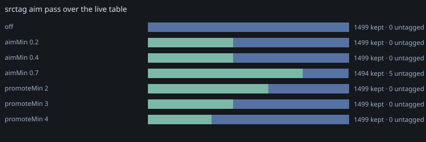

# srctag sweep over the live table

Recorded 2026-10-11 by `test/srctag-cdp.test.ts` against the running app on `localhost:5173`.
Rows, channel sets and dates come from that page’s own IndexedDB, so the numbers are
this table’s, not a fixture’s. Re-record with:

```sh
npx vitest run test/srctag-cdp.test.ts --reporter=verbose --silent=false
```

## static channels over 1499 live rows · priority from pin cards (1) (18 tags)

| case | dim | rows | scored | empty | sugg | dist | mean | max | prio | jaccard | ms | channels |
| --- | --- | --- | --- | --- | --- | --- | --- | --- | --- | --- | --- | --- |
| tfidf | tid | 1499 | 381 | 1118 | 1053 | 560 | 0.282 | 0.958 | 299 | 1.000 | 266ms | priority 0.50 · keyword 0.25 · tfidf 0.25 |
| textrank | tid | 1499 | 1499 | 0 | 10644 | 4907 | 0.906 | 2.250 | 167 | 0.084 | 839ms | textRank 0.91 · clusterRank 0.08 · priority 0.01 · keyword 0.00 |
| textrank@visitTime | visitTime | 1499 | 1499 | 0 | 10645 | 4901 | 0.906 | 2.250 | 167 | 0.083 | 900ms | textRank 0.91 · clusterRank 0.08 · priority 0.01 · keyword 0.00 |
| textrank@dt | dt | 1499 | 1499 | 0 | 10645 | 4900 | 0.906 | 2.250 | 167 | 0.083 | 1566ms | textRank 0.91 · clusterRank 0.08 · priority 0.01 · keyword 0.00 |
| textrank@domain | domain | 1499 | 1499 | 0 | 10645 | 4469 | 0.990 | 2.250 | 166 | 0.089 | 872ms | textRank 0.82 · clusterRank 0.17 · priority 0.01 · keyword 0.00 |
| hybrid | visitTime | 1499 | 1499 | 0 | 10641 | 4884 | 0.472 | 1.421 | 268 | 0.086 | 1270ms | textRank 0.86 · clusterRank 0.09 · priority 0.02 · tfidf 0.01 · keyword 0.01 |
| rstext | domain | 1499 | 1499 | 0 | 6973 | 2492 | 0.705 | 1.750 | 242 | 0.103 | 772ms | textRank 0.70 · clusterRank 0.26 · priority 0.02 · keyword 0.01 |
| rstext+embed | domain | 24 | 24 | 0 | 132 | 100 | 0.415 | 1.300 | 5 | 0.000 | 23ms | textRank 0.79 · clusterRank 0.15 · priority 0.04 · keyword 0.02 |
| hybrid+embed+classify | visitTime | 24 | 24 | 0 | 132 | 108 | 0.295 | 0.750 | 5 | 0.000 | 22ms | textRank 0.85 · clusterRank 0.08 · priority 0.04 · keyword 0.02 · tfidf 0.01 |

## hyperparameters around the rstext preset, 1499 live rows

| case | dim | rows | scored | empty | sugg | dist | mean | max | prio | jaccard | ms | channels |
| --- | --- | --- | --- | --- | --- | --- | --- | --- | --- | --- | --- | --- |
| rstext anchor | domain | 1499 | 1499 | 0 | 6973 | 2492 | 0.705 | 1.750 | 242 | 0.000 | 1240ms | textRank 0.70 · clusterRank 0.26 · priority 0.02 · keyword 0.01 |
| topK 4 | domain | 1499 | 1499 | 0 | 5741 | 1918 | 0.731 | 1.750 | 242 | 0.770 | 913ms | textRank 0.67 · clusterRank 0.29 · priority 0.03 · keyword 0.01 |
| topK 16 | domain | 1499 | 1499 | 0 | 13642 | 6203 | 0.618 | 1.750 | 242 | 0.402 | 799ms | textRank 0.79 · clusterRank 0.19 · priority 0.01 · keyword 0.01 |
| minScore 0.02 | domain | 1499 | 1499 | 0 | 7188 | 2617 | 0.694 | 1.750 | 242 | 0.952 | 786ms | textRank 0.70 · clusterRank 0.26 · priority 0.02 · keyword 0.01 |
| minScore 0.2 | domain | 1499 | 1499 | 0 | 7186 | 2616 | 0.694 | 1.750 | 242 | 0.953 | 644ms | textRank 0.70 · clusterRank 0.26 · priority 0.02 · keyword 0.01 |
| minScore 0.7 | domain | 1499 | 1269 | 230 | 3004 | 420 | 0.866 | 1.750 | 242 | 0.169 | 643ms | textRank 0.55 · clusterRank 0.38 · priority 0.05 · keyword 0.02 |
| window 2 | domain | 1499 | 1499 | 0 | 6968 | 2560 | 0.700 | 1.750 | 241 | 0.924 | 502ms | textRank 0.71 · clusterRank 0.26 · priority 0.02 · keyword 0.01 |
| window 8 | domain | 1499 | 1499 | 0 | 6982 | 2479 | 0.702 | 1.750 | 246 | 0.938 | 1057ms | textRank 0.70 · clusterRank 0.26 · priority 0.03 · keyword 0.01 |
| rank window 2 | domain | 1499 | 1499 | 0 | 6855 | 2390 | 0.707 | 1.750 | 247 | 0.450 | 469ms | textRank 0.69 · clusterRank 0.27 · priority 0.03 · keyword 0.01 |
| rank window 8 | domain | 1499 | 1499 | 0 | 6907 | 2472 | 0.720 | 1.750 | 254 | 0.522 | 898ms | textRank 0.70 · clusterRank 0.26 · priority 0.03 · keyword 0.01 |
| damping 0.5 | domain | 1499 | 1499 | 0 | 7129 | 2411 | 0.740 | 1.750 | 231 | 0.843 | 427ms | textRank 0.69 · clusterRank 0.27 · priority 0.02 · keyword 0.01 |
| damping 0.95 | domain | 1499 | 1499 | 0 | 6935 | 2573 | 0.699 | 1.750 | 243 | 0.914 | 803ms | textRank 0.70 · clusterRank 0.26 · priority 0.03 · keyword 0.01 |
| no clusterRank | domain | 1499 | 1499 | 0 | 6524 | 3412 | 0.572 | 1.350 | 299 | 0.693 | 342ms | textRank 0.94 · priority 0.04 · keyword 0.02 |
| no turboText | domain | 1499 | 1499 | 0 | 6953 | 2525 | 0.689 | 1.000 | 98 | 0.984 | 735ms | textRank 0.73 · clusterRank 0.27 |
| tfidf back on | domain | 1499 | 1499 | 0 | 7070 | 2609 | 0.758 | 1.916 | 230 | 0.943 | 656ms | textRank 0.65 · clusterRank 0.24 · tfidf 0.08 · priority 0.02 · keyword 0.01 |
| burstGap 60s | domain | 1499 | 1499 | 0 | 6973 | 2492 | 0.705 | 1.750 | 242 | 1.000 | 632ms | textRank 0.70 · clusterRank 0.26 · priority 0.02 · keyword 0.01 |

## aim pass over 1499 live rows · priority from pin cards (1) (18 tags)

| case | aimMin | promote | rows | untagged | prio | focus/row | tags/row | sub rows | sub tags | ms |
| --- | --- | --- | --- | --- | --- | --- | --- | --- | --- | --- |
| off | 0.40 | 3 | 1499 | 0 | 233 | 4.49 | 4.49 | 0 | 0 | 0ms |
| aimMin 0.2 | 0.20 | 3 | 1499 | 0 | 233 | 4.49 | 5.19 | 620 | 75 | 6ms |
| aimMin 0.4 | 0.40 | 3 | 1499 | 0 | 233 | 4.49 | 5.19 | 620 | 75 | 5ms |
| aimMin 0.7 | 0.70 | 3 | 1499 | 5 | 233 | 0.93 | 2.33 | 1149 | 52 | 3ms |
| promoteMin 2 | 0.40 | 2 | 1499 | 0 | 233 | 4.49 | 5.60 | 886 | 244 | 7ms |
| promoteMin 3 | 0.40 | 3 | 1499 | 0 | 233 | 4.49 | 5.19 | 620 | 75 | 3ms |
| promoteMin 4 | 0.40 | 4 | 1499 | 0 | 233 | 4.49 | 5.01 | 459 | 37 | 3ms |

## rrf stages over the newest 600 of 1499 live rows · priority from pin cards (1) (18 tags)

| case | stage | rows | scored | empty | sugg | dist | mean | max | sub rows | sub tags | jaccard | ms | channels | roots |
| --- | --- | --- | --- | --- | --- | --- | --- | --- | --- | --- | --- | --- | --- | --- |
| preset | anchor | 600 | 591 | 9 | 2346 | 1636 | 0.674 | 5.000 | 72 | 15 | 1.000 | 158ms | bm25,clusterRank,group,priority,textRank | ai 81 · deepseek 39 · 前消 16 · youtube 13 · dsh 12 · 匙補 12 |
| urls on | bm25f | 600 | 599 | 1 | 3327 | 1509 | 2.454 | 40.000 | 261 | 32 | 0.526 | 266ms | bm25,clusterRank,group,priority,textRank | google 193 · gx 165 · opera 118 · ai 114 · gemini 104 · utf 97 |
| k1 0.5 | bm25f | 600 | 591 | 9 | 2466 | 1656 | 0.836 | 8.000 | 119 | 26 | 0.957 | 166ms | bm25,clusterRank,group,priority,textRank | ai 112 · deepseek 39 · youtube 39 · md 33 · 千问 30 · google 19 |
| k1 3 | bm25f | 600 | 591 | 9 | 2464 | 1652 | 0.835 | 8.000 | 118 | 26 | 0.958 | 165ms | bm25,clusterRank,group,priority,textRank | ai 110 · deepseek 39 · youtube 39 · md 33 · 千问 30 · google 19 |
| b 0 | bm25f | 600 | 591 | 9 | 2464 | 1656 | 0.835 | 8.000 | 118 | 26 | 0.956 | 186ms | bm25,clusterRank,group,priority,textRank | ai 110 · deepseek 39 · youtube 39 · md 33 · 千问 30 · google 19 |
| b 1 | bm25f | 600 | 591 | 9 | 2466 | 1655 | 0.837 | 8.000 | 119 | 26 | 0.957 | 183ms | bm25,clusterRank,group,priority,textRank | ai 112 · deepseek 39 · youtube 39 · md 33 · 千问 30 · google 19 |
| title only | bm25f | 600 | 591 | 9 | 2333 | 1636 | 0.661 | 5.000 | 72 | 14 | 0.998 | 133ms | bm25,clusterRank,group,priority,textRank | ai 81 · deepseek 26 · 前消 16 · youtube 13 · 匙補 12 · com 11 |
| tags only | bm25f | 600 | 595 | 5 | 1241 | 14 | 11.430 | 14.000 | 573 | 6 | 0.005 | 122ms | bm25,clusterRank,group,priority,textRank | com 506 · youtube 506 · AI 163 · deepseek 39 · md 11 · LLM 6 |
| url field back | bm25f | 600 | 591 | 9 | 2466 | 1654 | 0.837 | 8.000 | 119 | 26 | 0.958 | 170ms | bm25,clusterRank,group,priority,textRank | ai 112 · deepseek 39 · youtube 39 · md 33 · 千问 30 · google 19 |
| k 1 | fusion | 600 | 600 | 0 | 878 | 448 | 1.309 | 5.000 | 132 | 12 | 0.267 | 140ms | bm25,clusterRank,group,priority,textRank | ai 116 · sleep 85 · AI 41 · deepseek 25 · 前消 15 · youtube 13 |
| k 10 | fusion | 600 | 590 | 10 | 2068 | 1478 | 0.595 | 5.000 | 54 | 12 | 0.869 | 124ms | bm25,clusterRank,group,priority,textRank | ai 55 · deepseek 25 · 前消 16 · youtube 13 · 匙補 12 · md 11 |
| k 200 | fusion | 600 | 591 | 9 | 2346 | 1639 | 0.688 | 5.000 | 72 | 15 | 0.985 | 149ms | bm25,clusterRank,group,priority,textRank | ai 81 · deepseek 39 · 前消 16 · youtube 13 · dsh 12 · 匙補 12 |
| maxDf 1 (floor off) | global | 600 | 591 | 9 | 2346 | 1636 | 0.674 | 5.000 | 72 | 15 | 1.000 | 116ms | bm25,clusterRank,group,priority,textRank | ai 81 · deepseek 39 · 前消 16 · youtube 13 · dsh 12 · 匙補 12 |
| maxDf 0.2 | global | 600 | 591 | 9 | 2346 | 1636 | 0.674 | 5.000 | 72 | 15 | 1.000 | 132ms | bm25,clusterRank,group,priority,textRank | ai 81 · deepseek 39 · 前消 16 · youtube 13 · dsh 12 · 匙補 12 |
| stop off | global | 600 | 591 | 9 | 2364 | 1637 | 0.674 | 5.000 | 72 | 15 | 0.962 | 132ms | bm25,clusterRank,group,priority,textRank | ai 81 · deepseek 39 · 前消 16 · vs 14 · youtube 13 · dsh 12 |
| stop + maxDf 1 | global | 600 | 591 | 9 | 2364 | 1637 | 0.674 | 5.000 | 72 | 15 | 0.962 | 123ms | bm25,clusterRank,group,priority,textRank | ai 81 · deepseek 39 · 前消 16 · vs 14 · youtube 13 · dsh 12 |
| no bm25 | signals | 600 | 597 | 3 | 1310 | 146 | 3.689 | 7.000 | 446 | 11 | 0.084 | 138ms | clusterRank,group,priority,textRank | sleep 368 · use 366 · AI 163 · deepseek 39 · wasgs 21 · 前消 12 |
| no priority | signals | 600 | 591 | 9 | 2322 | 1639 | 0.893 | 5.000 | 60 | 13 | 0.996 | 146ms | bm25,clusterRank,group,textRank | ai 81 · 前消 16 · dsh 14 · youtube 13 · 匙補 12 · com 11 |
| no graph | signals | 600 | 591 | 9 | 2298 | 1700 | 0.572 | 5.000 | 44 | 9 | 0.801 | 67ms | bm25,group,priority | AI 46 · ai 32 · deepseek 25 · 前消 16 · youtube 13 · md 11 |
| no buckets | buckets | 600 | 591 | 9 | 2243 | 1621 | 0.539 | 1.000 | 0 | 0 | 0.991 | 172ms | bm25,clusterRank,priority,textRank | ai 49 · deepseek 13 · youtube 13 · com 11 · md 11 · 千问 10 |
| mmr λ 0 | buckets | 600 | 591 | 9 | 2346 | 1636 | 0.674 | 5.000 | 72 | 15 | 1.000 | 151ms | bm25,clusterRank,group,priority,textRank | ai 81 · deepseek 39 · 前消 16 · youtube 13 · dsh 12 · 匙補 12 |
| mmr λ 1 | buckets | 600 | 591 | 9 | 2346 | 1636 | 0.674 | 5.000 | 72 | 15 | 1.000 | 138ms | bm25,clusterRank,group,priority,textRank | ai 81 · deepseek 39 · 前消 16 · youtube 13 · dsh 12 · 匙補 12 |
| graph λ 0 | buckets | 600 | 591 | 9 | 2346 | 1636 | 0.674 | 5.000 | 72 | 15 | 1.000 | 118ms | bm25,clusterRank,group,priority,textRank | ai 81 · deepseek 39 · 前消 16 · youtube 13 · dsh 12 · 匙補 12 |
| promote ≥ 2 | buckets | 600 | 591 | 9 | 2460 | 1674 | 0.729 | 5.000 | 127 | 53 | 0.975 | 121ms | bm25,clusterRank,group,priority,textRank | ai 113 · deepseek 39 · 前消 16 · youtube 13 · api 12 · dsh 12 |
| promote ≥ 5 | buckets | 600 | 591 | 9 | 2271 | 1625 | 0.594 | 5.000 | 23 | 4 | 0.993 | 126ms | bm25,clusterRank,group,priority,textRank | ai 49 · deepseek 26 · 前消 16 · youtube 13 · com 11 · md 11 |
| themes ≤ 1 | buckets | 600 | 591 | 9 | 2315 | 1630 | 0.637 | 5.000 | 72 | 9 | 0.996 | 149ms | bm25,clusterRank,group,priority,textRank | ai 81 · deepseek 26 · youtube 13 · com 11 · md 11 · 前消 11 |

## rrf over the 378 live rows carrying suffix_GoogleSearch · the pattern every row of the list repeats

| case | stage | rows | scored | empty | sugg | dist | mean | max | sub rows | sub tags | jaccard | ms | channels | roots |
| --- | --- | --- | --- | --- | --- | --- | --- | --- | --- | --- | --- | --- | --- | --- |
| urls on, w url 1 | filtered | 378 | 378 | 0 | 2354 | 707 | 14.742 | 120.000 | 236 | 15 | 1.000 | 412ms | bm25,clusterRank,group,priority,textRank | gx 462 · opera 291 · google 271 · utf 230 · gws 129 · serp 42 |
| urls off, w url 1 | filtered | 378 | 375 | 3 | 1577 | 1257 | 0.543 | 4.000 | 7 | 3 | 0.440 | 150ms | bm25,clusterRank,group,priority,textRank | database 12 · risk 7 · convexity 6 · macro 5 · system 5 · 3d 4 |
| urls off, w url 0 | filtered | 378 | 375 | 3 | 1577 | 1260 | 0.544 | 4.000 | 7 | 3 | 0.439 | 106ms | bm25,clusterRank,group,priority,textRank | ideas 12 · risk 7 · convexity 6 · macro 5 · 3d 4 · ai 4 |
| urls off, w url 0, floor on | filtered | 378 | 375 | 3 | 1577 | 1260 | 0.544 | 4.000 | 7 | 3 | 0.439 | 107ms | bm25,clusterRank,group,priority,textRank | ideas 12 · risk 7 · convexity 6 · macro 5 · 3d 4 · ai 4 |
| urls off, w url 0, floor on, f= named | filtered | 378 | 375 | 3 | 1573 | 1257 | 0.544 | 4.000 | 7 | 3 | 0.439 | 111ms | bm25,clusterRank,group,priority,textRank | ideas 12 · risk 7 · convexity 6 · macro 5 · 3d 4 · ai 4 |

## dynamic channels against a local provider, 24 live rows

| case | dim | rows | scored | empty | sugg | dist | mean | max | prio | jaccard | ms | channels |
| --- | --- | --- | --- | --- | --- | --- | --- | --- | --- | --- | --- | --- |
| rstext+embed | domain | 24 | 24 | 0 | 132 | 112 | 0.820 | 1.713 | 3 | 0.000 | 90ms | embed 0.51 · textRank 0.42 · clusterRank 0.05 · priority 0.01 · keyword 0.01 |
| hybrid+embed+classify | visitTime | 24 | 24 | 0 | 146 | 118 | 0.501 | 1.028 | 3 | 0.000 | 46ms | textRank 0.47 · embed 0.45 · suggest 0.03 · clusterRank 0.03 · priority 0.01 · tfidf 0.01 · keyword 0.01 |

## aim pass


